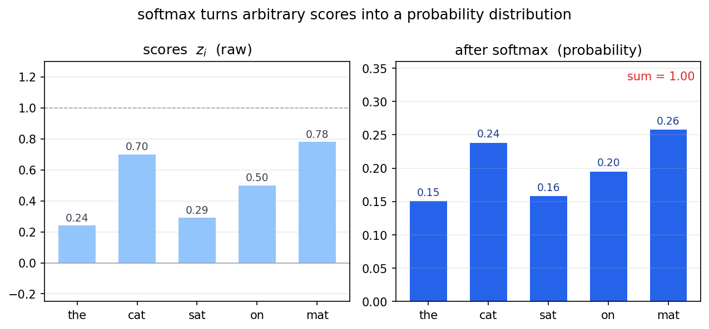
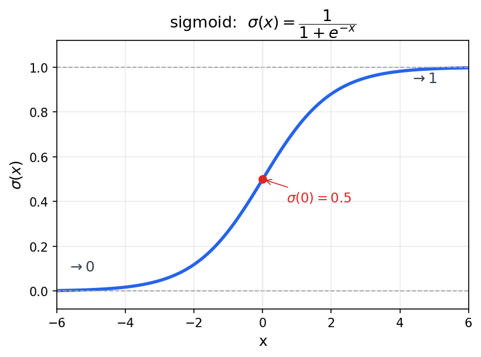

# CS224N Lecture 1: 词向量与 Word2Vec

> 2026-07-31 · 基于 Stanford CS224N 2025 Winter
>
> **前置知识**：假设读者已读完 Michael Nielsen 的《Neural Networks and Deep Learning》，熟悉神经网络基础、反向传播、梯度下降、softmax 和交叉熵损失。本文档从这些基础出发，走向词向量的完整设计。

---

## 1. 问题的起点：计算机怎么表示"词的意思"？

假设你读到下面两个词：

```
hotel  motel
```

人的直觉：这两个词意思很接近——都是睡觉的地方，都是商业场所。
计算机呢？它只认数字。我们必须把每个词翻译成一个数学对象。

更重要的是，这个数学对象必须能回答一个问题：

> **"词 A 和词 B 有多相似？"**

这是几乎所有 NLP 任务的基础。如果连相似度都算不了，后面的句法分析、机器翻译、对话系统都没法做。

---

## 2. 第一次尝试：one-hot 编码

### 2.1 做法

给每个词一个唯一的编号（"one-hot 向量"）。假设英文有 |V| = 50,000 个词，"hotel" 的编号是 2731，"motel" 是 2732，"cat" 是 859：

```
hotel  = [0, 0, 0, ..., 0, 1, 0, ..., 0]   ← 只有第 2731 位是 1
motel  = [0, 0, 0, ..., 0, 0, 1, ..., 0]   ← 只有第 2732 位是 1
cat    = [0, 0, 0, ..., 1, 0, 0, ..., 0]   ← 只有第  859 位是 1
```

每个向量长度 = |V| = 50,000，几乎全是 0，只有一个位置是 1。

### 2.2 致命缺陷

衡量两个向量相似度最朴素的方式是**点积**（对应位置相乘再求和）。
对于 one-hot 向量，任何两个不同的词，它们的"1"在不同位置，相乘永远错开：

```
hotel · motel = 0×0 + ... + 1×0 + 0×1 + ... + 0×0 = 0
hotel · cat   = 0×0 + ... + 1×0 + 0×1 + ... + 0×0 = 0
```

**所有词的相似度都是 0，无论它们意思多接近。**

这就像一个电话簿：你知道每个人的号码，但你不知道谁和谁是朋友。one-hot 只告诉你"这个词是它自己"，不告诉你"这个词像谁"。

> **教训 1**：我们需要的是一个**稠密的**表示——不但要标识一个词，还要编码它的语义位置，让意思相近的词在向量空间中彼此靠近。

---

## 3. 第二次尝试：WordNet（人类手工搭建）

### 3.1 做法

既然机器不会自己找相似度，那让人来标。WordNet 是 Princeton 大学从 1985 年开始维护的巨型词典，把英文词组织成一棵语义关系树：

```
vehicle
  ├── car, auto, automobile, motorcar
  │     ├── sedan, saloon
  │     └── coupe
  ├── truck
  └── bus
```

每个节点叫 synset（同义词集），边表示关系：上位词（"car"是"sedan"的上位词）、部分词（"wheel"是"car"的部件）、反义词等等。

用芯片的类比：这是一种 **ROM 查表法**——把语义映射关系全部预计算好，存进去，运行时查。

### 3.2 为什么不行

- **主观**："good"和"great"有多接近？WordNet 说它们都是 positive adjectives，但**无法给出一个数字**。对梯度下降来说，没有数字就没有信号。
- **维护地狱**："rizz"、"doomscrolling"、"yeet"——每年几千个新词，需要语言学家手动更新。
- **没有上下文**："bank"是河岸还是银行？WordNet 知道"river bank"和"financial bank"是两回事，但它无法根据具体句子判断"我昨天在 bank 坐了一下午"里到底是哪个。

> **教训 2**：手动标注知识是死路。我们需要一种方法，让机器**从海量文本中自动学习**词的语义，而不是从语言学家那里搬运。

---

## 4. 核心洞察：一个词的意思由它的"朋友圈"定义

这是 NLP 史上最重要的一句话，来自语言学家 J.R. Firth（1957 年）：

> **"You shall know a word by the company it keeps."**
> （要知道一个词是什么意思，看它老跟谁待在一起。）

如果 "cat" 和 "dog" 经常出现在几乎一样的上下文里：

```
The ___ sat on the mat.
I have a pet ___ .
The ___ barked/meowed loudly.
```

那这两个词很可能意思相近。**这是纯统计规律，不需要任何人告诉机器"cat 和 dog 意思接近"。**

更重要的是，这意味着语义不是需要手动标注的——它是隐藏在文本中的、等待被发现的模式。你只需要大量文本。

> 这就是 **distributional semantics（分布式语义假说）** 的核心。它是整个 Word2Vec 的理论基石。

---

## 5. 工程方案：词向量（Word Vectors）

### 5.1 基本想法

把每个词表示成一个**低维稠密向量**。不再像 one-hot 那样用 50,000 维的稀疏向量，而是用一个短得多的向量，比如 300 维，每个维度编码一种隐式的语义属性：

```
v_cat  = [0.8, -0.2, 0.5, ...]   ← 300 个小数
v_dog  = [0.7, -0.1, 0.6, ...]
v_king = [0.3,  0.9, 0.1, ...]
```

如果"cat"和"dog"意思接近，它们的向量就应该在空间中彼此靠近（点积大）。

### 5.2 要解决的问题

我们现在知道"想要什么"——每个词对应一个稠密向量，意思相近的词向量也相近。但怎么**得到**这些向量？

答案：不要直接编码语义（那是 WordNet 的死路），而是设计一个**预测任务**，让模型在做这个任务的过程中，**自动学到**好用的词向量。预测任务只是手段，词向量才是目标。

这就是 Word2Vec 的核心思路。

### 5.3 读到现在你应该知道

| 尝试 | 方法 | 为什么失败 |
|------|------|-----------|
| one-hot | 每个词一个独热编码 | 任意两词相似度 = 0 |
| WordNet | 人工标注语义树 | 无法量化、无法自更新 |
| **词向量** | 自动从文本学稠密向量 | —（我们正在设计的方案） |

---

## 6. 用具体的例子走一遍：从头到尾

从现在开始，我们不再抽象讨论，全部用同一个例子贯穿到底。

> 如果你在阅读过程中暂时看不懂某个公式，先别停下来硬啃。跳过去看后面的数字代入，再回来看公式就通了。

### 6.1 语料库

训练文本只有一句话（真实语料会是几十亿词，但原理完全一样）：

```
"the cat sat on the mat"
```

词汇表 V = {the, cat, sat, on, mat}，共 |V| = 5 个词。

| 词 | 索引（它在这个表里的编号） |
|---|--------------------------|
| the | 0 |
| cat | 1 |
| sat | 2 |
| on  | 3 |
| mat | 4 |

### 6.2 训练数据从哪来？——滑动窗口

我们怎么从这 5 个词生成训练样本？答案是：让模型做"完形填空"——给定一个中心词，预测它周围会出现哪些词。

设窗口半径 m = 2（中心词**左右各看 2 个词**）。扫描这句话：

```
位置:  0     1     2     3     4
词:   the   cat   sat   on    mat
```

以位置 2 的 "sat" 为圆心，窗口半径 2 覆盖了：

```
           the   cat   sat   on    mat
           ←───────────窗口───────────→
```

**中心词 = sat**，它周围出现了 {the, cat, on, mat}。

 Skip-Gram 的意思是：给定 "sat"，预测它的左邻右舍。**

对 "sat" 这一个中心词，我们就获得了 4 个训练样本：

```
给定 "sat" → 预测 "the"
给定 "sat" → 预测 "cat"
给定 "sat" → 预测 "on"
给定 "sat" → 预测 "mat"
```

对整个句子做同样的操作：

```
中心词="the":  周围={cat, sat}          → (the, cat), (the, sat)          [2 个样本]
中心词="cat":  周围={the, sat, on}      → (cat, the), (cat, sat), (cat, on) [3 个]
中心词="sat":  周围={the, cat, on, mat} → (sat, the), (sat, cat), (sat, on), (sat, mat) [4 个]
中心词="on":   周围={cat, sat, mat}     → (on, cat), (on, sat), (on, mat)   [3 个]
中心词="mat":  周围={sat, on}           → (mat, sat), (mat, on)             [2 个]
```

句子有 5 个位置（T=5），一共产生 14 个 (中心词, 上下文词) 对。

> 这些"对"让我们能把**无标签的原始文本**变成了**有监督的训练数据**——标签不是人类标注的，是滑动窗口自动生成的。中心词是输入，上下文词就是要预测的目标。

### 6.2.1 一个常见的疑惑：窗口包含"隔一个词"的词吗？

**包含。** m=2 的窗口半径是"左右各 2 个位置"，不是"只包含紧邻的那个"。

看 "sat" 到每个词的距离：

```
位置:   0     1     2     3     4
词:    the   cat   sat   on    mat
到sat距离: 2     1     |     1     2
        ↑          中心词        ↑
     距离2                       距离2
```

距离 ≤ 2 的词有 4 个：the（隔了 cat）、cat（紧邻）、on（紧邻）、mat（隔了 on）。所以 **the 和 mat 都进来了**，尽管它们和 sat 之间隔着一个词——距离正好等于窗口半径 2，落在窗口边界上，所以是正样本。

四个上下文词是**四个独立的训练样本**，各有各的 one-hot 标签（不是四个词在一个标签里抢一个"1"）：

```
样本 (sat, the)：标签 y = [1, 0, 0, 0, 0]   ← the 是 1
样本 (sat, cat)：标签 y = [0, 1, 0, 0, 0]   ← cat 是 1
样本 (sat, on) ：标签 y = [0, 0, 0, 1, 0]   ← on  是 1
样本 (sat, mat)：标签 y = [0, 0, 0, 0, 1]   ← mat 是 1
```

它们**共享同一次 softmax 的前向输出**（那 5 个概率），但每个样本拿着这个概率分布去跟自己的 one-hot 标签算自己的 loss。

> **一个真实的设计简化**：the（距离 2）和 cat（距离 1）在语义关联强度上其实不该完全一样——紧邻的词通常关联更强（"sat on"、"cat sat" 是强搭配），隔一个词的关联弱一些（"the ... sat" 的 the 更多是语法功能词）。
>
> 但原始 Skip-Gram **不区分距离**：窗口内所有词一视同仁，标签都是 1、权重相同。这是一个刻意的简化——实现简单、参数少、效果也够好。后来的 GloVe（用共现矩阵）和 window 加权变体会给距离更近的词对更高权重，但 Skip-Gram 原版选择"一刀切"。
>
> 所以：被"简化"掉的不是"是否包含"，而是"包含进来之后不按距离加权"。

---

## 7. 模型结构

### 7.1 两个查找表

对于每个词 w，我们需要学习两个 d 维向量（我们令 d=3，方便数字演示；真实场景通常 d=100~300）：

- **v_w**：当 w 作为**中心词**时使用的向量。它是一个 $1 \times d$ 的**行向量**。
- **u_w**：当 w 作为**上下文词**时使用的向量。它是一个 $d \times 1$ 的**列向量**。

把全部 5 个词的行向量堆叠起来，得到中心词嵌入矩阵 **V**（5×3）：

$$
\mathbf{V} =
\begin{bmatrix}
\text{—} & \mathbf{v}_{\text{the}} & \text{—} \\
\text{—} & \mathbf{v}_{\text{cat}} & \text{—} \\
\text{—} & \mathbf{v}_{\text{sat}} & \text{—} \\
\text{—} & \mathbf{v}_{\text{on}}  & \text{—} \\
\text{—} & \mathbf{v}_{\text{mat}} & \text{—}
\end{bmatrix}_{5 \times 3}
$$

把全部 5 个词的列向量拼起来，得到上下文嵌入矩阵 **U**（3×5）：

$$
\mathbf{U} =
\begin{bmatrix}
\mid & \mid & \mid & \mid & \mid \\
\mathbf{u}_{\text{the}} & \mathbf{u}_{\text{cat}} & \mathbf{u}_{\text{sat}} & \mathbf{u}_{\text{on}} & \mathbf{u}_{\text{mat}} \\
\mid & \mid & \mid & \mid & \mid
\end{bmatrix}_{3 \times 5}
$$

> 这样设计的巧妙之处：一行一列，$\mathbf{v}_{\text{sat}} \mathbf{u}_{\text{on}}$ 就是一次矩阵乘法，不需要转置：

```
v_sat · u_on = [v₁, v₂, v₃] × [u₁]
                              [u₂]
                              [u₃]
             = v₁u₁ + v₂u₂ + v₃u₃    ← 这就是"sat"对"on"的得分
```

形状验证：$(1 \times 3) \times (3 \times 1) = 1 \times 1$，得到一个标量。完美。

### 7.2 为什么需要两个矩阵？为什么不共享？

这是初学者最容易困惑的设计选择之一。答案很直接：

如果中心词和上下文词用的是同一套向量（即 U 只是 V 的转置），那么对于一个中心词，得分最高的上下文词永远是自己：

```
v_c · v_c^T = ||v_c||²  ← 因为向量和自己最像，这个值最大
```

模型会学到**所有词只预测自己**的平凡解——每个词都"说"自己的上下文应该是我自己。这毫无意义。

分开两个矩阵，v_sat 和 u_sat 是两个不同的向量，分别从不同的训练信号中学习（后面第 13 节会详细讲），模型被"逼迫"从语义角度做预测，而不是从恒等映射上投机取巧。

> **类比**：就像当你查询一个搜索框，你不希望结果只返回你输入的原词——你想要相关的信息。搜索词和搜索结果需要用不同的表示体系来编码。

### 7.3 初始化

向量里的每个元素从一个对称的小区间随机采样，例如 $[-0.5/d, +0.5/d]$。注意是**对称的**，有正有负——这对后面的学习至关重要（见第 12 节）。

---

## 8. 前向传播：从向量到概率

模型已经有了嵌入矩阵（初始化为随机值），现在要回答的问题是：给定一个中心词，词汇表中的每个词应该以多大概率出现在它周围？

### 8.1 算得分

假设经过一些训练后，我们取出一组具体的向量值（为了方便手算，数字做了简化）：

```
v_sat = [0.8, 0.1, 0.3]     ← 中心词 "sat" 的行向量

u_the = [0.2, 0.5, 0.1]ᵀ    ← 各词的上下文列向量
u_cat = [0.7, 0.2, 0.4]ᵀ
u_sat = [0.1, 0.3, 0.6]ᵀ
u_on  = [0.4, 0.3, 0.5]ᵀ
u_mat = [0.8, 0.5, 0.3]ᵀ
```

对于中心词 "sat"，它和每个可能的上下文词的得分是一系列独立的矩阵乘法：

```
score(sat→the) = v_sat · u_the = 0.8×0.2 + 0.1×0.5 + 0.3×0.1
               = 0.16 + 0.05 + 0.03 = 0.24

score(sat→cat) = v_sat · u_cat = 0.8×0.7 + 0.1×0.2 + 0.3×0.4
               = 0.56 + 0.02 + 0.12 = 0.70

score(sat→sat) = v_sat · u_sat = 0.8×0.1 + 0.1×0.3 + 0.3×0.6
               = 0.08 + 0.03 + 0.18 = 0.29

score(sat→on)  = v_sat · u_on  = 0.8×0.4 + 0.1×0.3 + 0.3×0.5
               = 0.32 + 0.03 + 0.15 = 0.50

score(sat→mat) = v_sat · u_mat = 0.8×0.8 + 0.1×0.5 + 0.3×0.3
               = 0.64 + 0.05 + 0.09 = 0.78
```

> **重要**：你可能会注意到 0.70、0.50、0.78 这些"得分"不都在 [0,1] 之间，甚至可能出现负数。没关系——这还只是"相似度的原始度量"，要变成概率还需要两步处理。

### 8.2 Softmax：把得分变成概率分布

来自 Nielsen 书中的老朋友——softmax。对于任意实数向量 z，它输出一个合法的概率分布（各项 ≥ 0，总和 = 1）：

$$
\text{softmax}(z_i) = \frac{\exp(z_i)}{\sum_{j} \exp(z_j)}
$$

公式分三步理解：

| 步骤 | 做什么 | 为什么 |
|------|--------|--------|
| ① 逐项取 exp | 把 z_i 变成 $\exp(z_i)$ | 保证非负（exp(任意实数) > 0） |
| ② 求和 | $Z = \sum \exp(z_j)$ | 得到归一化的"分母" |
| ③ 逐项除以 Z | $\exp(z_i) / Z$ | 现在全部加起来 = 1，是一个概率分布 |

**为什么用 exp？** 这不是随便选的。除了保证非负，还有两个关键原因：

1. **exp 单调递增**——得分高的，概率还是高，不颠倒顺序。
2. **exp 和 log 互为逆函数**。后面的损失函数用 -log(P)，前向的 exp 和后向的 log 刚好抵消，让梯度变得极其简洁（"预测值 - 真实值"）。

套进我们的具体数字：

```
得分 z = [0.24, 0.70, 0.29, 0.50, 0.78]

exp(0.24) = 1.27
exp(0.70) = 2.01
exp(0.29) = 1.34
exp(0.50) = 1.65
exp(0.78) = 2.18
────────────────
分母 Z = 1.27 + 2.01 + 1.34 + 1.65 + 2.18 = 8.45
```

除以 Z 得到概率分布：

```
P(the|sat) = 1.27 / 8.45 = 0.15
P(cat|sat) = 2.01 / 8.45 = 0.24
P(sat|sat) = 1.34 / 8.45 = 0.16
P(on |sat) = 2.18 / 8.45 = 0.20
P(mat|sat) = 2.18 / 8.45 = 0.26   ← 最高
```

模型当前认为："sat" 最可能出现在 "mat" 旁边（26%），其次 "cat"（24%）。"sat on the mat" 确实是个常见搭配，有一定合理性。

把上面两步画出来，softmax 干的事一目了然——左边是任意实数的"得分"，右边是它压成的概率分布（和为 1）：



### 8.3 多个上下文词怎么处理？——共享一次 softmax

"sat" 这个中心词有 4 个上下文词 {the, cat, on, mat}。这 4 个目标**共享同一次 softmax 输出**：

```
一次前向传播 → [P(the|sat), P(cat|sat), P(sat|sat), P(on|sat), P(mat|sat)]
                 = [0.15, 0.24, 0.16, 0.20, 0.26]

4 个上下文词各取各的概率：
  P(the|sat) = 0.15   →  -log(0.15) = 1.90  (loss 贡献)
  P(cat|sat) = 0.24   →  -log(0.24) = 1.43
  P(on |sat) = 0.20   →  -log(0.20) = 1.61
  P(mat|sat) = 0.26   →  -log(0.26) = 1.35
                                        ─────
  loss_sat = 1.90 + 1.43 + 1.61 + 1.35 = 6.29
```

也就说，4 个监督信号（4 个上下文词）的 loss 加起来，作为 "sat" 这一个中心词的**总 loss**。在反向传播时，4 个信号的梯度会累加在一起，同时更新 v_sat。

> 这不意味着要做 4 次前向传播——只需要 1 次 softmax，产生 5 个概率，取出 4 个有用的就行。

---

## 9. 损失函数：我们要最小化什么？

### 9.1 从一个训练对说起

考虑 (sat, on) 这一个对。我们已经算出 P(on|sat) = 0.20。

理想的 P(on|sat) 应该是多少？接近 1——因为在真实语料中，"sat" 的上下文确实包含了 "on"。

模型的"差"可以用交叉熵损失来量度（Nielsen 书里的老朋友）：

```
loss = -log(真实类别的预测概率)
     = -log P(on|sat)
     = -log(0.20)
     = 1.61
```

参考值：
```
P(on|sat) = 0.90  →  loss = -log(0.90) = 0.11  (很好，几乎没跑偏)
P(on|sat) = 0.20  →  loss = -log(0.20) = 1.61  (我们当前的状况)
P(on|sat) = 0.01  →  loss = -log(0.01) = 4.61  (很差，模型完全猜错了)
```

高的 P → 低的 loss。训练的目标就是让 loss 尽可能降到 0。

### 9.2 全句的总 loss

句子有 T=5 个中心词位置，每个位置有自己的上下文词集合：

```
loss_总 = (-log P(cat|the) - log P(sat|the))               ← "the" 的 2 个上下文词
        + (-log P(the|cat) - log P(sat|cat) - log P(on|cat)) ← "cat" 的 3 个
        + (-log P(the|sat) - log P(cat|sat) - log P(on|sat) - log P(mat|sat))  ← "sat" 的 4 个
        + (-log P(cat|on)  - log P(sat|on)  - log P(mat|on))  ← "on"  的 3 个
        + (-log P(sat|mat) - log P(on|mat))                   ← "mat" 的 2 个
```

用紧凑的数学记号：

$$
J(\theta) = -\frac{1}{T} \sum_{t=1}^{T} \sum_{-m \leq j \leq m,\; j \neq 0} \log P(w_{t+j} \mid w_t; \theta)
$$

符号说明：
- $T$ = 句子中中心词位置的个数（= 5）
- 外层 $\sum_{t=1}^{T}$：遍历每个中心词位置
- 内层 $\sum_{j}$：遍历该中心词的每个上下文词（窗口半径 m 内，跳过自己 j≠0）
- $P(w_{t+j} \mid w_t)$：给定中心词 $w_t$ 时预测其第 j 个上下文词 $w_{t+j}$ 的概率
- **除以 T**：取平均——这样不同大小的语料的 loss 可以比较
- **加负号**：似然是要**最大化**，但梯度下降是要**最小化**，取负翻转方向

> **直觉**：$-\log P$ 就是"惊讶程度"。P=0.9 时惊讶程度 0.11（不出所料）；P=0.01 时惊讶程度 4.6（吓一跳）。模型越好，对训练数据越不惊讶，loss 越低。

---

## 10. 梯度推导：往哪个方向调？调多少？

loss 算出来之后，我们要计算 loss 对 v_sat 的梯度——这告诉我们"把 v_sat 往哪个方向挪，loss 降得最快"。

> **对于熟悉 Nielsen 书的读者**：以下是普通的链式求导，没有新概念。我们用一个单变量展开的方式，把每一步都写清楚，最后再拼回向量形式。

### 10.1 符号准备

```
v_sat = [v₁, v₂, v₃]     ← 1×3 行向量（中心词）
u_on  = [d₁, d₂, d₃]ᵀ    ← 3×1 列向量（正确的上下文词）

得分 s_on = v_sat · u_on = v₁d₁ + v₂d₂ + v₃d₃
分母 Z = exp(s_the) + exp(s_cat) + exp(s_sat) + exp(s_on) + exp(s_mat)
概率 P(on|sat) = exp(s_on) / Z
loss = -log P(on|sat)
```

### 10.2 先对分量 v₁ 求导

把 loss 拆开成更适合求导的形式。用 $\log(a/b) = \log a - \log b$：

```
loss = -log(exp(s_on)/Z)
     = -[s_on - log Z]        ← 因为 log(exp(s_on)) = s_on
     = -s_on + log Z
```

对 v₁ 求导分两项：

**第一项：∂(-s_on)/∂v₁**

```
s_on = v₁d₁ + v₂d₂ + v₃d₃

∂(s_on)/∂v₁ = d₁    （v₂d₂ 和 v₃d₃ 不含 v₁，导数 = 0）

所以 ∂(-s_on)/∂v₁ = -d₁
```

**第二项：∂(log Z)/∂v₁**

链式法则：外层是 log，内层是 Z。

```
∂(log Z)/∂v₁ = (1/Z) · ∂Z/∂v₁
```

Z 是 5 个 exp 的和。对每个 exp 项再用一次链式法则：

```
Z = exp(s_the) + exp(s_cat) + exp(s_sat) + exp(s_on) + exp(s_mat)

∂Z/∂v₁ = exp(s_the) · ∂s_the/∂v₁
       + exp(s_cat) · ∂s_cat/∂v₁
       + exp(s_sat) · ∂s_sat/∂v₁
       + exp(s_on)  · ∂s_on/∂v₁
       + exp(s_mat) · ∂s_mat/∂v₁

       = exp(s_the) · u_the的v₁分量
       + exp(s_cat) · u_cat的v₁分量
       + exp(s_sat) · u_sat的v₁分量
       + exp(s_on)  · u_on的v₁分量
       + exp(s_mat) · u_mat的v₁分量
```

代入：

```
∂(log Z)/∂v₁ = (exp(s_the)/Z) · u_the的v₁分量
             + (exp(s_cat)/Z) · u_cat的v₁分量
             + (exp(s_sat)/Z) · u_sat的v₁分量
             + (exp(s_on)/Z)  · u_on的v₁分量
             + (exp(s_mat)/Z) · u_mat的v₁分量

             = P(the|sat) · u_the的第一个分量
             + P(cat|sat) · u_cat的第一个分量
             + P(sat|sat) · u_sat的第一个分量
             + P(on |sat)  · u_on的第一个分量
             + P(mat|sat)  · u_mat的第一个分量
```

**两部分合并：**

$$
\boxed{\frac{\partial \,\text{loss}}{\partial v_1} = \sum_{w} P(w \mid \text{sat}) \cdot u_{w,1} \;-\; d_1}
$$

"所有词的概率"乘"该词的上下文向量第一个分量"，然后减去正确词的对应分量。

这个公式的结构：
- 前部分：模型对所有可能上下文词的**期望**（加权平均）
- 后部分：正确词的**观测**值（只有这个词出现了，概率=1，其他=0）

> 你读到了这里，第一遍过可能不习惯。没关系——这是本文档最"数学"的一段。即使你只留下一个印象：**"梯度的结构是 期望 − 观测"**，你对 Word2Vec 的理解就不会有隐忧。

### 10.3 对 v₂、v₃ 完全一样的结构

```
∂loss/∂v₂ = Σ P(w|sat) · u_{w,2} - d₂
∂loss/∂v₃ = Σ P(w|sat) · u_{w,3} - d₃
```

三个分量的公式模板一模一样，唯一在变的是"取 u_w 的第几个分量"。

### 10.4 组装回向量

把三个分量并排写：

$$
\nabla_{\mathbf{v}_{\text{sat}}}
= \left[\,\frac{\partial \,\text{loss}}{\partial v_1},\;
            \frac{\partial \,\text{loss}}{\partial v_2},\;
            \frac{\partial \,\text{loss}}{\partial v_3}\,\right]
= \sum_{w} P(w \mid \text{sat}) \cdot [u_{w,1},\, u_{w,2},\, u_{w,3}]
\;-\;
[d_1,\, d_2,\, d_3]
$$

$[u_{w,1}, u_{w,2}, u_{w,3}]$ 就是 $\mathbf{u}_w$ 这个列向量转置成行向量，记作 $\mathbf{u}_w^{\mathsf{T}}$。$[d_1, d_2, d_3]$ 就是 $\mathbf{u}_{\text{on}}^{\mathsf{T}}$。

于是得到向量形式的梯度：

$$
\boxed{\nabla_{\mathbf{v}_{\text{sat}}}
= \underbrace{\sum_{w} P(w \mid \text{sat}) \cdot \mathbf{u}_w^{\mathsf{T}}}_{\text{期望}}
\;-\;
\underbrace{\mathbf{u}_{\text{on}}^{\mathsf{T}}}_{\text{观测}}}
$$

### 10.5 代入具体数字

把 8.2 节算出来的概率代入：

```
期望 = 0.15 × [0.2, 0.5, 0.1]   ← P(the|sat) × u_theᵀ
     + 0.24 × [0.7, 0.2, 0.4]   ← P(cat|sat) × u_catᵀ
     + 0.16 × [0.1, 0.3, 0.6]   ← P(sat|sat) × u_satᵀ
     + 0.20 × [0.4, 0.3, 0.5]   ← P(on|sat)  × u_onᵀ
     + 0.26 × [0.8, 0.5, 0.3]   ← P(mat|sat) × u_matᵀ

逐维求和：
维度 0: 0.15×0.2 + 0.24×0.7 + 0.16×0.1 + 0.20×0.4 + 0.26×0.8
      = 0.030 + 0.168 + 0.016 + 0.080 + 0.208 = 0.502

维度 1: 0.15×0.5 + 0.24×0.2 + 0.16×0.3 + 0.20×0.3 + 0.26×0.5
      = 0.075 + 0.048 + 0.048 + 0.060 + 0.130 = 0.361

维度 2: 0.15×0.1 + 0.24×0.4 + 0.16×0.6 + 0.20×0.5 + 0.26×0.3
      = 0.015 + 0.096 + 0.096 + 0.100 + 0.078 = 0.385

期望 = [0.502, 0.361, 0.385]
观测 = u_onᵀ = [0.4, 0.3, 0.5]

梯度 = [0.502 - 0.4, 0.361 - 0.3, 0.385 - 0.5]
     = [0.102, 0.061, -0.115]
```

### 10.6 一次性考虑 4 个上下文词

上面的推导是在单独考虑 (sat, on) 一个训练对。实际上 "sat" 有 4 个上下文词，它们的梯度会**累加**：

```
∂(-log P(the|sat))/∂v_sat : 期望 - u_theᵀ
∂(-log P(cat|sat))/∂v_sat : 期望 - u_catᵀ
∂(-log P(on |sat))/∂v_sat : 期望 - u_onᵀ    ← 上面演示的就是这一项
∂(-log P(mat|sat))/∂v_sat : 期望 - u_matᵀ

四者相加: 4×期望 - (u_theᵀ + u_catᵀ + u_onᵀ + u_matᵀ)
```

注意这四项共享同一个"期望"（因为来自同一次 softmax），只有观测项在变。

### 10.7 解读梯度的物理意义

梯度的每个分量是一个"修正信号"：

| 维度 | 梯度值 | 含义 | 操作 |
|------|--------|------|------|
| 0 | +0.102 | "期望" > "观测"。模型在这个维度上高估了不相关词的分量 | 减小 v_sat[0]（从这些词推开） |
| 1 | +0.061 | 同上，程度较轻微 | 减小 v_sat[1] |
| 2 | -0.115 | "期望" < "观测"。模型在这个维度上**低估**了正确词 "on" 的分量 | **增大** v_sat[2]（拉向 u_on） |

学习率 η = 0.01，更新 v_sat：

```
v_sat_new = v_sat - η × 梯度
          = [0.8, 0.1, 0.3] - 0.01 × [0.102, 0.061, -0.115]
          = [0.8, 0.1, 0.3] - [0.00102, 0.00061, -0.00115]
          = [0.7990, 0.0994, 0.3012]
```

每次更新量很小。几千次迭代下来，v_sat 会逐渐移动到语义空间中正确的位置。

---

## 11. 梯度里的 one-hot 分布

### 11.1 一个更对称的视角

梯度公式里 $\mathbf{u}_{\text{on}}^{\mathsf{T}}$ 这一项，表面上只是"正确上下文词"。但它背后藏着一个基本事实：

训练样本的真实标签是一个 **one-hot 向量** $\mathbf{y}$，只有正确词的位置是 1：

$$
\mathbf{y} = [0, 0, 0, 1, 0] \quad \leftarrow \text{只有索引 3 "on" 是 1}
$$

如果对 one-hot 做"概率加权求和"（和期望那边**完全对称的操作**）：

$$
\sum_w y_w \cdot \mathbf{u}_w^{\mathsf{T}}
= 0 \cdot \mathbf{u}_{\text{the}}^{\mathsf{T}}
+ 0 \cdot \mathbf{u}_{\text{cat}}^{\mathsf{T}}
+ 0 \cdot \mathbf{u}_{\text{sat}}^{\mathsf{T}}
+ 1 \cdot \mathbf{u}_{\text{on}}^{\mathsf{T}}
+ 0 \cdot \mathbf{u}_{\text{mat}}^{\mathsf{T}}
= \mathbf{u}_{\text{on}}^{\mathsf{T}}
$$

因为只有正确位置是 1，求和结果刚好就是正确词向量。**$\mathbf{u}_{\text{on}}^{\mathsf{T}}$ 就是 one-hot 分布的"期望"**——不是什么特殊项。

### 11.2 完全对称的形式

于是梯度可以写成：

$$
\boxed{
\nabla_{\mathbf{v}_c}
= \sum_w \big(P(w \mid c) - y_w\big) \cdot \mathbf{u}_w^{\mathsf{T}}
}
$$

对每个词 w，梯度贡献 = "(模型认为w该出现的概率 - w实际出现了吗) × w的上下文向量"。

| 词 w | P(w\|c)（模型） | y_w（数据） | P−y | 对梯度的贡献 |
|------|----------------|------------|-----|------------|
| the | 0.15 | 0 | +0.15 | +0.15·u_the^T（推开） |
| cat | 0.24 | 0 | +0.24 | +0.24·u_cat^T（推开） |
| sat | 0.16 | 0 | +0.16 | +0.16·u_sat^T（推开） |
| on | 0.20 | 1 | −0.80 | −0.80·u_on^T（**拉近**） |
| mat | 0.26 | 0 | +0.26 | +0.26·u_mat^T（推开） |

> **核心洞察**：梯度的全部信息来自一件事——"模型对每个词的信念"和"数据说了什么"之间的差距。P−y 为正的要推开，P−y 为负的要拉近。one-hot 没有显式出现在公式里，但它藏在 $\mathbf{u}_o^{\mathsf{T}}$ 的背后。

---

## 12. Softmax 的计算瓶颈与负采样

### 12.1 软性最大：五个词还行，五万个词呢？

我们的例子只有 5 个词，每次算 softmax 毫无压力。但真实词汇表有 10 万到 100 万个词。分母 $\sum_{w \in V} \exp(\mathbf{v}_c \mathbf{u}_w)$ 每次前向传播都要跑一次全词汇表求和——每次更新都要算 10 万个 exp，再归一化，再求 10 万个导数。这太贵了。

### 12.2 瓶颈的根源：那个"共享分母" Z

先看清楚贵在哪里。softmax 是：

$$
P(w \mid c) = \frac{\exp(\mathbf{v}_c \mathbf{u}_w)}{Z}, \qquad
Z = \sum_{w' \in V} \exp(\mathbf{v}_c \mathbf{u}_{w'})
$$

Z 是**所有 |V| 个词**的 exp 之和，叫"归一化分母"。它的作用是让 |V| 个概率加起来恰好等于 1——**概率之间互相竞争**：你涨 1%，别人就得一起跌 1%。

这个"竞争"的代价就是：哪怕你只想算 P(on|sat) 一个词，也得先把 |V| 个 exp 全加一遍得到 Z。反向传播时（回顾第 10.2 节的 ∂logZ/∂v₁），Z 对**每一个词**都产生一项梯度。所以**每一次更新都碰全部 |V| 个向量**。词表 10 万、100 万时，这直接不可行。

> **关键认识**：贵的不在"算得分"（v_c · u_w 每个词一次点积，已经很便宜），而在"让所有概率和为 1"这个共享分母 Z。

### 12.3 关键转折：负采样不是"更快的 softmax"，而是"换一个目标"

这是本节最重要的一步，也是最容易卡住的地方。

一开始你可能以为：负采样是"想办法把 softmax 算得便宜点"。**不。它是干脆放弃了 softmax，换成了另一个完全不同的任务。**

原任务（多分类）：
> 给定 "sat"，在这 |V| 个词里，**哪一个**是上下文词？

新任务（二分类）：
> 给定 "sat" 和另一个词 w，**这两个词是不是真的**一起出现过？

这两个问题看起来像，但第二个**没有共享分母 Z**——因为二分类不要求"所有候选概率加起来等于 1"，每个判断是独立的。这就是整个解法的全部秘密。

为什么要这么换？停下来想清楚：softmax 在做一件很"霸道"的事——它要求"正确答案概率 = 1，其余 |V|−1 个词概率全部 = 0"，并且每次更新都显式把这 |V|−1 个词往下压。

但我们真正要的只是：

- 真上下文对 (sat, on) 的分数**高**
- 假组合的分数**低**

要"压低分数"，不需要每次把 |V|−1 个词全压一遍——压**几个有代表性的错误例子**就够了。就像复习错题：你不需要重看整本练习册才学会一个知识点，每次几道错题 + 一道对题，就够纠正方向。

> **一句话概括负采样的思路**：用一个廉价的二分类问题，去逼近原来那个昂贵的多分类问题。

### 12.4 具体走一遍：同一个例子，改成二分类

还是中心词 "sat"，真上下文 "on"。取负样本数 k = 2，随机抽两个噪声词当"假上下文"，比如 "banana" 和 "rocket"。

> **一个先说明的细节**：真实语料 |V| 很大（几十万词），随机抽到的噪声词几乎不可能是当前中心词的真实上下文。但我们的玩具语料只有 5 个词，the/cat/on/mat 全是 "sat" 的真实上下文，抽它们当"负样本"就成假负例了。所以演示用语料外的 "banana"/"rocket"，更清晰。真实训练里这种"抽到真上下文当负样本"的概率 ≈ k/|V|，极小，无害。

模型现在要判断三个**独立的**"是/否"：

| 对 | 标签 | 含义 |
|---|---|---|
| (sat, on) | 1 | 真的出现过（语料里确实有） |
| (sat, banana) | 0 | 假的，随机凑的 |
| (sat, rocket) | 0 | 假的，随机凑的 |

用 sigmoid（Nielsen 书里的老朋友，单个是/否判定，**不竞争**）代替 softmax：

$$
P(\text{这是一对真实的上下文对}) = \sigma(\mathbf{v}_c \mathbf{u}_w) = \frac{1}{1 + e^{-\mathbf{v}_c \mathbf{u}_w}}
$$

其中 $\sigma$ 就是 sigmoid，把任意实数压到 $(0,1)$ 区间、用于"是/否"判定（不像 softmax 那样要求所有候选概率和为 1）：

$$
\sigma(x) = \frac{1}{1 + e^{-x}}
$$



代入数字。v_sat 沿用第 8 节的值 [0.8, 0.1, 0.3]；噪声词也各有一个向量：

```
v_sat    = [0.8, 0.1, 0.3]
u_on     = [0.4, 0.3, 0.5]ᵀ     →  score = 0.50   （第 8.1 节算过）
u_banana = [-0.3, 0.6, -0.2]ᵀ   →  score = 0.8×(-0.3) + 0.1×0.6 + 0.3×(-0.2) = -0.24
u_rocket = [0.5, -0.4, 0.2]ᵀ    →  score = 0.8×0.5 + 0.1×(-0.4) + 0.3×0.2 = 0.42
```

sigmoid 各自独立地把分数压成概率：

```
σ(0.50)  = 1/(1+e^-0.50) = 0.62   （模型认为 (sat,on)     有 62% 是真的）
σ(-0.24) = 1/(1+e^0.24)  = 0.44   （模型认为 (sat,banana) 有 44% 是真的，太高了）
σ(0.42)  = 1/(1+e^-0.42) = 0.60   （模型认为 (sat,rocket) 有 60% 是真的，太高了）
```

我们希望：正样本概率 → 1，负样本概率 → 0。损失还是第 9 节的"惊讶程度" −log：

```
正样本 (sat, on)     : -log(0.62)           = 0.47   （拉高）
负样本 (sat, banana) : -log(1 - 0.44) = 0.58      （压低）
负样本 (sat, rocket) : -log(1 - 0.60) = 0.92      （压低）
                                          ─────
                                 loss ≈ 1.98
```

> 注意负样本项是 −log(1 − σ)，因为我们要它的"真"概率尽量**小**；而 1 − σ(x) = σ(−x)，所以负样本项常写作 −log σ(−v_c · u_w)，和正样本项 −log σ(v_c · u_o) 长得对称。

这一步更新**只碰 1 + k = 3 个上下文向量，外加 1 个中心向量**：

```
v_sat    ← 被拉向 u_on，同时被推离 u_banana、u_rocket
u_on     ← 被拉向 v_sat
u_banana ← 被推离 v_sat
u_rocket ← 被推离 v_sat
```

而 u_the、u_cat、u_sat、u_mat 这步**根本不动**（除非被抽中当负样本）。

对比一下：

| | softmax | 负采样 |
|---|---|---|
| 每次更新的上下文向量 | \|V\| 个 | 1 + k 个（k≈5~20） |
| 每次要算的指数 | \|V\| 个 exp | 1 + k 个 sigmoid |
| 计算量 | O(\|V\|) | O(k) |

从 O(|V|) 降到 O(k)——十万分之一变成几千分之一。

整个损失函数的数学形式（一个正例 + k 个负例）：

$$
J = -\log\sigma(\mathbf{v}_c \mathbf{u}_o)
    \;-\; \sum_{j=1}^{k} \log\sigma(-\mathbf{v}_c \mathbf{u}_{w_j}),
\quad w_j \sim P_n(w)
$$

符号说明：
- 第一项：正样本 (c, o) 的损失，σ(v_c u_o) 越大越好
- 第二项：k 个负样本的损失之和，每个 σ(v_c u_wj) 越小越好（等价于 σ(−v_c u_wj) 越大越好）
- $w_j \sim P_n(w)$：负样本从噪声分布 P_n 里抽（怎么抽见 12.7）

### 12.5 为什么"只压几个随机词"就够了？——蒙特卡洛近似

你可能还有个疙瘩：那些**没被抽到**的错误词，这步不压它们，它们不会一直错下去吗？

答案分两层：

**第一层（统计）：它在逼近原来的梯度。** 回顾第 10.7 / 11.2 节你推出来的梯度：

$$
\nabla_{\mathbf{v}_c} = \sum_w P(w \mid c)\, \mathbf{u}_w^{\mathsf{T}} \;-\; \mathbf{u}_o^{\mathsf{T}}
= \underbrace{\sum_w P(w \mid c)\,\mathbf{u}_w^{\mathsf{T}}}_{\text{期望}} \;-\; \underbrace{\mathbf{u}_o^{\mathsf{T}}}_{\text{观测}}
$$

贵的正是前面那个"对所有 |V| 个词求和"的**期望**项。负采样做的事，就是**不精确算这个平均，而是随机抽 k 个噪声词，用它们的平均去估计它**——标准的蒙特卡洛抽样。所以它不是"另一个不相干的东西"，而是**同一个梯度，抽了个样的近似**。

**第二层（直觉）：每个词迟早都会被抽到。** 这一步抽中 banana、rocket，下一步抽中 the、cat…… 训练跑几百万步，词汇表里每个词都当过无数次负样本。**累积起来**，所有不相干的词对都被推开了——和 softmax 的效果等价，只是省掉了每一步的精确簿记。

> **芯片类比**：差分比较器。你要训练它分辨"真信号 vs 噪声"，不需要让它和每一个可能的参考电平都对一遍，只需要每轮给它几个有代表性的噪声电平做对比，训练出的判别能力一样，但每轮的硬件开销小几个数量级。

> **扩展阅读**：蒙特卡洛这个工具本身（误差为什么是 1/√N、为什么高维也扛得住、和芯片工艺仿真的关系、重要性采样与 3/4 次方的关系），见附录 `appendix-monte-carlo.md`。

### 12.6 一个自然的疑问："这不是变成另一个问题了吗？"

对，负采样确实是一个**不同的目标函数**，不是 softmax 的等价改写。你可能会担心："我换了问题，学出来的还是我要的词向量吗？"

答案是：**没关系，甚至更好。** 别忘了第 14 节的框架——词向量本来就是训练这个预测任务的**副产品**。我们不在乎"是不是原汁原味的 softmax"，只在乎"这个向量最后能不能反映分布语义"。

而"真的一起出现 → 拉近；随机凑对 → 推开"这个信号，softmax 能给，负采样也能给，只是后者便宜几百倍。这是典型的工程权衡：**目标函数稍微换个形式，换来收敛速度和内存的指数级下降，学到的向量质量几乎不打折。** 这正是"设计是被成本逼出来的"的又一个例子。

> 一个更深的补充（可选读）：负采样其实是"噪声对比估计"（Noise Contrastive Estimation, NCE）的一个特例。用足够多的负样本和合适的噪声分布，负采样的最优点和原 softmax 的最优点在极限下一致。这里不展开，只要记住"换目标 → 换成本 → 结果几乎不变"这个架构逻辑就够。

### 12.7 噪声词怎么采？不是均匀随机

如果均匀采样（每个词概率相等），就会高估低频词的"出现概率"——低频词在真实语料里本来就不出现，但被你均匀拖进来了。

如果按原始词频采样，又会极端偏向高频词。像"the"、"a"、"of"几乎抢走了大部分负样本——低频词永远得不到纠正。

实际做法是折中——按词频的 **3/4 次方**采样：

$$
P(\text{采到词 }w) = \frac{\text{count}(w)^{3/4}}{\sum_i \text{count}(w_i)^{3/4}}
$$

效果：

| 词 | 在语料中的次数 | ³⁄₄ 次方 | 效果 |
|---|-------------|---------|------|
| the | 1,000,000 | 31,623 | 大幅压低 |
| cat | 100 | 31.6 | 相对温和 |
| mat | 5 | 3.3 | 仍然抬升 |

指数 3/4 压缩了极端频率的差距：高频词仍然采得多（但不像原始那样霸占一切），低频词也被照顾到。

---

## 13. 训练中的其他问题

### 13.1 初始化为啥不一定从 0~1 采？

如果所有分量初始化为正数，所有词天然正相关——softmax 输出的概率会接近平均分布（每个词 ~1/5），区分度很差。

实际初始化使用**对称区间**，比如 [-0.01, +0.01]（均匀分布）。这样：
- 不同向量的各分量正负交错
- 点积可能正也可能负
- softmax 的输出分布有区分度（部分相近，部分完全不是）

### 13.2 训练时点积为啥可能是负数？

初始化是正负各半的，点积自然是各分量乘积累加的结果——符号取决于各分量的符号组合。训练中梯度可以任意方向，分量在正负之间自由游走。这不仅是正常的，而且是必要的——如果所有点积永远 ≥ 0，那所有 P(w|c) 都差不多，区分度不够。

> **类比**：差分电路不会让信号只在正电压工作。你需要 swing 在 0V 上下，正负各半，才能最大化动态范围。

### 13.3 训练结束后，v_w 和 u_w 一样吗？

**不一样，而且不应该一样。**

同一个词 "sat"，它的两个向量 v_sat 和 u_sat 收到的是**不同的更新、来自不同的训练样本**：

```
v_sat 被更新：当 "sat" 是中心词时
  → 训练对 (sat, the), (sat, cat), (sat, on), (sat, mat) 驱动 v_sat

u_sat 被更新：当 "sat" 是别人的上下文词时
  → 训练对 (the, sat), (cat, sat), (on, sat), (mat, sat) 驱动 u_sat
```

两组训练样本不重叠：(sat, mat) 只更新 v_sat，(mat, sat) 只更新 u_sat。加上随机初始化、独立梯度，两者自然收敛到不同位置。

**实践中怎么做？**

| 方案 | 做法 |
|------|------|
| 只用 v | 只保留中心词向量矩阵 V 作为最终词向量 |
| 取平均 | $\mathbf{w} = (\mathbf{v}_w + \mathbf{u}_w^{\mathsf{T}}) / 2$ |
| GloVe 的方式 | 对称看待 v 和 u，直接用 v+u 作为嵌入 |

> **类比**：v 像是"主动发起请求时看到的自己"（发射端），u 像是"被命中时别人看到的自己"（接收端）。同一个模块在收发两端的天线增益图不一样——但各有各的作用。

---

## 14. 训练结束后，词向量有什么性质？

几千次、几万次迭代之后，你拉出 V 矩阵，会发现一些神奇的事情：

### 14.1 语义聚类

```
"cat" 的最近邻居：dog, kitten, pet, feline, animal
"king" 的最近邻居：queen, prince, emperor, throne, kingdom
"Paris" 的最近邻居：Lyon, Marseille, France, Berlin, London
```

**模型从来没有被告知"cat 和 dog 意思相近"**——它只是在做预测上下文词的任务。做着做着，相似词的向量自然就靠近了。这是一种**涌现的语义结构**。

为什么？因为 "cat" 和 "dog" 在语料中出现在几乎一样的上下文里——"the ___ sat"、"a pet ___"、"the ___ barked/meowed"。当两个词总被同样的上下文词"围住"，它们的向量就在同样的约束下收缩，最后趋向于彼此靠近。自然发生的。

### 14.2 向量类比——最惊艳的属性

最著名的一条：

```
v(king) - v(man) + v(woman) ≈ v(queen)
```

用三个词就能找到第四个——就像在语义空间中做线性导航。"king 减去 male 属性，加上 female 属性 → queen"。这不是有人教的，是从纯统计里自动浮现的。

还有更多：

```
Paris  - France + Italy   ≈ Rome
walk   - walk  + swim     ≈ swam     （现在-过去式的语态方向）
bigger - big   + small    ≈ smaller  （比较级的梯度方向）
```

> 用架构师的语言：语义空间不是输入的特征，而是训练产生的**副产品**。就像缓存一致性协议不需要显式编码"哪条 cache line 该无效"——它是 MESI 状态机自动涌现的行为。这里的"MESI 状态机"就是分布语义假说 + 预测上下文词的训练目标。

### 14.3 局限：多义词

"bank" 既是河岸又是银行。Word2Vec **每个词只有一个向量**——你要河岸还是要银行？最后的单一向量是这两个意思的**加权平均**——不是河岸也不是银行，而是两者之间一个模糊的点。

对于很多应用这够用了（比如句子级别的分类），但对于需要精确词义的场景是明显的短板。后续的 ELMo、BERT 会解决这个问题（每个词在不同的上下文中得到不同的向量），那是后话。

---

## 15. 设计决策回顾：从架构师的视角

| 我们面对的问题 | 我们的选择 | 为什么选这个 | 当时淘汰的方案 |
|-------------|-----------|-------------|-------------|
| 词怎么表示成数字 | 稠密词向量（~300 维） | one-hot 无相似度信息 | one-hot, WordNet |
| 语义怎么学 | 分布语义：上下文相似则词相似 | 自动从数据学，无需人标 | 手工词典 |
| 怎么把文本变成训练数据 | 滑动窗口 → (中心, 上下文) 对 | 利用无标签文本自监督 | 人工标注（贵） |
| 中心词和上下文的表示 | 两个独立矩阵，一"行"一"列" | 打破平凡解（全等向量）；矩阵乘法一次算所有得分 | 共享同一个向量 |
| 得分怎么变概率 | softmax = exp(得分) / Σexp | exp 保证正数+单调+和 log 互逆 | x²（不保序）, ReLU（丢信息） |
| 损失怎么定义 | −log P（交叉熵） | 最大化似然，梯度形式极简 | 均方误差 |
| 分词空间太大 | **负采样**：每次只更新 1+k 个向量 | 换目标（多分类→二分类，去掉共享分母 Z）+ 蒙特卡洛近似，O(\|V\|)→O(k) | 完整 softmax, 层级 softmax |
| 负采样怎么控制频率 | 词频^{3/4} 加权 | 高频词不过度采、低频词不被忽略 | 均匀采样, 原始频率 |
| 向量初始化区间 | 对称 [-a, +a] | 给正负各半，让 softmax 有区分度 | [0, a)（太偏——所有词正相关） |
| 最终用哪个向量 | 通常只用 v 或用均值 (v+u^T)/2 | 两个视角含互补信息 | 只保留 u |

---

## 16. 下一步

从单一的词向量走向**序列**——我们要开始考虑词与词之间的顺序和依赖关系。

CS224N Lecture 2：GloVe（另一种词向量方法——用全局共现统计 vs Word2Vec 的局部窗口）、词向量的评估方法（怎么客观衡量"这个词向量好不好"）。

---

## 参考

- [CS224N 2025 课程主页](https://web.stanford.edu/class/archive/cs/cs224n/cs224n.1254/)
- Mikolov et al., "Efficient Estimation of Word Representations in Vector Space" (2013)
- [CS224N 中文笔记（博客园）](https://www.cnblogs.com/geekdoc/p/19775463)
