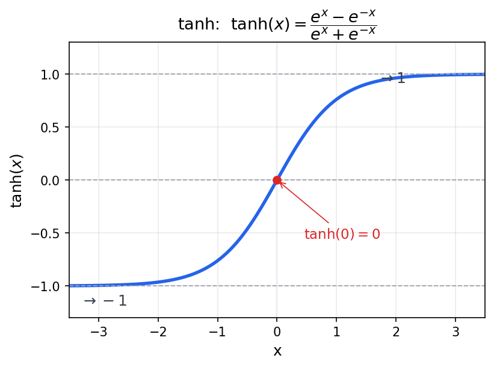

# RNN 与 Seq2Seq

> 2026-08-18 · 基于 Stanford CS224N（2025 Winter）RNN / 语言模型 / Seq2Seq 讲次
>
> **前置知识**：假设读者已完成 `../01-word-vectors/01-word2vec.md`（词向量、softmax、负采样、反向传播），并熟悉 Nielsen 书里的反向传播与梯度下降。本文从"词向量把顺序丢了"这个缺口出发，走向 RNN 与 Seq2Seq 的完整设计，最后停在两个待解决的瓶颈上——它们分别是 LSTM 和 Attention 诞生的理由。

---

## 0. 历史与根因：RNN 为什么会被发明

在进入细节前，先回答一个容易被跳过的"元问题"：RNN 到底是为了什么被发明的？是为了翻译？还是为了让机器理解语言？

**都不是。** RNN 要解决的是一个更底层的**架构缺口**——给神经网络加一个"记忆"，让它能处理"时间 / 顺序"。

### 0.1 根因：前馈网络是"无状态"的

你学过的所有前馈网络（MLP，即 Multi-Layer Perceptron 多层感知机，也就是多层全连接网络；以及 word2vec）都是**无状态**的：给定输入，一次前向算出输出，算完就忘，没有"上一次"的概念。

用芯片的语言：前馈网络是**组合逻辑**——输出只是当前输入的纯函数。但语言（以及语音、视频、时序信号）是**顺序**的：下一个词取决于前面所有的词。要处理顺序，你需要**状态**，也就是**时序逻辑**——一个寄存器 / 触发器，在时钟之间把状态存住。

RNN 的隐藏状态 $h_t$ 本质上就是那个"寄存器"。它的递归 $h_t = f(h_{t-1}, x_t)$ 就是"把上一拍的输出锁存住，和当前输入一起算下一拍"。**RNN = 给组合逻辑网络加了反馈和存储。**

### 0.2 历史：它诞生于认知科学，不是 NLP 工程

| 年份 | 人物 | 贡献 |
|---|---|---|
| 1982 | Hopfield | 最早的递归网络，做联想记忆（content-addressable memory），动机来自物理 |
| 1986 | Jordan | 把递归用于"序列顺序"任务（serial order） |
| 1990 | Elman | "简单递归网络"（SRN），今天基础 RNN 的直系祖先；动机是**心理语言学** |

Elman 是关键人物——他是**心理语言学家**，研究的是"人脑如何按顺序处理句子"。他让 RNN 做**预测下一个词**的任务，结果发现隐藏层里词**自动按语法类别聚了类**（名词聚一起、动词聚一起）。

> 注意一个重要的分寸：它"发现"的是语言的**统计结构**，不是"理解"了意思。RNN 的第一目标是建模序列的规律，不是语义理解。

### 0.3 准确的定位

| 你可能会以为是 | 实际情况 |
|---|---|
| 为了解决翻译？ | 不是。翻译（Seq2Seq）2014 年才用上 RNN，那时 RNN 已存在约 30 年 |
| 为了理解语言？ | 不是这个宏大目标。最初是认知科学想建模"人脑怎么处理时间序列"，语言只是 Elman 选的案例 |
| 真正的目的 | 给神经网络加**随时间流动的记忆**，让它能处理序列 |

它的第一个语言应用是**语言模型**（预测下一个词，Mikolov 2010，最初用于语音识别重打分）；翻译、摘要、问答都是后来才接上去的应用。

> **一句话定位**：RNN 解决的问题不是某个具体任务，而是一个**架构缺口**——前馈网络是无状态的（组合逻辑），处理不了顺序；RNN 补上了"状态"（时序逻辑），把神经网络从"看一张静态输入"变成"读一段随时间流动的输入"。

带着这个定位，再看下面第 1 节就清楚了："词袋丢顺序"只是"前馈网络无状态"在词向量上的一个具体表现。RNN 的递归结构，正是为这个缺口而生。

---

## 1. 问题的起点：词向量把顺序丢了

上一章我们用 Word2Vec 学出了词向量，每个词一个稠密向量，意思相近的词向量也相近。这解决了"词的表示"，但它有一个我们**刻意忽略**的缺陷。

看这两句话：

```
the cat sat on the mat
the mat sat on the cat
```

它们的词袋（bag of words）是**完全相同**的——同样的 6 个词，同样的计数。但从语义上，第一句是"猫坐在垫子上"，第二句是"垫子坐在猫上"（荒诞）。意思天差地别。

更极端的经典例子：

```
dog bites man    （狗咬人）
man bites dog    （人咬狗）
```

词袋一样，但受害者完全相反。

> **教训 1**：词向量编码了"词的意思"，但**没有编码"词与词之间的顺序"**。而顺序是语义的核心——自然语言是序列，不是集合。我们需要一种能**按顺序处理序列**的模型。

---

## 2. 第一次尝试：固定窗口的前馈网络

既然要顺序，最朴素的想法是：预测下一个词时，把**最近 k 个词**的向量拼起来，送进一个普通的前馈网络（MLP）。

```
输入: [v_{t-3}, v_{t-2}, v_{t-1}]   ← 前 3 个词的向量拼成一个长向量
        ↓  MLP（几层全连接）
输出: P(下一个词 | 前 3 个词)        ← softmax 到词表
```

这是 Bengio 等人在 2003 年就提出的"神经语言模型"。它确实能抓住短距离的局部搭配，但有两个致命缺陷：

### 2.1 窗口 k 是固定的：长程依赖看不见

自然语言里大量依赖**远超过**任意固定窗口。看这句：

```
the man who wore a red shirt and a blue hat that his mother
bought him last Tuesday at the market near the river  ____
```

空应该填 `was`（因为主语是 "man"，单数）——但 "man" 到 "was" 之间隔了 20 多个词。k=5 的窗口永远看不到 "man"。**无论 k 取多大，总有更长的依赖超出窗口。**

### 2.2 没有"记忆"：每次从头看

窗口模型每预测一个词，都要**重新读一遍窗口**，之前算过的东西没有累积下来。它没有一种"持续运行的状态"来承载已经读过的历史。

> **教训 2**：我们需要一个能**携带历史**的结构——不是"每次重看最近 k 个词"，而是"维护一个不断更新的记忆，它累积了从头到现在的所有信息"。这就引出了递归。

---

## 3. 核心洞察：用"记忆"携带历史 —— 递归

想象你逐词读一句话，脑子里始终有一个"到目前这句话在讲什么"的摘要。每读一个新词，你就**更新**这个摘要，而不是扔掉重来：

```
读到 "the"   → 摘要 h₁ = "有个冠词开头，暂时不知道主语"
读到 "cat"   → 摘要 h₂ = "主语是 cat"
读到 "sat"   → 摘要 h₃ = "cat sat（猫坐下了）"
```

这个"摘要"就是 RNN 的**隐藏状态（hidden state）** h_t。它的更新规则是：

> **新记忆 = 旧记忆 + 新词的共同作用。**

数学上就是一句话：

$$
h_t = f(h_{t-1}, x_t)
$$

读入新词 x_t，把旧记忆 h_{t-1} 和它揉在一起，得到新记忆 h_t。这就是**递归（recurrence）**——函数 f 反复调用自己，每一次都带上上一次的结果。

> 用芯片的语言：这是一个**带反馈的模块**，它的输出（隐藏状态）会回流到输入。就像 ΣΔ 调制器里的积分器——当前输出取决于当前输入**和上一个时钟周期的输出**。区别是这里我们还要让这个反馈回路**可学习**。

---

## 4. RNN 前向传播的数学

把上面那个抽象的 f 具体化。最常用的选择是"线性组合 + tanh 非线性"：

$$
h_t = \tanh\!\big(W_{hh} h_{t-1} + W_{xh} x_t + b_h\big)
$$

$$
\hat{y}_t = \text{softmax}\!\big(W_{hy} h_t + b_y\big)
$$

**逐个符号说明**：

| 符号 | 含义 | 形状 |
|---|---|---|
| $x_t$ | 第 t 个词的输入向量（通常是词向量） | d_in × 1 |
| $h_t$ | 第 t 步的隐藏状态（"到现在的摘要"） | d_hid × 1 |
| $h_{t-1}$ | 上一步的隐藏状态（旧记忆） | d_hid × 1 |
| $W_{xh}$ | 输入 → 隐藏 的权重矩阵（新词如何影响记忆） | d_hid × d_in |
| $W_{hh}$ | 隐藏 → 隐藏 的权重矩阵（旧记忆如何影响新记忆）——**递归的核心** | d_hid × d_hid |
| $b_h$ | 隐藏层偏置 | d_hid × 1 |
| $\tanh$ | 非线性激活，把值压到 (−1, 1)，防止 h 在多次迭代中无限增长 | — |
| $W_{hy}$ | 隐藏 → 输出 的权重矩阵（摘要如何变成词表分数） | \|V\| × d_hid |
| $b_y$ | 输出偏置 | \|V\| × 1 |
| $\hat{y}_t$ | 预测"下一个词"的概率分布 | \|V\| × 1 |

**为什么用 tanh？** 因为 h_t 要反复迭代很多次（一句话可能几百步）。如果每次更新不带界，h 会指数增长或衰减，数值直接爆炸。tanh 把每次输出都压回 (−1, 1)，给这个反馈回路一个稳定的动态范围——和你熟悉的"信号要 swing 在有限电压范围内"是同一个道理。



> **别混淆**：`tanh` 是**双曲正切**（hyperbolic tangent，$\tanh x = \frac{e^x - e^{-x}}{e^x + e^{-x}}$），**不是 tan 的反函数**。tan 的反函数是 arctan（记作 $\tan^{-1}$）。那个 `h` 是 "hyperbolic（双曲）" 的意思，不是 "inverse"。`tanh` 和 `arctan` 恰好都是"单调上升、S 形、两头饱和、关于 0 对称"的曲线，所以长得像、容易串——但一个来自双曲线（基于 eˣ），一个来自圆（三角）。RNN 选 tanh 是看中它的形状和性质，跟"tan 的反函数"毫无关系。

### 4.1 关键设计：三个矩阵在所有时间步**共享**

注意：$W_{xh}$、$W_{hh}$、$W_{hy}$ 这**同一套**权重，在 t=1、t=2、t=3…… 每一步都用。不是每一步一套新权重。

把 RNN 按时间**展开（unroll）**，再**竖过来画**，和普通深度网络对照，就一目了然了。

先看你熟悉的普通 4 层前馈网络（每一层各有各的权重 $W^1, W^2, W^3, W^4$）：

```
        x
        │  W¹ + 非线性
        ▼
       a¹
        │  W² + 非线性
        ▼
       a²
        │  W³ + 非线性
        ▼
       a³
        │  W⁴ + 非线性
        ▼
       a⁴   ← 输出
```

再看展开的 RNN（4 个时间步，**同一套** $W_{hh}$ 反复用）：

```
       h₀   ← 初始记忆（空）
        │  W_hh  （+ 读入 x₁）
        ▼
       h₁
        │  W_hh  （+ 读入 x₂）
        ▼
       h₂
        │  W_hh  （+ 读入 x₃）
        ▼
       h₃
        │  W_hh  （+ 读入 x₄）
        ▼
       h₄
```

把两条竖链 `h₀ → h₁ → h₂ → h₃ → h₄` 和 `x → a¹ → a² → a³ → a⁴` 对照：**长相一模一样**。RNN 的每一个时间步，就是前馈网络里的一个"层"——**深度 = 序列长度**。

只有两处不同：

1. **每"层"多一个输入**：除了接上一"层"的输出 $h_{t-1}$，还额外读入这个时间步的词 $x_t$（前馈网络只有最底层读输入 x）。
2. **每"层"权重相同**：前馈网络每层是 $W^1, W^2, W^3, W^4$ 各一套；RNN 每一"层"用的都是**同一个** $W_{hh}$。

> 第 2 点是最关键的区别，也是后面一切麻烦的根源：因为同一个 $W_{hh}$ 在每一"层"都被用了一次，反向传播时它的梯度要沿这条链**累加**（第 8 节 BPTT）；又因为同一个矩阵被连乘多次，梯度会**消失或爆炸**（第 9 节）。

---

## 5. 具体走一遍：the cat sat → 预测 on

和上一章一样，我们把同一套数字从头算到尾。假设训练进行到某一步，权重如下（数字已简化、四舍五入到三位小数，便于手算；真实场景 d_hid 通常 100~300 维）。

### 5.1 设定

沿用上一章的词汇表 V = {the, cat, sat, on, mat}，|V| = 5。取 d_in = d_hid = 2。

```
输入向量（d_in = 2）:
x_the = [ 1.0 ]
        [ 0.0 ]

x_cat = [ 0.0 ]
        [ 1.0 ]

x_sat = [ 0.6 ]
        [ 0.8 ]

权重（d_hid = 2）:
W_xh = [[ 0.5, -0.2],
        [ 0.1,  0.4]]
W_hh = [[ 0.3,  0.6],
        [-0.5,  0.2]]
b_h  = [ 0 ]          （偏置，这里简化成 0）
       [ 0 ]

初始状态 h₀ = [ 0 ]
             [ 0 ]
```

### 5.2 第一步：读到 "the"

```
W_xh · x_the = [0.5×1.0 + (-0.2)×0.0,  0.1×1.0 + 0.4×0.0] = [0.5, 0.1]
W_hh · h₀    = [0, 0]      ← 初始记忆为空，递归项为 0
z₁ = [0.5, 0.1] + [0, 0] = [0.5, 0.1]

h₁ = tanh(z₁) = [tanh(0.5), tanh(0.1)] = [0.462, 0.100]
```

### 5.3 第二步：读到 "cat"

```
W_xh · x_cat = [0.5×0.0 + (-0.2)×1.0,  0.1×0.0 + 0.4×1.0] = [-0.2, 0.4]
W_hh · h₁    = [0.3×0.462 + 0.6×0.100,  -0.5×0.462 + 0.2×0.100]
            = [0.139 + 0.060,  -0.231 + 0.020] = [0.199, -0.211]
z₂ = [-0.2, 0.4] + [0.199, -0.211] = [-0.001, 0.189]

h₂ = tanh(z₂) ≈ [-0.001, 0.187]
```

### 5.4 第三步：读到 "sat"

```
W_xh · x_sat = [0.5×0.6 + (-0.2)×0.8,  0.1×0.6 + 0.4×0.8] = [0.30 - 0.16, 0.06 + 0.32] = [0.14, 0.38]
W_hh · h₂    = [0.3×(-0.001) + 0.6×0.187,  -0.5×(-0.001) + 0.2×0.187]
            = [-0.000 + 0.112,  0.001 + 0.037] = [0.112, 0.038]
z₃ = [0.14, 0.38] + [0.112, 0.038] = [0.252, 0.418]

h₃ = tanh(z₃) ≈ [0.247, 0.395]
```

> 注意每一步 `W_hh · h_{t-1}` 这一项：**旧记忆通过 W_hh 进入新记忆**。h₂、h₃ 里都混着从 h₁ 一路传下来的成分——这就是"历史"在流动。

### 5.5 输出层：预测下一个词

读完了 "the cat sat"，现在用 h₃ 预测第 4 个词。输出权重 W_hy（5 行 × 2 列），每行对应一个词：

```
the: [0.3, 0.1]
cat: [0.2, 0.4]
sat: [0.1, 0.2]
on:  [0.5, 0.5]
mat: [0.4, 0.3]

scores = W_hy · h₃:
score(the) = 0.3×0.247 + 0.1×0.395 = 0.074 + 0.040 = 0.114
score(cat) = 0.2×0.247 + 0.4×0.395 = 0.049 + 0.158 = 0.207
score(sat) = 0.1×0.247 + 0.2×0.395 = 0.025 + 0.079 = 0.104
score(on)  = 0.5×0.247 + 0.5×0.395 = 0.124 + 0.198 = 0.321   ← 最高
score(mat) = 0.4×0.247 + 0.3×0.395 = 0.099 + 0.119 = 0.217
```

softmax 转成概率：

```
exp(0.114)=1.121, exp(0.207)=1.230, exp(0.104)=1.110, exp(0.321)=1.379, exp(0.217)=1.242
Z = 1.121+1.230+1.110+1.379+1.242 = 6.082

P(the|the cat sat) = 0.184
P(cat|the cat sat) = 0.202
P(sat|the cat sat) = 0.182
P(on |the cat sat) = 0.227   ← 最高
P(mat|the cat sat) = 0.204
```

模型预测下一个词是 "on"（0.227，最高）。正确答案确实是 "on"（"the cat sat on..."）。

> 诚实说明：这组权重是**特意选**的，让演示结果落在正确词上。真实随机初始化下通常不会这么巧。这里只想让你看清"记忆如何在时间上流动，最后变成对下一个词的预测"这个机制。

---

## 6. 为什么权重共享是"被逼出来的"

你可能想问：既然展开后像 4 层网络，为什么不让每层各用各的权重，而要共享 $W_{hh}$？

答案是：**共享不是一种美学偏好，是被变长输入逼出来的。**

如果每个位置用一套独立权重，那么：

- 一句话 3 个词，你需要 3 套参数；
- 一句话 300 个词，你需要 300 套参数。

**参数数量随句子长度增长**，而句子长度可以任意长。这既不可行（内存、训练样本都不够），也不合理——"cat 在位置 3 出现"和"cat 在位置 300 出现"，语义是一样的，不该因为位置不同就用不同的处理逻辑。

共享权重让 RNN 变成**同一个 cell 被反复调用**：无论句子多长，参数数量固定。就像芯片里的一块复用模块，靠时钟反复驱动，而不是为每一种输入长度都做一块新硬件。

> **代价**：参数少 → 表达能力受限。这个"反复调用的 cell"必须能处理所有可能的上下文，负担极重。后面你会看到，这个负担正是 RNN 各种问题的根源之一（也是 attention 最终"不再复用"的原因之一——那是后话）。

---

## 7. 语言模型的视角：损失函数

把 RNN 放在"语言模型"的位置上看，目标就清楚了：给一个词序列 $w_1, \dots, w_T$，最大化它的概率。用链式法则拆开：

$$
P(w_1, \dots, w_T) = \prod_{t=1}^{T} P(w_t \mid w_1, \dots, w_{t-1})
$$

RNN 做的事，就是用隐藏状态 $h_{t-1}$ 去近似"整个前缀 $w_1,\dots,w_{t-1}$"，输出 $P(w_t \mid h_{t-1})$。

损失取负对数似然（Nielsen 里的交叉熵老朋友）：

$$
J = -\frac{1}{T}\sum_{t=1}^{T} \log P(w_t \mid w_{t-1}, \dots, w_1)
= -\frac{1}{T}\sum_{t=1}^{T} \log \hat{y}_t[w_t]
$$

符号说明：$\hat{y}_t[w_t]$ 是第 t 步预测分布里、正确词 $w_t$ 对应的那个概率。我们在第 5 节的例子就是其中一步：$P(\text{on} \mid \text{the cat sat}) = 0.227$，这一步的 loss = $-\log 0.227 = 1.48$。

> **直觉**：RNN 是一个"从头到尾不断预测下一个词"的机器。它训练得越好，对语料越不惊讶，loss 越低。这和 word2vec 的"预测上下文词"同源——只是现在条件从"一个中心词"变成了"整个前缀"。

---

## 8. 训练：随时间反向传播（BPTT）

loss 有了，怎么算梯度？回到第 4 节的展开图——**展开后的 RNN 就是一个很深的、每层共享权重的网络**。所以反向传播还是你熟悉的链式法则，只是要**沿着时间往回走**。这叫 Backpropagation Through Time（BPTT）。

**预备：Jacobian 是什么？**

BPTT 里会反复出现一个对象叫 **Jacobian**，这里先把它在数学上的定义说清楚，后面直接引用。

设 $\mathbf{f}:\mathbb{R}^n \to \mathbb{R}^m$，输入是 $n$ 维向量 $\mathbf{x}=(x_1,\dots,x_n)$，输出是 $m$ 维向量 $\mathbf{f}(\mathbf{x})=(f_1,\dots,f_m)$。

标量函数 $y=f(x)$ 的导数是一个数；但多进多出时，"敏感度"有 $m\times n$ 个——每个「输出分量 $i$ × 输入分量 $j$」组合一个偏导。把它们按**行 = 输出、列 = 输入**排成矩阵：

$$
\frac{\partial \mathbf{f}}{\partial \mathbf{x}}
= \begin{bmatrix}
\frac{\partial f_1}{\partial x_1} & \cdots & \frac{\partial f_1}{\partial x_n} \\
\vdots & \ddots & \vdots \\
\frac{\partial f_m}{\partial x_1} & \cdots & \frac{\partial f_m}{\partial x_n}
\end{bmatrix},
\qquad
\left[\frac{\partial \mathbf{f}}{\partial \mathbf{x}}\right]_{ij} = \frac{\partial f_i}{\partial x_j}
$$

这张 $m\times n$ 矩阵就是 **Jacobian**——"多维函数的导数"，把标量导数从一个数推广成一张矩阵。

它值得单独一个名字，是因为**链式法则靠它才能写成"相乘"**。标量版 $\frac{dy}{dx}=\frac{dy}{dz}\frac{dz}{dx}$（两数相乘）推广到多维：若 $\mathbf{g}:\mathbb{R}^n\to\mathbb{R}^m$、$\mathbf{f}:\mathbb{R}^m\to\mathbb{R}^p$，则复合函数 $\mathbf{f}\circ\mathbf{g}$ 的 Jacobian 是两个 Jacobian 的**矩阵乘积**

$$
J_{\mathbf{f}\circ\mathbf{g}} = J_{\mathbf{f}}\; J_{\mathbf{g}}
$$

这正是下面 8.2 里"梯度往回传一步 = 左乘一个 Jacobian"的数学根基。

> 命名小坑：换元积分里"Jacobian"有时指这张矩阵的**行列式** $\det J$（同一张表的另一种用法）；神经网络里我们永远指**矩阵本身**。

关键点有两个。

### 8.1 共享权重的梯度 = 各时间步之和

因为 $W_{hh}$ 在每一步都被用了一次，它最终的梯度是**每一步贡献的累加**：

$$
\frac{\partial J}{\partial W_{hh}} = \sum_{t=1}^{T} \frac{\partial J}{\partial h_t} \cdot h_{t-1}^{\mathsf{T}} \;(\text{再乘 tanh' 因子})
$$

直观：改变 $W_{hh}$，会影响 h₁，进而影响 h₂、h₃…… 一路影响到最后。所有这些影响都要加起来。这和你 word2vec 第 10.6 节"多个上下文词的梯度累加"是同一个道理——**共享的东西，梯度要累加**。

### 8.2 从第 t 步到最后的梯度：一串 Jacobian 的连乘

要更新"早期"的参数，损失信号得从末尾一路传回开头。定义每一步隐藏状态之间的 Jacobian（对 2 维情形，写成标量）：

$$
\frac{\partial h_t[i]}{\partial h_{t-1}[j]} = \tanh'(z_t[i]) \cdot W_{hh}[i][j]
$$

也就是矩阵形式：

$$
\frac{\partial h_t}{\partial h_{t-1}} = \mathrm{diag}\big(\tanh'(z_t)\big) \cdot W_{hh}
$$

那么从第 T 步传回第 t 步，要连乘中间所有步的 Jacobian：

$$
\frac{\partial J}{\partial h_t} = \frac{\partial J}{\partial h_T} \cdot \prod_{k=t}^{T-1} \Big( \mathrm{diag}\big(\tanh'(z_{k+1})\big)\, W_{hh} \Big)
$$

**这就是一切麻烦的来源。** 注意这个连乘里，$W_{hh}$ 出现了 $(T-t)$ 次——**同一个矩阵乘了自己几十上百次**。

### 8.3 用标量把 BPTT 写开（回到第 5 节的 2 维例子）

> 下面把 8.1、8.2 的两个结论落成具体的标量矩阵，全部沿用第 5 节的数值：$W_{hh} = \begin{bmatrix}0.3 & 0.6\\ -0.5 & 0.2\end{bmatrix}$，$h_0 = \begin{bmatrix}0 \\ 0\end{bmatrix}$，$z_1 = \begin{bmatrix}0.5 \\ 0.1\end{bmatrix}$，$z_2 = \begin{bmatrix}-0.001 \\ 0.189\end{bmatrix}$，$z_3 = \begin{bmatrix}0.252 \\ 0.418\end{bmatrix}$。
>
> **约定**：$h_t$ 是列向量；梯度 $\partial J/\partial h_t$ 也是列向量；Jacobian $\partial h_t/\partial h_{t-1}$ 是 $2\times2$ 矩阵，第 $(i,j)$ 个元素 = $\partial h_t[i]/\partial h_{t-1}[j]$。

#### 8.3.1 先写开一个 Jacobian（把 8.2 的矩阵公式落成标量）

把 $W_{hh}$ 记为 $\begin{bmatrix}a & b\\ c & d\end{bmatrix}$，$h_{t-1} = \begin{bmatrix}p \\ q\end{bmatrix}$，$z_t = \begin{bmatrix}r \\ s\end{bmatrix}$，其中：

$$
r = a\,p + b\,q + (\text{来自 } x_t \text{ 的项}), \qquad
s = c\,p + d\,q + (\text{来自 } x_t \text{ 的项})
$$

且 $h_t = \begin{bmatrix}\tanh(r) \\ \tanh(s)\end{bmatrix}$。对四个标量分别求导：

```
∂h_t[1]/∂p = tanh'(r)·a        ∂h_t[1]/∂q = tanh'(r)·b
∂h_t[2]/∂p = tanh'(s)·c        ∂h_t[2]/∂q = tanh'(s)·d
```

写成矩阵：

$$
\frac{\partial h_t}{\partial h_{t-1}}
= \begin{bmatrix} \tanh'(r)\,a & \tanh'(r)\,b \\[2pt] \tanh'(s)\,c & \tanh'(s)\,d \end{bmatrix}
= \begin{bmatrix} \tanh'(r) & 0 \\ 0 & \tanh'(s) \end{bmatrix}
\begin{bmatrix} a & b \\ c & d \end{bmatrix}
= \mathrm{diag}\big(\tanh'(z_t)\big)\, W_{hh}
$$

这就是 8.2 那个矩阵公式的标量来源：**每一行 = $W_{hh}$ 的对应行，乘上该分量的 $\tanh'$**。

代入 t=1 的数值（$\tanh'(0.5) = 0.787$，$\tanh'(0.1) = 0.990$）：

$$
\frac{\partial h_1}{\partial h_0}
= \begin{bmatrix} 0.787\times 0.3 & 0.787\times 0.6 \\[2pt] 0.990\times(-0.5) & 0.990\times 0.2 \end{bmatrix}
= \begin{bmatrix} 0.236 & 0.472 \\ -0.495 & 0.198 \end{bmatrix}
$$

> 注意：$\tanh'(x) = 1 - \tanh^2(x) \le 1$，所以 Jacobian 的**每一行**都被额外压小一次。这是消失梯度的帮凶之一。

#### 8.3.2 连乘两个 Jacobian，看梯度怎么往回传（8.2 的连乘）

梯度从末尾传回开头，要连乘这些 Jacobian（严格说传回时是转置连乘 $\frac{\partial J}{\partial h_0} = J_1^{\mathsf{T}} J_2^{\mathsf{T}} J_3^{\mathsf{T}} \frac{\partial J}{\partial h_3}$；转置不改变范数，所以下面用前向乘积 $\frac{\partial h_3}{\partial h_0} = J_3 J_2 J_1$ 演示"大小"）。

先算 $J_2$（$z_2 = [-0.001, 0.189]$，$\tanh'(-0.001)\approx 1.000$，$\tanh'(0.189)\approx 0.965$）：

$$
J_2 = \begin{bmatrix} 1.000\times 0.3 & 1.000\times 0.6 \\[2pt] 0.965\times(-0.5) & 0.965\times 0.2 \end{bmatrix}
= \begin{bmatrix} 0.300 & 0.600 \\ -0.483 & 0.193 \end{bmatrix}
$$

$J_2 J_1$ 的四个标量：

```
[1][1] =  0.300×0.236 + 0.600×(−0.495) =  0.071 − 0.297 = −0.226
[1][2] =  0.300×0.472 + 0.600×0.198    =  0.142 + 0.119 =  0.260
[2][1] = −0.483×0.236 + 0.193×(−0.495) = −0.114 − 0.096 = −0.210
[2][2] = −0.483×0.472 + 0.193×0.198    = −0.228 + 0.038 = −0.190
```

$$
J_2 J_1 = \begin{bmatrix} -0.226 & 0.260 \\ -0.210 & -0.190 \end{bmatrix}
$$

再乘 $J_3$（$z_3 = [0.252, 0.418]$，$\tanh'(0.252)\approx 0.939$，$\tanh'(0.418)\approx 0.844$）：

$$
J_3 = \begin{bmatrix} 0.939\times 0.3 & 0.939\times 0.6 \\[2pt] 0.844\times(-0.5) & 0.844\times 0.2 \end{bmatrix}
= \begin{bmatrix} 0.282 & 0.563 \\ -0.422 & 0.169 \end{bmatrix}
$$

$$
\frac{\partial h_3}{\partial h_0} = J_3 J_2 J_1 = \begin{bmatrix} -0.182 & -0.034 \\ 0.060 & -0.142 \end{bmatrix}
$$

元素从 $0.3\sim 0.6$ 一路缩到 $0.03\sim 0.18$。3 步还不明显，但方向已经对：**每乘一次，信号整体缩小一圈。**

#### 8.3.3 为什么说"消失"：看 $W_{hh}$ 的特征值

把 $W_{hh}$ 看成"每步的缩放器"。它的特征值：

$$
\mathrm{trace} = 0.3 + 0.2 = 0.5,\quad \det = 0.3\times 0.2 - 0.6\times(-0.5) = 0.36
\;\Rightarrow\; \lambda = 0.25 \pm 0.545i,\quad |\lambda| = 0.6
$$

最大特征值模长 $|\lambda| = 0.6 < 1$。连乘 $t$ 次就是 $0.6^t$：

```
0.6¹⁰ ≈ 0.006
0.6²⁰ ≈ 3.6 × 10⁻⁵    ← 缩到原来的十万分之几
0.6⁵⁰ ≈ 8 × 10⁻¹²
```

**20 步之后，梯度信号缩到十万分之几**——这就是"消失"。而 $\tanh'$ 每步还在额外压一点，实际消失得更快。

#### 8.3.4 8.1 的标量版：$\partial J/\partial W_{hh}$ 的元素 = 各时间步之和

$W_{hh}$ 的每个元素 $w_{ij}$ 在每一步都被用了一次，所以它的总梯度是每一步贡献之和：

$$
\frac{\partial J}{\partial w_{ij}}
= \sum_{t=1}^{T} \frac{\partial J}{\partial h_t[i]}\cdot \tanh'(z_t[i]) \cdot h_{t-1}[j]
$$

（每一项 = "该步对 $h_t[i]$ 的梯度" × "$\tanh'$ 因子" × "该步输入的 $h_{t-1}[j]$"。）

以 $w_{11} = 0.3$ 为例，三项（对应 t=1,2,3）：

```
∂J/∂w₁₁ = ∂J/∂h₁[1] · tanh'(z₁[1]) · h₀[1]      ← t=1（h₀=[0,0]，此项为 0）
        + ∂J/∂h₂[1] · tanh'(z₂[1]) · h₁[1]      ← t=2
        + ∂J/∂h₃[1] · tanh'(z₃[1]) · h₂[1]      ← t=3
```

三个时间步的贡献加起来，就是 $w_{11}$ 的总梯度。这就是 8.1 那句"共享权重的梯度 = 各时间步之和"的标量展开。

> 附带可见：因为 $h_0 = [0, 0]$，t=1 那项恒为 0——初始状态为 0 时，第一步的递归梯度贡献天然为 0。这也提示"初始状态怎么设"是有讲究的（实践中常设 0，或设一个可学习的初始向量）。

---

## 9. 消失/爆炸梯度 —— 本节的关键转折

连乘同一个矩阵 $(T-t)$ 次，会发生什么？先看一维的直觉：

```
g = 0.5：  0.5¹⁰  ≈ 0.001   → 越来越小，最后趋近 0（消失）
g = 1.5：  1.5¹⁰  ≈ 57.7    → 越来越大，最后爆炸
```

矩阵的情况，等价地看 $W_{hh}$ 的**特征值**：

- 若最大特征值 |λ| < 1：$(W_{hh})^n$ 的每个分量按 λⁿ 衰减 → **梯度消失**。
- 若最大特征值 |λ| > 1：按 λⁿ 增长 → **梯度爆炸**。

而且还有一个"帮凶"：$\tanh'(x) = 1 - \tanh^2(x) \le 1$，当 x 较大（饱和）时趋近 0。每经过一个 tanh，梯度还要再乘一个 ≤ 1 的因子。所以**即使 $W_{hh}$ 的特征值接近 1，一串 tanh 也会把梯度进一步压小**。

### 9.1 后果：长程依赖学不到

这个"消失"是什么意思？回到第 2.1 节那句 20 多个词的长句：

```
the man who ... (20 个词) ... was happy
```

训练时，"was" 处的 loss 要传回去更新模型"如何处理 the man"的参数，中间要乘 20 多次 Jacobian——每乘一次缩一点，20 次下来，信号已经微弱到可以忽略。

> **翻译成工程师的语言**：一个信号经过 20 级串联衰减，信噪比已经烂掉了，你无法从最终输出反推出第一级的输入该往哪调。

结果就是：**RNN 实际上只能记住最近几步的上下文，远距离的依赖（主语-谓语一致、指代）它学不到。** 这不是实现 bug，是**结构固有的**。

- 梯度爆炸：可以"截断"（gradient clipping，把过大的梯度砍到一个上限）勉强兜住。
- 梯度消失：**没有简单补救**。它是 RNN 的"天花板"。

> **这是本笔记最重要的转折**。消失梯度这个"天花板"，直接"挣来"了两个后续设计：
>
> - **LSTM / GRU**：给记忆加"门控"，让梯度有一条不经过 tanh 压缩的"高速公路"，绕过消失问题。
> - **Attention**：干脆放弃"靠一条隐藏状态链传递所有信息"，改成"每步直接看所有位置"——短路掉这条长链。
>
> 这两个是我们接下来的主角。先把 Seq2Seq 讲完，因为它同时暴露了第二个瓶颈。

---

## 10. Seq2Seq：编码器-解码器

### 10.1 新问题：输入输出长度不同

语言模型是"读一句，预测下一个词"，输入输出还是同一个序列。但很多任务不是：**机器翻译、摘要、问答**，输入长度和输出长度不一样。

```
英文:  the green cat      （3 个词）
法语:  le chat vert       （3 个词，但顺序不同：形容词跑到名词后面）
```

一个 RNN 只能输出"下一个词"，没法"读完整句再吐一整句"。怎么办？

### 10.2 结构：两个 RNN 接力

答案是把它拆成**两个 RNN**（Sutskever et al. 2014；Cho et al. 2014）：

```
             the          green          cat
              │             │             │
              ▼             ▼             ▼
        h₀ ──▶[ ]──────▶[ ]──────▶[ ]──────▶ h₃
        └──────────────── 编码器 encoder ────────────────┘
                                                │
                                                │   c = h₃（整句话被压成这一个向量）
                                                ▼
        s₀ ──▶[ ]──────▶[ ]──────▶[ ]──────▶[ ]──────▶ s₄
              │            │            │            │
              ▼            ▼            ▼            ▼
             "le"        "chat"       "vert"       <END>
        └──────────────── 解码器 decoder ────────────────┘
         （s₀ 由 c 初始化；之后每一步都拼入 c 和上一个词）
```

- **编码器（encoder）**：逐词读入整个输入句，最后一步的隐藏状态 $c = h_3$ 就是**整句话的摘要**，叫"上下文向量（context vector）"。
- **解码器（decoder）**：从上下文向量 c 出发，**逐词生成**输出句。每一步用上一步的输出（或上一词）和 c，预测下一个词。

翻译 "the green cat" → "le chat vert" 的流程：

```
encoder 读: the → green → cat        →  c 编码了 "the green cat"
decoder 生成:
  输入 <START> + c  →  预测 "le"
  输入 "le"   + c  →  预测 "chat"
  输入 "chat" + c  →  预测 "vert"
  输入 "vert" + c  →  预测 <END>（停止）
```

注意**顺序重排**：英文 "green cat"（形容词在前），法语 "chat vert"（形容词在后）。解码器之所以能正确重排，是因为**每一步都能看到整个 c**——它知道"形容词 green 在英文里修饰 cat，翻译时要放到名词后面"。这是逐词翻译做不到的。

### 10.3 teacher forcing：训练时喂"正确答案"

训练解码器时有一个关键技巧：**每一步喂给解码器的，不是模型自己上一步的预测，而是训练语料里的正确答案。**

```
训练时（teacher forcing）:
  s₁ = f(s₀, c, "le")      ← 喂正确答案 "le"，即使模型自己猜错了
  s₂ = f(s₁, c, "chat")
  ...
```

为什么？两个原因：

1. **训练更稳**。如果喂模型自己的预测，早期一旦猜错，错误会一路滚雪球，训练早期几乎学不动。喂正确答案，等于把每一步都变成独立的监督学习。
2. **可并行**。喂正确答案时，所有时间步不依赖模型自身的输出，可以并行计算，训练快得多。

> **代价**：训练时模型看到的是"正确答案 + 正确答案"，推理时却只能看到"自己的预测 + 自己的预测"——训练和推理分布不一致，叫 **exposure bias（暴露偏差）**。这是一个真实的工程权衡，也是一堆后续技巧（scheduled sampling 等）要修的洞。

---

## 11. 瓶颈：一句话被压成一个向量

Seq2Seq 很巧妙，但它有一个**结构性的瓶颈**，就藏在那个上下文向量 c 里。

看编码器：不管输入句多长，最后**全部信息都被压进唯一的一个固定向量** $c = h_T$（比如 300 维）。解码器每一步只能看这个 c，**看不到编码器中间的 h₁、h₂、h₃**。

对 "the green cat"（3 个词）无所谓。但对一个 50 词的句子：

```
把这个 50 词的完整语义，塞进一个 300 维的向量，还要逐词无损还原成另一种语言。
```

这就像**把整本书压缩成一个单词**，再要求别人从这个单词还原全书。句子越长，被挤掉的信息越多，翻译质量急剧下降（对长句尤其明显，这也是当年评测报告里 seq2seq 的典型失败模式）。

> **这是第二个关键瓶颈，它直接"挣来"了 Attention**：
>
> 与其逼所有信息穿过 c 这个"独木桥"，不如让解码器**每一步直接回头去看编码器的每一个隐藏状态** h₁, h₂, h₃，按相关性加权取用。这样信息不需要被压缩进一个向量，长程依赖也不再依赖那条会消失的隐藏状态链。
>
> 这就是下一个笔记（`03-attention-transformer`）的开场。

---

## 12. 设计决策回顾：从架构师的视角

| 我们面对的问题 | 我们的选择 | 为什么选这个 | 当时淘汰的方案 |
|---|---|---|---|
| 顺序丢了 | 递归结构：隐藏状态携带历史 | 自然语言是序列，需要按序处理 | 词袋（丢顺序）、固定窗口（无记忆） |
| 历史怎么携带 | h_t = tanh(W_hh h_{t-1} + W_xh x_t) | 线性组合 + tanh 有界，反馈回路稳定 | 无界线性（会爆炸）、ReLU（无上界） |
| 参数随句子长度爆炸 | 三矩阵跨时间步共享 | 变长输入逼的：参数数必须与长度无关 | 每位置独立权重（不可行） |
| 非线性选什么 | tanh | 输出有界 (−1,1)，反复迭代不漂移 | ReLU（无上界，反馈会爆） |
| 损失怎么定义 | 负对数似然 −log P(w_t\|w_<t) | 最大化序列概率，梯度形式简洁 | 均方误差 |
| 怎么算梯度 | BPTT（沿时间反向传播） | 展开后就是共享权重的深度网，链式法则即可 | 前向差分（数值不稳） |
| 梯度爆炸 | gradient clipping | 把过大梯度砍到上限，兜底 | — |
| 梯度消失 | （RNN 无解，见下） | 结构固有，靠后续 LSTM/attention | 无法在 RNN 内简单解决 |
| 输入输出长度不同 | encoder-decoder 两段式 | 翻译/摘要天然变长入变长出 | 单个 RNN（只能逐词接龙） |
| 训练解码器不稳 | teacher forcing | 喂正确答案，稳定 + 可并行 | 喂自身预测（错误滚雪球） |
| 长句信息丢失 | （seq2seq 瓶颈，见下） | 靠 attention 直接看所有 encoder 状态 | 单向量 c 的独木桥 |

---

## 13. 下一步

两个瓶颈各指向一个主角：

1. **梯度消失 → LSTM / GRU**：给记忆加"门"，让梯度有高速公路。这是 RNN 家族自身的补丁。
2. **Seq2Seq 瓶颈 → Attention**：解码器每步直接看所有编码器状态，不再走独木桥。这是通往 Transformer 的路。

我们建议先走第 2 条（Attention），因为它是主线；LSTM/GRU 作为可选的分支在需要时补上。

---

## 参考

- [CS224N 2025 课程主页](https://web.stanford.edu/class/archive/cs/cs224n/cs224n.1254/)
- Bengio, Ducharme, Vincent, Jauvin, "A Neural Probabilistic Language Model" (2003) —— 固定窗口神经语言模型（第 2 节的第一次尝试）
- Mikolov et al., "Recurrent neural network based language model" (2010) —— RNN 语言模型
- Sutskever, Vinyals, Le, "Sequence to Sequence Learning with Neural Networks" (2014) —— Seq2Seq（[论文 PDF](papers/1409.3215.pdf)，Figure 1 见第 10.2 节）
- Cho et al., "Learning Phrase Representations using RNN Encoder-Decoder" (2014) —— Seq2Seq + GRU
- Hochreiter & Schmidhuber, "Long Short-Term Memory" (1997) —— 消失梯度的原始出处，LSTM
- Pascanu, Mikolov, Bengio, "On the difficulty of training recurrent neural networks" (2013) —— 消失/爆炸梯度的系统分析
