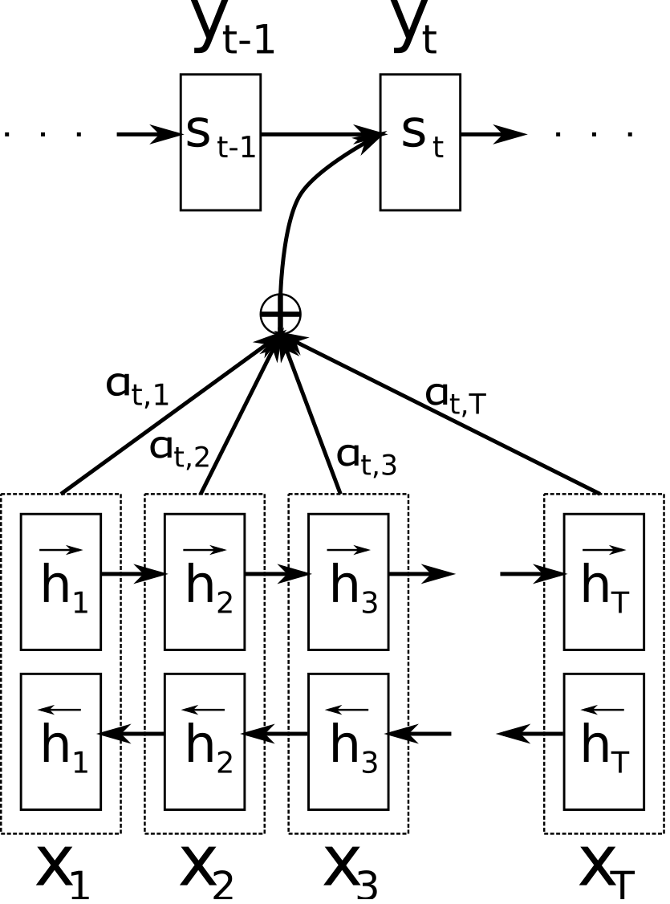
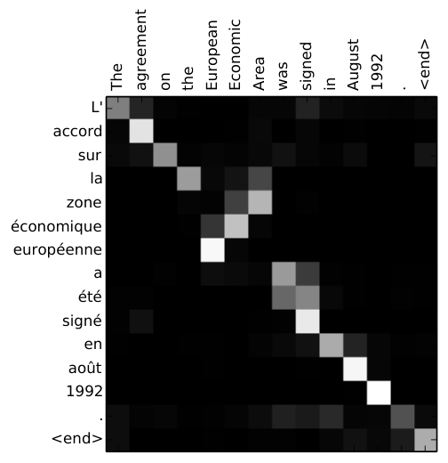
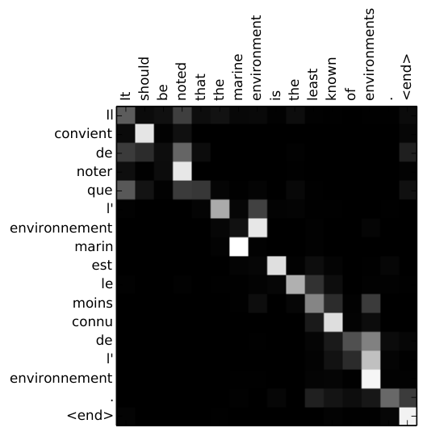
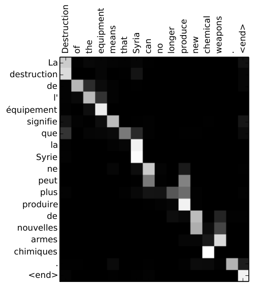
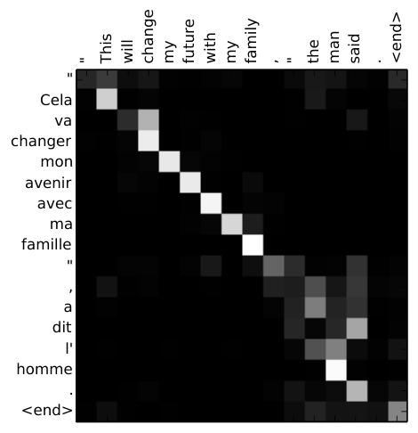

# Attention：让解码器"回头看"

> 2026-08-20 · 基于 Stanford CS224N（2025 Winter）Attention 讲次 + Bahdanau et al. 2014《Neural Machine Translation by Jointly Learning to Align and Translate》
>
> **前置知识**：假设读者已完成 `../02-rnn-seq2seq/01-rnn-seq2seq.md`（RNN、Seq2Seq、固定向量 c 的瓶颈）。本文从那个"一句话被压成一个向量"的瓶颈出发，引出 Attention 机制，最后停在"self-attention"门口——那是 Transformer 的核心。

---

## 0. 历史与根因：Attention 为什么被发明

先回答元问题：Attention 是又一个"性能补丁"，还是一个**结构性的新想法**？

答案是后者。但它的确是被一个具体的失败逼出来的。

### 0.1 根因：固定向量 c 是信息瓶颈

上一章第 11 节停在一个问题上：Seq2Seq 里，编码器不管输入句多长，最后都把整句话**压进唯一一个固定向量** $c = h_T$，解码器每一步只能看这个 c。

```
把 50 个词的完整语义，塞进一个 300 维向量，还要逐词无损还原成另一种语言。
```

句子越长，被挤掉的信息越多，翻译质量越差。这是当年评测里 seq2seq 的**典型失败模式**：短句还行，长句崩。

**问题不是"c 这个想法错了"，而是"只准看一个 c"太死。** 解码器每生成一个词，需要的其实只是输入句里**一小部分**信息——翻译 "chat" 时只需要 "cat" 这个词，不需要把 "the" 和 "green" 都塞进脑子。

### 0.2 历史：从"对齐"到"注意力"

| 年份 | 人物 | 贡献 |
|---|---|---|
| 2013 | Graves | 在"手写生成"任务里最早用了类似机制——每写一笔，回头挑一个要看的位置 |
| 2014 | Bahdanau et al. | 把它用于**机器翻译**，起名"对齐（alignment）"，论文标题就叫 *Jointly Learning to Align and Translate* |
| 2015 | Luong et al. | 整理出"全局/局部 attention"和几种不同的分数函数，术语定为 "attention" |
| 2017 | Vaswani et al. | *Attention Is All You Need*——把 RNN 整个扔掉，只用 attention 自身，这就是 Transformer |

Bahdanau 是最关键的转折。他用的词是"**对齐**"：翻译就是找到"法语第 t 个词对应英语哪个词"的对应关系。这个直觉（软对齐）后来被重命名为更通用的"注意力"。

### 0.3 准确的定位：不是一种网络，是一种机制

| 你可能会以为是 | 实际情况 |
|---|---|
| 一种新的神经网络？ | 不是。attention 本身没有可训练的结构，它是**插在两层之间的一种"软寻址"操作** |
| 一个翻译专用的技巧？ | 不是。它是通用的"按相关性取用信息"的机制，后来用到摘要、问答、图像、乃至 Transformer |

> **一句话定位**：Attention 解决的瓶颈是"**一次只能看一个固定摘要**"。它把"压成一个向量"换成"每步按需、动态地回头加权取用所有中间状态"。

带着这个定位，下面第 1 节就从那个瓶颈讲起。

---

## 1. 问题的起点：长句翻译为什么崩

沿用上一章的翻译例子，但把句子拉长，问题就现形了。

短句 "the green cat" → "le chat vert"：编码器读完 3 个词，$c = h_3$ 勉强装得下。

长句（50 词）：编码器每读一个词，隐藏状态 $h_t$ 都只记住"到这一步为止"的信息。读到最后，$c = h_T$ 里**早期词的细节已经被一路冲刷得差不多了**——这正是 RNN 消失梯度的另一种体现：信息在时间上传播，越远越衰减。

于是解码器面对一个"信息被压缩 + 被衰减"双重污染的 c，翻译长句自然崩。

> **关键观察**：问题不在"编码器产生了中间状态 $h_1, h_2, \dots, h_T$"——这些状态本身是**丰富**的（$h_3$ 里 "cat" 的信息还很新鲜）。问题在"**解码器被禁止看它们，只能看最后一个 $h_T$**"。

这一句话，就是整个 Attention 的出发点：**这些中间状态都在，凭什么不让我用？**

---

## 2. 直觉：为什么不回头看一眼？

解码器生成第 t 个词时，理想情况是：

- 生成 "chat"（法语"猫"）→ 我现在需要英语里那个**名词** → 去看 $h_3$（"cat"）
- 生成 "vert"（法语"绿"）→ 我现在需要那个**颜色词** → 去看 $h_2$（"green"）

换句话说，**解码器每一步应该能"回头扫一遍"所有编码器状态 $h_1, h_2, h_3$，并重点取用当前最相关的那一个。**

但"扫一眼"是个模糊动作。要变成可计算的操作，得回答两个问题：

1. **每个 $h_j$ 看多重？** —— 得给每个 $h_j$ 配一个权重 $\alpha_j$，表示"这一步它有多重要"。
2. **取用出来的是什么？** —— 不是挑一个 $h_j$，而是把所有 $h_j$ **按权重加权求和**，得到一个针对当前步的"定制摘要" $c_t$。

这个"每步定制、动态变化的摘要"，就是 Attention 的核心。下面用具体数字把它走一遍。

---

## 3. 核心机制：三个量 e、α、c

回到 "the green cat" → "le chat vert"。编码器读完三个词，得到三个隐藏状态（沿用上一章 RNN 的记号，这里把它们写成 2 维列向量，两个维度**故意给成可解释的语义**：第 1 维 = "名词性"，第 2 维 = "颜色/修饰性"）：

$$
\mathbf{h}_1 = \begin{bmatrix}0.10 \\ 0.10\end{bmatrix}\ (\text{"the"，弱功能词}), \qquad
\mathbf{h}_2 = \begin{bmatrix}0.05 \\ 0.95\end{bmatrix}\ (\text{"green"，颜色}), \qquad
\mathbf{h}_3 = \begin{bmatrix}0.95 \\ 0.05\end{bmatrix}\ (\text{"cat"，名词})
$$

> 注意：编码器内部就是上一章第 4 节的 RNN 递归，这里不再重复计算，直接给"读完后"的三个状态。维度是示意，但让每个词"独占"一个语义方向，后面的注意力权重才会一目了然。

现在解码器要生成第 2 个法语词 "chat"（= cat）。解码器的隐藏状态沿用上一章的记号记作 $s$（编码器记作 $h$），下标是时间步：$s_0$ 是初始状态，$s_1$ 是生成完第一个词 "le" 之后的状态。所以此刻要生成第 2 个词，解码器手上拿的是**上一步的状态 $s_1$**（它怎么一步步算出来的，见第 6 节的递归公式）。Attention 分三步走。

### 3.1 第一步：算分数 e（每个 h_j 有多相关）

对每个编码器状态 $\mathbf{h}_j$，算一个**分数** $e_{2j}$，衡量"我（$s_1$）现在和它有多相关"：

$$
e_{21} = 0.3 \ (\text{对 "the"}), \qquad
e_{22} = 0.5 \ (\text{对 "green"}), \qquad
e_{23} = 3.0 \ (\text{对 "cat"})
$$

分数越大 = 越相关。这里 "cat"（名词）的分数 3.0 远远压过另两个——因为在训练好的模型里，$s_1$ 这个向量已经学会了"生成完冠词后，下一步该找名词"，所以它和 $\mathbf{h}_3$（cat）最"同向"，分数最高。这里的 $s_1$ 扮演的角色叫 **query（查询向量）**：它携带"我现在要找什么"，拿去和每个 $h_j$ 比相关性。分数具体怎么算，第 5 节再展开，现在先接受"有一个函数能算出这个相关性"。

### 3.2 第二步：softmax 归一化成权重 α

分数的大小没有约束（可以是任意实数），不能直接当权重用。用 softmax 把它们压成**和为 1 的概率**：

$$
\alpha_{2j} = \frac{\exp(e_{2j})}{\sum_{k=1}^{3}\exp(e_{2k})}
$$

代入：

- $\exp(0.3) = 1.350$，$\exp(0.5) = 1.649$，$\exp(3.0) = 20.086$
- 分母 $= 1.350 + 1.649 + 20.086 = 23.085$
- $\alpha_{21} = 1.350/23.085 = 0.058$
- $\alpha_{22} = 1.649/23.085 = 0.071$
- $\alpha_{23} = 20.086/23.085 = 0.870$

$$
\boldsymbol{\alpha}_2 = \begin{bmatrix}0.058 \\ 0.071 \\ 0.870\end{bmatrix}
$$

**看 softmax 干了什么**：它没有改变"cat 最大"这个排序，但把"3.0 对 0.5"这种原始差距，放大成了"0.87 对 0.07"的**概率差距**，让权重真正"聚焦"到 cat 上。指数函数在这里的作用，和你熟悉的 word2vec softmax 里一模一样。

### 3.3 第三步：加权求和得到 context c_t

把三个 $\mathbf{h}_j$ 按权重 $\alpha_{2j}$ 加权求和，得到第 2 步的**上下文向量**：

$$
\mathbf{c}_2 = \sum_{j=1}^{3} \alpha_{2j}\,\mathbf{h}_j
= 0.058\begin{bmatrix}0.10 \\ 0.10\end{bmatrix}
+ 0.071\begin{bmatrix}0.05 \\ 0.95\end{bmatrix}
+ 0.870\begin{bmatrix}0.95 \\ 0.05\end{bmatrix}
$$

逐分量算：

- 第 1 维：$0.058 \times 0.10 + 0.071 \times 0.05 + 0.870 \times 0.95 = 0.0058 + 0.0036 + 0.8265 = 0.836$
- 第 2 维：$0.058 \times 0.10 + 0.071 \times 0.95 + 0.870 \times 0.05 = 0.0058 + 0.0675 + 0.0435 = 0.117$

$$
\mathbf{c}_2 = \begin{bmatrix}0.836 \\ 0.117\end{bmatrix}
$$

---

## 4. 加权和的意义：c_t 就是"聚焦的那部分"

把 $\mathbf{c}_2$ 和三个 $\mathbf{h}_j$ 摆在一起看：

| 向量 | 第 1 维（名词） | 第 2 维（颜色） |
|---|---|---|
| $\mathbf{h}_1$（the） | 0.10 | 0.10 |
| $\mathbf{h}_2$（green） | 0.05 | 0.95 |
| $\mathbf{h}_3$（cat） | **0.95** | 0.05 |
| $\mathbf{c}_2$（加权和） | **0.836** | 0.117 |

$\mathbf{c}_2 = [0.836,\ 0.117]$ 几乎就是 $\mathbf{h}_3 = [0.95,\ 0.05]$——**因为权重 0.87 都压在 "cat" 上，所以加权和长得就像 "cat"**。

这就是 Attention 的全部奥义，一句话：

> **加权和 = 软选择。权重压在哪，c_t 就像谁。**

如果权重是均匀的 $[1/3, 1/3, 1/3]$，$c_t$ 就是三个词的平均（模糊一团）；如果权重完全聚焦 $[0, 0, 1]$，$c_t$ 就精确等于 $\mathbf{h}_3$。真实的 $\alpha$ 落在这两者之间——所以叫"**软**选择"（soft），不叫"硬选择"。

用芯片的语言：这是**模拟域的软加权混合**（soft mixing），不是数字域的硬开关。每个 $h_j$ 对输出都有贡献，只是贡献大小由 $\alpha_j$ 连续控制。

下面这张图是 Bahdanau 原论文的 Figure 1，把整个结构画出来了：



> 图注（原论文 Figure 1）：模型读入源句 $(x_1, x_2, \dots, x_T)$，生成第 $t$ 个目标词 $y_t$。注意右下角——解码器第 $t$ 步会**先算一组权重 $\alpha_{tj}$，再对所有编码器状态 $\mathbf{h}_j$ 加权求和**，得到当前步专用的 $\mathbf{c}_t$，而不是永远用同一个固定 c。

---

## 5. 权重怎么算：alignment model（对齐模型）

第 3 节里我说"分数 $e_{2j}$ 由一个函数算出"。现在补上这个函数——这是 attention 里**唯一需要训练的部分**。

### 5.1 最直觉的想法：点积

衡量两个向量 $\mathbf{s}_{t-1}$ 和 $\mathbf{h}_j$ 的相关性，最朴素的想法是**内积**（点积）——两个向量越"同向"，内积越大：

$$
e_{tj} = \mathbf{s}_{t-1} \cdot \mathbf{h}_j = \mathbf{s}_{t-1}^{\mathsf{T}} \mathbf{h}_j
$$

这很自然：如果 $\mathbf{s}_{t-1}$ 此刻"想要名词"，而 $\mathbf{h}_3$ 就是名词向量，它们方向一致，内积就大。

### 5.2 点积有个隐含假设，Bahdanau 把它打破了

点积假设 $\mathbf{s}$ 和 $\mathbf{h}$ **已经在同一个坐标空间里可以直接比**。但现实是：

- $\mathbf{s}$ 来自**解码器**的 RNN，$\mathbf{h}$ 来自**编码器**的 RNN——两个不同的网络，坐标空间本来就不对齐，维度甚至可能不同（比如 encoder 用 256 维，decoder 用 512 维，根本没法点积）。
- 就算强行同维，也没有理由说"解码器状态的第 1 维"和"编码器状态的第 1 维"是可比的。

于是 Bahdanau 用一个**可学习的小前馈网络**来做这件事，先把两边投影到公共空间再比：

$$
e_{tj} = \mathbf{v}_a^{\mathsf{T}} \tanh\!\big(W_a \mathbf{s}_{t-1} + U_a \mathbf{h}_j\big)
$$

逐个符号解释：

- $\mathbf{s}_{t-1}$：解码器上一步的隐藏状态（"我现在想要什么"）
- $\mathbf{h}_j$：编码器第 j 个隐藏状态（"这个位置有什么"）
- $W_a$、$U_a$：两个**可训练的投影矩阵**，把 s 和 h 分别投影到一个公共的"对齐空间"
- $\tanh$：加非线性（和 RNN 里一样，把值压到 $(-1,1)$）
- $\mathbf{v}_a$：一个**可训练的向量**，把投影结果压成**一个标量分数** $e_{tj}$

这整个东西叫 **alignment model（对齐模型）**——它学到的就是"解码器这一步，该看编码器哪一步"。

### 5.3 为什么用这个小网络，而不是固定点积

| 方案 | 假设 | 代价 |
|---|---|---|
| 点积 $s \cdot h$ | s、h 已在同一空间 | 无参数，但假设太强，通常不成立 |
| additive $v_a^{\mathsf{T}}\tanh(W_a s + U_a h)$ | 无（投影矩阵自己学） | 多了 $W_a, U_a, v_a$ 三个参数 |

**这是"设计是被逼出来的"的又一个例子**：先有点积这个朴素想法，发现它默认"两个不同 RNN 的状态天生可比"这个不成立的假设，于是逼出一个"先投影再比"的可学习版本。

> 顺带一提：点积版后来（Luong 2015、Transformer 2017）又回来了，因为 Transformer 里 $\mathbf{s}$ 和 $\mathbf{h}$ 来自**同一个**网络，同空间的假设重新成立，点积就够用且更快。所以"点积 vs additive"不是谁对谁错，是"**同源则点积，异源则投影**"。

---

## 6. 完整的 Attention decoder 前向

把上面拼起来，解码器生成第 t 个词的完整流程：

1. **算分数**：对每个编码器状态，$e_{tj} = a(\mathbf{s}_{t-1}, \mathbf{h}_j)$（$a$ 是第 5 节的 alignment model）
2. **算权重**：$\alpha_{tj} = \dfrac{\exp(e_{tj})}{\sum_k \exp(e_{tk})}$（softmax）
3. **算 context**：$\mathbf{c}_t = \sum_j \alpha_{tj} \mathbf{h}_j$（加权和）
4. **更新 decoder 状态**：
   $$
   \mathbf{s}_t = \tanh\!\big(W_{hh}\mathbf{s}_{t-1} + W_{yh}\mathbf{e}(y_{t-1}) + W_{ch}\mathbf{c}_t + b_h\big)
   $$
   其中 $\mathbf{e}(y_{t-1})$ 是上一词的词向量（和上一章 decoder 一样），**新出现的是第三项 $W_{ch}\mathbf{c}_t$——每一步都把这个"定制摘要"喂进来**。
5. **预测下一个词**：
   $$
   \hat{y}_t = \text{softmax}\!\big(W_{hy}[\mathbf{s}_t; \mathbf{c}_t] + b_y\big)
   $$
   其中 $[\mathbf{s}_t; \mathbf{c}_t]$ 表示把两个向量**上下拼接**成一个更长的向量，让输出层同时看到"我现在的状态"和"我这步看到的 context"。

### 关键：每一步的 c_t 都不一样

对比上一章的固定 c：那里所有步用的是**同一个** $c = h_T$；这里每一步都算一个**新的** $\mathbf{c}_t$，针对当前要生成的词量身定做。

走完三步，注意力聚焦的位置如下（权重是示意，重点是"每步都在动"）：

| 生成 | 注意力权重 $\alpha_t$ | 聚焦在 | 为什么 |
|---|---|---|---|
| "le"（冠词） | $[0.85,\ 0.08,\ 0.07]$ | $\mathbf{h}_1$（the） | 冠词对冠词 |
| "chat"（名词） | $[0.06,\ 0.07,\ 0.87]$ | $\mathbf{h}_3$（cat） | 名词对名词 |
| "vert"（形容词） | $[0.05,\ 0.90,\ 0.05]$ | $\mathbf{h}_2$（green） | 颜色对颜色 |

**看这个顺序**：英语词序是 "the → green → cat"，但法语是 "le chat vert"（名词在前、形容词在后），所以注意力按 $h_1 \to h_3 \to h_2$ 跳着看。

**这就是 attention 解决"词序重排"的方式**：解码器不靠"按顺序读 c"，而是每步主动跳到最相关的位置去取信息。上一章结尾说的"green 修饰 cat，翻译时形容词要放到名词后面"，在这里有了机制上的落地——生成 "vert" 时，权重 0.90 直接压在 $\mathbf{h}_2$（green）上，管它英语里 green 排在 cat 前面。

---

## 7. 关键设计：软选择，而不是硬选择

为什么第 3 节是**加权求和** $\sum_j \alpha_j h_j$，而不是干脆**挑一个最大的** $h_{j^*}$（硬选择）？

表面看，硬选择更"干净"——生成 "chat" 就直接拿 $h_3$，何必还掺 5.8% 的 $h_1$？

**答案是梯度。** 硬选择 $j^* = \arg\max_j e_j$ 是一个**不可微**的操作：它的输出要么是 $h_3$ 要么不是，输入 $e_j$ 发生无穷小的变化，输出**完全不变**（除非跨过边界突然跳变）。梯度在这里是 0 或不存在，**反向传播传不过去，整个 seq2seq 就没法端到端训练**。

软选择的加权和处处可微：$\alpha_j$ 对 $e_j$ 的导数是 softmax 的雅可比（你已经在 RNN 笔记第 8 节见过 softmax 求导），梯度能一路从 loss 传回 encoder、传回 alignment model。

> 用芯片的语言：这是"**软切换**"和"**硬开关**"的区别。硬开关（argmax）状态不可微分、无法做小信号分析；软加权（softmax）处处连续，可以做梯度下降这种"小信号优化"。你调 ΣΔ ADC 的增益时,一定更喜欢连续可微的软量,而不是啪一下跳档的硬开关。

**一句话**：Attention 之所以"软"，不是审美，是**为了让梯度能流过去**。这也是它和 word2vec 负采样里"用 softmax 变概率"一脉相承的设计——把不可微的"选择"换成可微的"加权"。

---

## 8. 对齐热力图：attention 送的礼物

Attention 带来一个副产品，价值甚至不亚于性能提升：**可解释性**。

权重 $\alpha_{tj}$ 本身就是一张表——"生成第 t 个法语词时，注意力放在第 j 个英语词上"。把整张表画成热力图，就能**看见模型在翻译时到底在看哪里**。

下面是 Bahdanau 论文 Figure 3 里的四张真实对齐图（法语在 y 轴，英语在 x 轴，格子越亮 = $\alpha$ 越大）：









读图方法：找**对角线**。大部分句子对齐是"近似对角"的——第 1 个法语词对第 1 个英语词，第 2 个对第 2 个…… 但你会在某些地方看到**亮块跳出了对角线**，那正是词序不同的地方（比如英语 "European Economic Area" 对应法语 "zone économique européenne"，形容词和名词顺序颠倒，热力图上的亮块也跟着拐弯）。

> 这一张图说清了一个之前很难回答的问题：**"模型到底理解了什么？"** 在没有 attention 的年代，你只能看输出对不对；有了 attention，你能看它**每一步在参考输入的哪个词**。这种"可追溯性"，和你做芯片时喜欢"能指出信号是从哪一级过来的"是一个道理。

---

## 9. 双向 encoder：让 h_j 带上上下文

上一章和本文到目前为止，编码器都是**单向** RNN——$\mathbf{h}_3$（"cat"）只包含它**左边**的词（the、green），看不到右边的任何东西。

这有个问题：$\mathbf{h}_3$ 里的 "cat" 是"只看到左边"的 cat。但 "cat" 这个词的意思有时取决于右边（比如 "cat food" vs "cat" 单独成词）。单向的 $h_j$ 缺少右边上下文。

于是 Bahdanau 用了**双向 RNN**（bidirectional RNN）：一句话从左到右读一遍得到前向状态 $\overrightarrow{\mathbf{h}_j}$，从右到左读一遍得到后向状态 $\overleftarrow{\mathbf{h}_j}$，然后**拼起来**：

$$
\mathbf{h}_j = \begin{bmatrix}\overrightarrow{\mathbf{h}_j} \\ \overleftarrow{\mathbf{h}_j}\end{bmatrix}
$$

这样每个 $\mathbf{h}_j$ 都同时携带了"左边是什么 + 右边是什么"的完整上下文。这就是为什么论文 Figure 1 里 encoder 那排单元画成了两层——一层前向、一层后向。

> 这也是为什么第 5.2 节说 encoder/decoder 状态"维度可能不同"：双向 encoder 的 $\mathbf{h}_j$ 是前向+后向拼接的 2 倍长，和 decoder 的 $s$ 维度天然不一样——于是更需要 additive attention 的投影矩阵来对齐。**双向 + additive，是一对彼此配合的设计。**

---

## 10. 设计决策回顾：从架构师的视角

| 我们面对的问题 | 我们的选择 | 为什么选这个 | 当时淘汰的方案 |
|---|---|---|---|
| 固定 c 信息瓶颈 | 每步动态算 $c_t = \sum_j \alpha_{tj} h_j$ | 解码器每步只需输入的一部分信息，按需取用 | 永远用同一个 $c = h_T$ |
| "看多重"怎么定 | 算分数 $e$ 再 softmax 成权重 $\alpha$ | 分数无界，softmax 压成和为 1 的概率 | 直接用原始分数（无界、无法当权重） |
| 分数怎么算 | 可学习小网络 $v_a^{\mathsf{T}}\tanh(W_a s + U_a h)$ | s、h 来自不同网络，需先投影到公共空间 | 点积（假设同空间，通常不成立） |
| 选一个还是加权 | 软加权求和 | 可微，梯度能端到端回传 | 硬选 argmax（不可微，训不了） |
| h_j 缺右边上下文 | 双向 RNN + 拼接 | 让每个位置看到完整上下文 | 单向（只看左边） |

---

## 11. 从 attention 回头看：encoder-decoder 为什么分离

上一章第 10 节把 encoder-decoder 分离的理由归为"输入输出长度不同"。学完 attention 后再回头看，这个理由只是**表象**。

### 11.1 长度不一致只是表象

一个反例就够：`the green cat` → `le chat vert` 长度恰好都是 3。就算所有句子长度都碰巧一样，你**仍然需要** encoder-decoder 分离——因为两边的词汇表、语法、词序都不同。你需要的不是"接龙"，而是"先把源句的意思抽出来，再用目标语言的规则重新表达"。

### 11.2 结构根因：翻译是"跨空间的条件映射"，不是"接龙"

单 RNN 语言模型建模的是 $P(w_t \mid w_{<t})$——**同一个**语言空间里词接词，输入输出是同一个域，天然不需要分离。

翻译建模的是 $P(\text{目标句} \mid \text{源句})$——两个**不同的域**（不同词汇表、不同语法、不同长度）。这是"跨空间映射"，不是"接龙"。

> **一句话根因**：翻译是"两个不同语言空间之间的条件映射"；长度不一致，只是"两个域不同"最容易看见的一个表现。

### 11.3 表示学习动机：那个瓶颈是故意的

"encoder / decoder" 这两个词不是 seq2seq 发明的，它继承自**信息论**——Shannon 1948 的通信模型（信源 → 编码器 → 信道 → 解码器 → 信宿）：编码 = 把消息变换成适合传输/压缩的形式，解码 = 还原。更早的神经网络 autoencoder（Hinton 1980s）就是"编码-解码"，它的动机**根本不是翻译，而是表示学习**——逼网络把输入压成低维表示再重构，从而学到本质特征。

所以分离的深层动机是**逼模型学一个"语言无关的语义表示"**：

- 不分离（单 RNN 逐词硬映射），模型会退化成"源词 → 目标词的查表对应"，学不到"语义"这层抽象；
- 分离 + 中间的瓶颈，逼模型把"具体语言的表层形式"剥掉、只保留"意思"——因为 decoder 只能靠这个"意思"去重建目标语言。

这里有个反直觉的点值得说破：上一章一直抱怨的"固定向量 c 是瓶颈"（信息丢失），**结构上是故意的**。瓶颈是表示学习的核心机制——不给够通道，就逼你只传"本质"。它的"坏处"（长句信息丢失）和"好处"（逼出语义表示）是同一枚硬币。

> 用芯片的语言：这是 **protocol bridge / codec**。两个不同协议（USB 和 HDMI、差分和单端）之间通信，你不会硬连，而是中间放一个桥——把源协议"解包"成内部通用表示，再"打包"成目标协议。encoder 是解包器（源语言 → 语义），decoder 是打包器（语义 → 目标语言），中间那个"语义表示"就是片上通用总线（比如 AXI）。你放一个 bridge，从来不是为了"引脚数不一样"，而是因为两套协议本来就是两个域。

### 11.4 两个尺度的对齐 + Transformer 的反向印证

把你在读 attention 时注意到的"alignment model 也是一种对齐"接上，就能看到 encoder-decoder 和 attention 是**同一个思想在两个尺度上**：

| 尺度 | 谁对齐谁 | 机制 |
|---|---|---|
| 句子级 | 整个源句 ↔ 整个目标句 | encoder-decoder 分离 + 中间的语义表示 |
| 词级 | 目标第 $t$ 个词 ↔ 源第 $j$ 个词 | attention 的 alignment model（软对齐 $\alpha_{tj}$） |

attention 不是新发明了对齐，而是**把 encoder-decoder 里那个隐式的、句子级的对齐，显式化、可微化、细化到词级**。

最后是一个反向印证（详细机制见下一节）：到了 Transformer——第 0.2 节提到的那只"只用 attention、扔掉 RNN"的模型——序列长度已经不再是障碍，但 Vaswani **仍然保留了 encoder-decoder 分离**（encoder 读源句，decoder 自回归生成，中间用 attention 连接）。

长度问题消失了，分离还在——**说明长度从来不是分离的根本原因，"两个语言空间之间的映射"才是。**

---

## 12. 下一步：三种用法，通向 Transformer

Attention 到这里还只是一个"插在 encoder–decoder 之间的组件"。但它有三种用法，第三种会引爆一切：

| 用法 | 谁 attend 谁 | 用途 |
|---|---|---|
| **encoder–decoder attention** | decoder 的 s 去 attend encoder 的 h | 本文讲的翻译（跨序列对齐） |
| **self-attention** | 序列里的每个词 attend **同一序列**里的所有词 | 一句话内部"哪个词修饰哪个词" |
| **multi-head + 纯 attention** | 多个 attention 并行 | 彻底丢掉 RNN → **Transformer** |

本文的 encoder–decoder attention 只是第一种。下一个笔记的主角 **self-attention** 更根本：它让每个词直接看同一句里的所有其他词，长程依赖不再需要 RNN 那根"会消失的链"。

> **一句话收尾**：Attention 把"读完整句再压成一个向量"（有损、有瓶颈），改成了"每步按需、软性地回头取用"（无损、可解释、可端到端训练）。这个"软寻址"的机制，是通往 Transformer 的那道门。

---

## 参考

- Bahdanau, Cho, Bengio, "Neural Machine Translation by Jointly Learning to Align and Translate" (2014) —— Attention 的起源（[论文 PDF](papers/1409.0473.pdf)，Figure 1 见第 4 节，Figure 3 见第 8 节）
- Luong, Pham, Manning, "Effective Approaches to Attention-based Neural Machine Translation" (2015) —— 术语 "attention" 的确立 + 点积/global/local 变体
- Graves, "Generating Sequences with Recurrent Neural Networks" (2013) —— 更早的"注意力"萌芽（手写生成）
- Vaswani et al., "Attention Is All You Need" (2017) —— 去掉 RNN、只用 self-attention 的 Transformer（下一个笔记的主角）
- [CS224N 2025 课程主页](https://web.stanford.edu/class/archive/cs/cs224n/cs224n.1254/)
