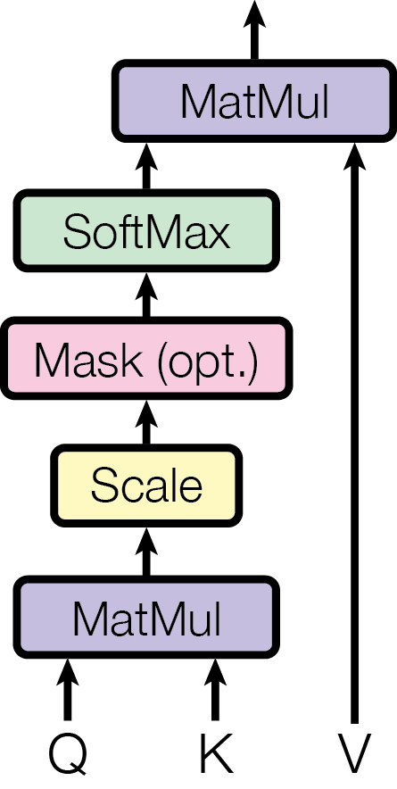

# Self-Attention：让每个词看到整句话

> 2026-08-21 · 基于 Stanford CS224N（2025 Winter）Transformer 讲次 + Vaswani et al. 2017《Attention Is All You Need》
>
> **前置知识**：假设读者已完成 `01-attention.md`（encoder-decoder attention、分数 → 权重 → 加权和）。本文把 attention 从"跨序列对齐"推广到"序列内部对齐"，即 self-attention——这是 Transformer 的核心。本文只讲 self-attention 本身，multi-head 和完整架构留待后续笔记。
>
> **本章总览**：Transformer 这一章拆三篇——① self-attention（本篇）；② multi-head + 位置编码；③ 完整 encoder-decoder 架构。

---

## 0. 历史与根因：为什么需要 self-attention

### 0.1 根因：RNN 有两个固有缺陷

上一章我们一直用 RNN 处理序列。RNN 有两个**结构上的**毛病，不是调参能解决的：

1. **长程依赖会衰减**：信息沿时间步一步步传，第 t 步要影响第 t+100 步，得穿过 100 次 tanh 和矩阵乘法。RNN 笔记第 9 节算过——特征值 <1 时梯度指数消失，长距离的依赖学不到。
2. **无法并行**：$h_t$ 依赖 $h_{t-1}$，必须**串行**一步一步算。这句话有 50 个词，就得串 50 步，GPU 再多也没法并行。

这两个缺陷是同一个病根：**RNN 把"顺序"硬编码成了"时间上的串行依赖"**。要同时解决长程依赖和并行，就得换一种不靠"链式传递"的机制。

### 0.2 self-attention 就是 attention 的第三种用法

上一章末尾（第 12 节）列过 attention 的三种用法，其中第二种是 self-attention：

> **self-attention**：序列里的每个词 attend **同一序列**里的所有词。

它不引入新的数学，只是把 attention 的"谁去查谁"从"跨序列"换成了"序列内"。但它带来一个质变：**任意两个词之间都是一步直达**，不再需要 RNN 那根链。

### 0.3 准确的定位

| 你可能会以为是 | 实际情况 |
|---|---|
| 一个全新的发明？ | 不是。它是 attention 的"自己 attend 自己"版本，思想更早在 Cheng et al. 2016（intra-attention，机器阅读）就出现过 |
| 只是翻译里的一个组件？ | 不是。Vaswani 2017 用它**整个替换掉了 RNN**，这就是 Transformer |

> **一句话定位**：self-attention 用"任意两个位置之间的一步直达"替换掉 RNN 的"链式串行传递"，同时干掉长程依赖衰减和无法并行两个病根。

---

## 1. 从 attention 到 self-attention：一个自然的推广

先回忆上一篇的 encoder-decoder attention。它有三个角色：

- **query**：解码器状态 $\mathbf{s}_{t-1}$——"我现在想查什么"
- **key / value**：编码器状态 $\mathbf{h}_1, \dots, \mathbf{h}_T$——"每个位置能被查什么 / 实际提供什么"

attention 做的事：拿 query 去和每个 key 算分数，softmax 成权重，再对 value 加权求和。

现在做一个**只换一个字**的推广：把 query 也换成序列里的词。

- 不再是"解码器去看编码器"
- 而是"**句子里的每个词，去看同一句话里的所有词**"

一句话 "the cat sat" 里，"cat" 会去查 "the"、"cat"、"sat" 三个词（包括它自己），算出"它此刻最该参考谁"，然后加权吸收它们的信息。这就是 self-attention。

---

## 2. Query / Key / Value：把 attention 抽象成三个角色

为了讲清 self-attention，先把 attention 统一抽象成三个量。这是理解 Transformer 的关键，值得停下来讲透。

### 2.1 一个检索的类比

把 attention 想成**查字典**：

- **Query（查询）**：你想查什么。比如"我要找那个名词"
- **Key（键）**：每个词条的"索引标签"。比如每个词的词性
- **Value（值）**：词条的实际内容。比如这个词的完整信息

匹配过程：拿 query 和每个 key 比相似度 → 按相似度加权 → 取出对应的 value。

### 2.2 关键：Key 和 Value 可以不同

上一篇 Bahdanau attention 里，key 和 value 是**同一个东西**——都是 $\mathbf{h}_j$，既拿它算相关性（key）、又拿它做加权求和的素材（value）。它能用，但有个隐藏的两难：**同一个向量身兼两职，而两职的优化方向相反**。

- 当 **key（定位）**：向量要朝**判别性**走，突出"我是名词"这类抽象标签 → 意味着**抹平类内差异**（同类词往一个方向靠）。
- 当 **value（取用）**：向量要朝**保真性**走，保留这个词独特的语义细节 → 意味着**突出每个词的与众不同**。

一个要"抹平差异"，一个要"突出差异"，两股反向的梯度最终汇到同一个 $\mathbf{h}_j$ 上，它只能在中间妥协。

举个具体的例子。翻译 "The cat sat on the mat"，解码器要生成动词 "sat"：

- **定位视角**（$\mathbf{h}_j$ 当 key）：生成动词时，query 要找源句里的动词，$\mathbf{h}_j$ 最好能清晰标出词性——$\mathbf{h}_{\text{sat}}$ 是"动词"，$\mathbf{h}_{\text{cat}}$、$\mathbf{h}_{\text{mat}}$ 是"名词"。为了让 query 快速定位，训练会把**所有名词往一起拉**：$\mathbf{h}_{\text{cat}}$ 和 $\mathbf{h}_{\text{mat}}$ 越来越像。因为对"定位动词"这件事，"猫 vs 垫子"的区别是**噪声**——query 不关心你是猫还是垫子，只关心"你不是动词"。
- **取用视角**（$\mathbf{h}_j$ 当 value）：同一步，定位到 "sat" 后要加权求和出 $c_t$。若要融合 "cat" 的信息，$c_t$ 必须保留"猫是动物、有生命"，绝不能和 "mat"（无生命垫子）搞混，否则会生成"垫子在坐"这类错。于是"猫 vs 垫子"的区别又成了**必须保留的信号**。

同一个差异，被两个角色判了相反的刑：**对 key 是噪声（该抹平），对 value 是信号（该保留）**。而 Bahdanau 里 $\mathbf{h}_{\text{cat}}$ 就一个向量，没法既把"猫 vs 垫子"当噪声抹掉、又当信号留住——拉近 cat 和 mat 的梯度、与拉开 cat 和 mat 的梯度，作用在同一个 $\mathbf{h}_{\text{cat}}$ 上，方向正好相反。

> 你可能会问：Bahdanau 论文 Figure 3 的对齐热力图很清晰，看不出冲突啊？两个原因：① 那张图只画了**定位**的结果（权重 $\alpha$ 的分布），没画**取用**的结果（$c_t$ 丢了多少细节），冲突藏在图外；② 更关键的是，Bahdanau 其实已经**偷偷做了一半分离**——看它的分数公式 $e_{tj} = v_a^{\mathsf{T}}\tanh(W_a \mathbf{s}_{t-1} + U_a \mathbf{h}_j)$：$\mathbf{h}_j$ 当 key 时先经过 $U_a$ 投影，当 value 时（$c_t = \sum_j \alpha_{tj}\mathbf{h}_j$）却是**裸的**。这个 $U_a$ 就是隐式的 key 投影，已经在把"定位"和"取用"分开缓冲。

但 Bahdanau 只"缓冲"没"根治"，区别看这张表：

| | 输入源头 | 可训练参数 |
|---|---|---|
| Bahdanau | $\mathbf{h}_j$ | **同一个 $\mathbf{h}_j$** 身兼两职 + 共享的 $U_a$（只缓冲 key 侧） |
| Transformer | $\mathbf{x}_j$（仍是同一个） | **$W^K$ 和 $W^V$ 各自独立** |

Bahdanau 里，$U_a\mathbf{h}_j$ 和裸 $\mathbf{h}_j$ 两条路径的梯度**最终都汇回同一个 $\mathbf{h}_j$**，它仍被两头拉扯；$U_a$ 只是加了一层缓冲。Transformer 换成点积后，key/value 投影显式化成各自独立的 $W^K$、$W^V$，**两股梯度各回各家**。

一句话收束：分离的不是"输入"（$\mathbf{x}_j$ 仍是共享的原材料），而是"**表示 + 参数**"。Bahdanau 用一个表示 $\mathbf{h}_j$ 身兼两职；Transformer 用 $W^K$、$W^V$ 各投出一套独立表示 $\mathbf{k}_j$、$\mathbf{v}_j$，让定位与取用各有各的身躯。（$\mathbf{x}_j$ 自然也会收到经 $W^K$、$W^V$ 回传的两股梯度，但那只是"一份原材料喂给两个各有专属参数的下游"，不构成冲突。）

### 2.3 每个词通过三个投影产生 Q、K、V

在 self-attention 里，输入是 $n$ 个词的向量 $\mathbf{x}_1, \dots, \mathbf{x}_n$（每个 $d$ 维）。每个词 $\mathbf{x}_i$ 通过三个**可学习的投影矩阵**，生成自己的三个角色：

$$
\mathbf{q}_i = W^Q \mathbf{x}_i, \qquad
\mathbf{k}_i = W^K \mathbf{x}_i, \qquad
\mathbf{v}_i = W^V \mathbf{x}_i
$$

- $W^Q$：投影成 query——"我作为**查询者**时，该怎么表达我要找什么"
- $W^K$：投影成 key——"我作为**被查对象**时，我的'标签'该怎么表达"
- $W^V$：投影成 value——"我**实际提供**的内容该怎么表达"

同一个词 $\mathbf{x}_i$，作为 query、key、value 时是**三种不同的向量**——这正是它比 Bahdanau（key=value）更灵活的地方。投影矩阵的作用，第 5 节再展开。

---

## 3. 缩放点积 attention（Scaled Dot-Product Attention）

有了 Q、K、V，attention 的计算可以一口气写成矩阵形式（这是 Transformer 论文里的原始公式）：

$$
\text{Attention}(Q, K, V) = \text{softmax}\!\left(\frac{Q K^{\mathsf{T}}}{\sqrt{d_k}}\right) V
$$

逐个符号解释：

- $Q$：query 矩阵，形状 $n \times d_k$，第 $i$ 行是 $\mathbf{q}_i$
- $K$：key 矩阵，形状 $n \times d_k$，第 $i$ 行是 $\mathbf{k}_i$
- $V$：value 矩阵，形状 $n \times d_v$，第 $i$ 行是 $\mathbf{v}_i$
- $d_k$：key（和 query）的维度，$\sqrt{d_k}$ 是那个缩放因子，见下
- $QK^{\mathsf{T}}$：$n \times n$ 的**分数矩阵**，第 $(i,j)$ 元 = $\mathbf{q}_i \cdot \mathbf{k}_j$（query i 和 key j 的内积）
- $\text{softmax}$：沿**每行**做（对每个 query 单独归一化，让它的所有权重和为 1）
- 最后乘 $V$：得到 $n \times d_v$ 的输出，第 $i$ 行 = $\sum_j \alpha_{ij}\mathbf{v}_j$

和上一篇的对应关系一目了然：$QK^{\mathsf{T}}$ 就是"算分数 e"，softmax 就是"归一化成权重 α"，乘 V 就是"加权求和"——只是把这三步压缩成了一行矩阵公式。

下面这张是论文的 Figure 2（左），画的就是这个式子：

### 3.1 为什么要除以 √d_k：这是被逼出来的

这个 $\sqrt{d_k}$ 不是装饰，是修一个具体 bug 的。

点积 $\mathbf{q}_i \cdot \mathbf{k}_j = \sum_{r=1}^{d_k} q_r k_r$ 是 $d_k$ 个数相加。如果 $q$、$k$ 的每个分量独立、均值 0、方差 1（网络初始化时大致如此），那么**点积的方差是 $d_k$**（方差相加）。

后果链：

1. $d_k$ 大（比如 512）→ 点积数值飙到 ±几十
2. softmax 里 $\exp(\text{大值})$ 爆炸 → softmax 输出**极度饱和**，接近 one-hot（权重几乎全压在最大值上，其余趋近 0）
3. 饱和区的 softmax **梯度趋近 0**（你已经在 RNN 笔记第 8 节见过 softmax 饱和时梯度消失）→ 反向传播传不动 → 训不动

除以 $\sqrt{d_k}$，把点积的方差从 $d_k$ 拉回 1：

$$
\text{Var}\!\left(\frac{\mathbf{q}\cdot\mathbf{k}}{\sqrt{d_k}}\right) = \frac{d_k}{d_k} = 1
$$

> 这里的 $d_k/d_k$ 用的是方差缩放性质 $\text{Var}(aX) = a^2\,\text{Var}(X)$（系数要平方，不是 $a$ 倍）：除以 $\sqrt{d_k}$，系数 $a = 1/\sqrt{d_k}$，平方后是 $1/d_k$，乘上原本的方差 $d_k$ 正好得 1。顺带区分：被"拉回 1"的是**方差**；原本的**标准差**是 $\sqrt{d_k}$，除以 $\sqrt{d_k}$ 后也归 1——两者起点不同、终点相同。

点积落回温和的量级，softmax 落在"不饱和、梯度正常"的区域。

> 用芯片的语言：这就是**信号归一化 / 自动增益控制（AGC）**。输入信号（点积）幅度随通道数（维度）增长，不控制增益就会打爆后级的动态范围（softmax 饱和）。除以 √d_k 就是给这条通路加一个固定衰减，把信号幅度稳定在设计区间内。

---

## 4. 具体走一遍：the cat sat

回到最熟悉的三个词，词向量沿用 RNN 笔记第 5 节的 2 维设定（这里先做**最简版**：暂时让 $Q=K=V=X$，即不投影，纯粹走通机制；投影的作用下一节补）：

$$
\mathbf{x}_{\text{the}} = \begin{bmatrix}1.0 \\ 0.0\end{bmatrix}, \qquad
\mathbf{x}_{\text{cat}} = \begin{bmatrix}0.0 \\ 1.0\end{bmatrix}, \qquad
\mathbf{x}_{\text{sat}} = \begin{bmatrix}0.6 \\ 0.8\end{bmatrix}
$$

三个词排成矩阵（每行一个词）：

$$
X = \begin{bmatrix}1.0 & 0.0 \\ 0.0 & 1.0 \\ 0.6 & 0.8\end{bmatrix}, \qquad Q = K = V = X
$$

### 4.1 第一步：QKᵀ 算分数

$QK^{\mathsf{T}} = XX^{\mathsf{T}}$ 是 $3\times3$ 矩阵，第 $(i,j)$ 元是词 i 和词 j 的内积：

$$
XX^{\mathsf{T}} = \begin{bmatrix}
1.0 & 0.0 & 0.6 \\
0.0 & 1.0 & 0.8 \\
0.6 & 0.8 & 1.0
\end{bmatrix}
$$

第 1 行 = "the" 对 the/cat/sat 的分数 $[1.0,\ 0.0,\ 0.6]$。

### 4.2 第二步：除以 √d_k 再 softmax

$d_k = 2$，$\sqrt{2} \approx 1.414$。第一行 $[1.0, 0.0, 0.6]$ 除以 $\sqrt{2}$ 得 $[0.707,\ 0,\ 0.424]$，再 softmax：

- $\exp(0.707) = 2.028$，$\exp(0) = 1$，$\exp(0.424) = 1.528$，分母 $= 4.556$
- 得权重 $[0.445,\ 0.219,\ 0.335]$

整张权重矩阵（每行各自 softmax）：

$$
\text{softmax}\!\left(\frac{XX^{\mathsf{T}}}{\sqrt{2}}\right) = \begin{bmatrix}
0.445 & 0.219 & 0.335 \\
0.209 & 0.423 & 0.368 \\
0.287 & 0.331 & 0.382
\end{bmatrix}
$$

### 4.3 第三步：乘 V 得到输出

第 1 行（"the" 更新后）$= 0.445\,\mathbf{x}_{\text{the}} + 0.219\,\mathbf{x}_{\text{cat}} + 0.335\,\mathbf{x}_{\text{sat}}$：

$$
= 0.445\begin{bmatrix}1.0\\0.0\end{bmatrix} + 0.219\begin{bmatrix}0.0\\1.0\end{bmatrix} + 0.335\begin{bmatrix}0.6\\0.8\end{bmatrix}
= \begin{bmatrix}0.646 \\ 0.487\end{bmatrix}
$$

这就是 self-attention 的完整一步：**"the" 的输出 = 三个词按注意力权重 0.445 / 0.219 / 0.335 的加权和**。每个词的输出都长这样——它不再只是"自己"，而是"整句话里所有词，按相关性混合"。

> 注意这个例子里的权重**比较分散**（对角线 0.445 没压倒性优势）。这不是 bug，是"$Q=K=V=X$ 没投影"的必然结果——词向量本身不是为"注意力匹配"设计的。这正是下一节要解决的问题。

---

## 5. 为什么要有投影矩阵 W^Q、W^K、W^V

第 4 节用了最简版 $Q=K=V=X$，走通了机制，但暴露一个问题：注意力权重**分散**，模型没法表达"该聚焦谁"。

根源是：$Q=K=V=X$ 把三个角色**绑死**了。同一个词向量 $\mathbf{x}_i$，既当 query 又当 key 又当 value。但"cat 作为查询时想找名词"、"cat 作为被查对象时的标签"、"cat 实际提供的内容"，这三件事**本该用不同的表示**——绑死就失去了灵活性。

于是给每个角色一个**可学习投影**：

$$
\mathbf{q}_i = W^Q\mathbf{x}_i, \quad \mathbf{k}_i = W^K\mathbf{x}_i, \quad \mathbf{v}_i = W^V\mathbf{x}_i
$$

投影矩阵学到的就是：

- $W^Q$ 学会"把词投到**查询空间**"——比如名词的 query 会自动指向"我找名词"的方向
- $W^K$ 学会"把词投到**标签空间**"——让同类的词 key 彼此接近
- $W^V$ 学会"把词投到**内容空间**"——保留需要被取走的信息

**这是"设计是被逼出来的"的又一个例子**：先有 $Q=K=V$ 的最简版，发现它绑死角色、注意力学不聚焦，于是逼出三个投影矩阵，让每个角色各学各的表示。

> 一个预览（下篇展开）：multi-head 就是把这个"投影"做多份——用 8 组不同的 $W^Q, W^K, W^V$，让模型同时关注 8 种不同的关系（语法、指代、词义……）。

---

## 6. self-attention vs RNN：三个优势

现在可以回答"为什么它值得替代 RNN"了。三个优势，都来自"任意两词一步直达"：

| | RNN | self-attention |
|---|---|---|
| **两词之间的路径** | $O(n)$（要穿过中间的每一步） | $O(1)$（一步直达） |
| **并行性** | 串行（$h_t$ 等 $h_{t-1}$） | 完全并行（每个词独立算） |
| **可解释性** | 隐藏状态是黑盒 | 每对词之间都有显式权重 $\alpha_{ij}$ |

- **路径 O(1)** 直接解决长程依赖：不管两个词隔多远，注意力都是一步内积 + softmax，梯度不会在"链"上指数衰减。
- **并行**，关键在于**没有跨位置的数据依赖**：RNN 的 $h_t$ 依赖 $h_{t-1}$，算 $h_3$ 前必须先有 $h_2$、算 $h_2$ 前必须先有 $h_1$——这条依赖链多长就得串多少拍，每个时间步都在等上一步，GPU 核心再多，同一时刻也只有一个在真正算。self-attention 的 $z_i$ 依赖的是**原始输入 $x_j$**（$x_j$ 一开始就齐了），$z_1$ 不等 $z_2$、$z_3$ 也不等 $z_2$，所有词可以同时算。而且它的每一步（$Q=W^QX$、$K=W^KX$、$V=W^VX$、$QK^{\mathsf{T}}$、乘 $V$）都是**矩阵乘法**，矩阵乘法把一个 $n\times n$ 的计算同时铺到所有核心上，GPU 天生擅长——整层 self-attention 就是"几个矩阵乘法的串联"，没有任何跨位置的顺序依赖。
- **可解释**：上一篇讲过对齐热力图；self-attention 里这份"每对词之间的权重矩阵"是现成的，能直接看出"哪个词在参考哪个词"。

---

## 7. self-attention 丢掉了顺序

天下没有免费的午餐。self-attention 用"一步直达 + 并行"换来了一个**新缺陷**：

> **它看不见词的顺序。**

看第 3 节的公式：输出是 $\sum_j \alpha_{ij}\mathbf{v}_j$，这是一个**集合的加权和**——如果你把输入词的顺序打乱，"the cat sat" 变成 "sat cat the"，每个词算出的注意力权重**完全不变，只是跟着重排**。数学上这叫**置换不变性（permutation invariance）**：self-attention 本质上分不出"the cat sat"和"sat the cat"。

但语言**强烈依赖顺序**。"cat sat the" 是错的，"the" 在句首还是句尾意义不同。一个分不出顺序的机制，处理语言必然抓瞎。

**这就是下一篇的主角——位置编码（position encoding）——的出生理由**：self-attention 好用（长程依赖 O(1)、并行、可解释），但它"瞎了"看不见顺序；于是我们必须**人为把"第几个位置"的信息注入进去**，它才能读句子。

> 这条因果链和之前每一处都一样：**每个设计的下一个设计，都是被上一个设计的缺陷逼出来的。** self-attention 丢了顺序 → 逼出 position encoding。

---

## 8. 设计决策回顾：从架构师的视角

| 我们面对的问题 | 我们的选择 | 为什么选这个 | 当时淘汰的方案 |
|---|---|---|---|
| RNN 长程依赖衰减 | self-attention：任意两词一步直达 | 路径 O(1)，梯度不沿链衰减 | 靠 RNN 硬扛（无解） |
| RNN 无法并行 | self-attention 的并行结构 | 无串行依赖，所有词同时算 | 逐拍串行的 RNN |
| 三个角色绑死 | 三个投影 $W^Q, W^K, W^V$ | query/key/value 本就该是不同的表示 | $Q=K=V$（注意力分散，学不聚焦） |
| 点积方差随维度膨胀 | 除以 $\sqrt{d_k}$ | 把点积方差拉回 1，避免 softmax 饱和 | 不缩放（饱和 → 梯度消失） |
| 丢了顺序 | （下一篇：position encoding） | 语言依赖顺序，必须人为注入 | 无视顺序（分不出语序） |

---

## 9. 下一步：multi-head + 位置编码

self-attention 是 Transformer 的地基，但它还缺两块才能成楼：

1. **multi-head attention**：一个 attention 的 softmax 只肯给出一份注意力预算，多种关系会互相稀释；多组并行、各领一份（下篇）。
2. **position encoding**：补上它丢掉的顺序信息（下篇，和 multi-head 一起讲）。

这两块拼齐，就得到了 Transformer 编码器的完整一层；再把它叠起来、配上 decoder，就是完整架构（第三篇）。

> **一句话收尾**：self-attention 让每个词"一步直达"整句话里的所有词，用并行换掉了 RNN 的串行链，代价是丢了顺序——这个代价直接"挣来"了位置编码，也引出了更灵活的 multi-head。

---

## 参考

- Vaswani et al., "Attention Is All You Need" (2017) —— self-attention 与 Transformer 的原始出处（[论文 PDF](papers/1706.03762.pdf)，Figure 2 见第 3 节，Figure 1 完整架构见后续笔记）
- Cheng, Dong, Lapata, "Long Short-Term Memory-Networks for Machine Reading" (2016) —— intra-attention / self-attention 的更早萌芽
- Bahdanau, Cho, Bengio, "Neural Machine Translation by Jointly Learning to Align and Translate" (2014) —— encoder-decoder attention（上一篇）
- [CS224N 2025 课程主页](https://web.stanford.edu/class/archive/cs/cs224n/cs224n.1254/)
