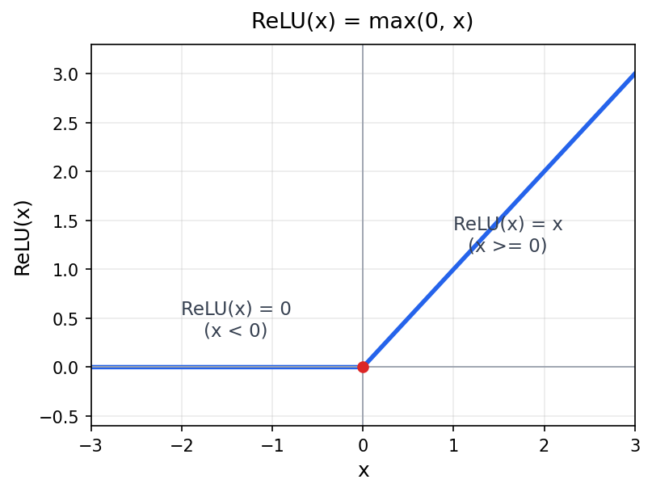
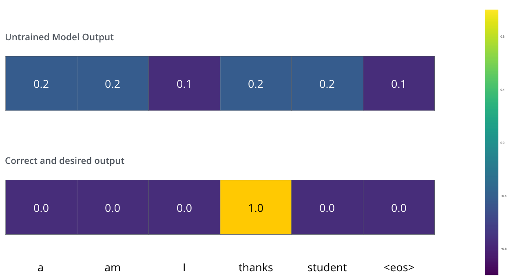
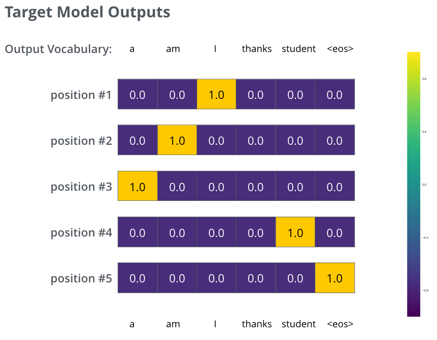

# 完整的一层：把零件拼成 Transformer

> 2026-08-25 · 2026-08-27 增补第四部分（输出头 / 训练目标 / 解码策略）· 基于 Vaswani et al. 2017《Attention Is All You Need》+ CS224N（2025 Winter）+ 后续工作（Pre-LN、GELU 等）
>
> **前置知识**：`01-attention.md`、`02-self-attention.md`、`03-multihead-position.md`。前三篇分别讲完 attention 机制、self-attention、multi-head + 位置编码，手上已凑齐一个"让每个词看到整句话、并按顺序加权"的零件。本篇把它拼成**完整的一层**（FFN、残差 + LayerNorm、叠层 + decoder），再一路补到"开口"（输出头、训练目标、解码策略）——从零件到一台能生成词的机器。

---

## 0. 承接：零件齐了，还差三样

回看前三篇攒下的东西：

- **第二篇**给了 self-attention：每个词的输出是 $V$ 的加权和 $\sum_j \alpha_{ij}v_j$，让词与词"交流"。
- **第三篇**给了 multi-head（把注意力预算复制成 $h$ 份，同时看多种关系）和 position encoding（补上顺序）。

但把这几样拼起来，得到的**还不是**一个能用的 Transformer 层。缺三样，每一样都对应一个真实的失败：

1. **非线性**：self-attention 的输出是 $V$ 的**加权和**，本质是线性的——得加非线性，否则叠多少层都等价于一个大线性映射。
2. **稳训练**：层要叠到 6~12 层，梯度会消失/爆炸、数值会漂——得加残差和归一化。
3. **成架构**：单层不够，要叠 $N$ 层；而且生成式任务（翻译、续写）需要一个**不能偷看未来**的 decoder。

本篇按这个顺序，先补 FFN，再补残差 + LayerNorm，最后拼出 encoder–decoder 完整结构。拼完之后机器还不会"开口"——从向量到词、怎么训练、怎么解码，是**第四部分**的事，本篇末尾一并讲完。

---

## 第一部分：FFN（前馈网络）

> **FFN = Feed-Forward Network（前馈网络）**。原论文的全称是 "Position-wise Feed-Forward Network"——"position-wise（逐位置）"正是 §4 要讲的重点：每个位置独立、参数共享。平时大家都简称 FFN。

### 1. 问题：attention 只会"聚过来"，不会"加工"

attention 干的事是**加权求和**：把其他词的信息按注意力权重聚过来。这个操作对 $V$ 是**线性**的：

$$
\text{Attention}(Q,K,V) = \text{softmax}\!\left(\frac{QK^\top}{\sqrt{d_k}}\right)V
$$

multi-head 是把 $h$ 个这种线性结果拼起来再过一个线性 $W^O$——**还是线性**。

这里有个容易踩的误区，得先讲清楚：**softmax 不是非线性的吗？** 是，但 softmax 的非线性作用在**权重** $\alpha$ 上（把分数归一化、制造竞争），作用完之后，输出 $\sum_j \alpha_j v_j$ 对 $v$ 依然线性。换句话说，attention 的非线性是"**决定怎么加权**"的非线性，不是"**加工每个特征的数值**"的非线性。

于是问题来了：一层只有线性变换，$N$ 层线性变换叠起来还是一个线性变换（矩阵乘法可合并），表达能力上不去，学不出语言里大量**非线性**的组合关系（"非常 + 好"不等于"好"的简单缩放）。需要给每层补一个**逐位置的非线性**，把 attention 聚过来的信息"加工"一下。

### 1.5 哪里线性、哪里非线性：UAT 与归纳偏置

讲到这里，你可能会搬出 Nielsen 书里的**通用近似定理（UAT）**反问：一个隐藏层 + 足够多神经元 + 非线性激活的 MLP，能逼近**任意**连续函数——那还纠结"哪里线性、哪里非线性"干什么？这一步值得单独澄清，因为它是"架构设计"和"表达能力"的分水岭。

**先拆误解：UAT 保证的是"存在"，不是"好找"。** UAT（Cybenko 1989 / Hornik et al. 1989）说的是"存在一个足够宽的 MLP 能逼近任意连续函数"，但它没保证四件事：① "足够宽"可能是**天文数字**（指数级）；② 需要**海量数据**才学得出来；③ 梯度下降**未必找得到**那个解；④ 找到的解**未必泛化**。所以 UAT 回答的是**表达能力的天花板**（能不能），不是**学习效率**（好不好、省不省、泛不泛）。

**"哪里线性、哪里非线性"的本质 = 归纳偏置。** 架构把非线性放在 FFN、让 attention 保持线性，是在往网络里**注入归纳偏置**——预先告诉网络"你要解的这类问题，结构长这样"。纯 MLP 没有任何关于"序列、词与词对齐、位置"的先验，得从零学"两个词怎么相关"；而 `QK^T softmax V` 这个结构**本身就把"元素按相似度动态对齐"焊进了架构**。这不是"能拟合更多函数"（UAT 说都能），而是"用对的结构，让拟合变便宜"。

**分工的依据，是两种操作的数学性质：**

- **线性（矩阵乘法、加权求和）= 无损的路由。** 线性变换可逆、保结构：只要矩阵满秩，信息从一个空间搬到另一个空间**不丢失**。attention 的加权和 $\sum_j \alpha_j v_j$ 是线性——它的职责是"把别的词的信息按比例聚过来"，聚合天然就该无损、可叠加。
- **非线性（ReLU、tanh）= 塑造 / 选择 / 压缩，引入"拐弯"但会丢信息。** ReLU 是"留正丢负"，tanh 是"压到有界"。它们让网络表达特征间的非线性组合，代价是**不可逆地丢信息**。

于是两条铁律：

1. **attention 必须线性**——职责是"传递"，传递要无损；聚合处一旦加非线性，信息在几十层里一路衰减、扭曲，梯度也传不动。
2. **FFN 必须非线性**——职责是"塑造"，要引入拐弯；一旦 FFN 也纯线性，attention + FFN 叠 $N$ 层还是一个线性映射，深度作废，学不了任何非线性函数。

> 一句话：**线性管"传递"（无损路由），非线性管"塑造"（打破线性）。哪个位置放哪个，是被"这个位置在传递还是在塑造"逼出来的，不是随便摆的。**

**回头再补一个妙点：attention 里其实藏着非线性。** softmax 确实是非线性，但它在**权重** $\alpha$ 上（决定"关注谁、取多少"），而**特征** $V$ 上保持线性加权和（保证"取来的信息无损"）。也就是"**非线性地选、线性地取**"——和上面是同一条逻辑：选择是塑造（可以非线性、可以有取舍），聚合是传递（必须线性、必须无损）。

**收束：架构设计 = 用归纳偏置，去置换 UAT 里"加宽"的代价。** UAT 告诉你天花板是"任意函数"，但没告诉你怎么便宜地爬上去。纯 MLP 靠"加宽"来逼近任意函数（蛮力）；Transformer 靠"对的结构"（attention 的对齐偏置 + FFN 的非线性塑造）来逼近同一族函数（设计）。前者要天文数字的参数和数据，后者用少几个数量级的参数就逼近了同一个天花板。

### 2. 方案：两层全连接夹一个非线性

论文的 FFN 极简，每个位置独立过一个两层的 MLP（Multi-Layer Perceptron，多层感知机——"感知机"是神经网络早期的叫法，这里就是**多层全连接网络**的意思）：

$$
\text{FFN}(x) = W_2\,\sigma(W_1 x + b_1) + b_2
$$

- $W_1$：升维投影，$d_{\text{model}} \to d_{ff}$
- $\sigma$：非线性，原论文用 **ReLU**
- $W_2$：降维投影，$d_{ff} \to d_{\text{model}}$
- 中间维度 $d_{ff} = 4 d_{\text{model}}$（论文 $d_{\text{model}}=512$ 时，$d_{ff}=2048$）

其中原论文用的非线性 $\sigma$ 是 **ReLU**：

$$
\text{ReLU}(x) = \max(0,\,x)
$$

函数图像是一个"折角"——负半轴被抹成 0，正半轴原样放行：



一句话：**ReLU 就是"负数抹 0、正数放行"，是最朴素的逐元素非线性**——正是 §1 说的"加工每个特征数值"的能力。

结构就是"**升维 → 非线性 → 降维**"。为什么是这个形状，下一节讲。

### 3. 为什么中间放大 4 倍

先升到 $4d$，在宽空间里做非线性，再降回 $d$。直觉是：**给非线性腾出足够的"容量"去组合特征**。在 $d$ 维里，ReLU 每个单元只能开/关一个方向；升到 $4d$ 后，有 $4d$ 个 ReLU 单元同时工作，能表示更丰富的逐元素非线性映射，最后 $W_2$ 把它们压缩回 $d$ 维。

这个"先膨胀再收缩"的瓶颈结构，很像 autoencoder 的中间层——宽度决定了这一段"加工"能多复杂。

> **诚实的标注：4 倍不是定理，是经验值。** 论文选 $4\times$ 是调出来的，不是有什么数学必然。后来的实践里 $2\times$、$8/3\times$（SwiGLU 里常用）、$8\times$ 都有。真正被普遍保留的不是"4"，而是"**升维 → 非线性 → 降维**"这个形状——升维是非线性有发挥空间的必要条件。所以这一节的标题不是"为什么是 4 倍"，而是"为什么升维"。

### 4. position-wise：逐位置加工，跨位置交给 attention

一个关键细节：FFN 是**逐位置（position-wise）**的——对每个位置 $i$，它的 FFN 只吃自己的向量 $x_i$，不看别的位置；但**所有位置共享同一套 $W_1, W_2$**。

这带来一个漂亮的分工：

| 谁 | 干什么 | 方向 |
|---|---|---|
| **attention** | 跨位置的交流：把别的词的信息聚过来 | 位置 → 位置（横着） |
| **FFN** | 单位置的加工：把聚来的信息做非线性变换 | 特征 → 特征（竖着） |

一句话：**attention 负责"消息传递"，FFN 负责"逐点处理"。** 信息先靠 attention 横向流通，再靠 FFN 在每个位置上纵向加工。这也是为什么两层缺一不可——只 attention 没非线性，只 FFN 没跨位置交流（就退化成对每个词的独立 MLP，和没 attention 一样）。

### 5. 现代变体：ReLU → GELU → SwiGLU

原论文用 ReLU。后来的演进（这条线你现在有印象就行，等学 GPT/LLaMA 时再展开）：

- **GELU**（Hendrycks & Gimpel 2016）：$\text{GELU}(x) = x\,\Phi(x)$，比 ReLU 更光滑，BERT、GPT-2 用它。
- **SwiGLU**（Shazeer 2020）：把"非线性"和"门控"结合，$\text{SwiGLU}(x) = xW \otimes \text{SiLU}(xV)$，LLaMA 等现代模型基本都换成了它。

方向一致：都在**换一个更好的逐元素非线性**，FFN 的"升维 → 非线性 → 降维"骨架不变。

---

## 第二部分：残差连接 + LayerNorm

### 6. 问题：层一深，训练就崩

Transformer 的 encoder/decoder 各叠 6 层（论文），后来的模型几十上百层。深网络有两个老毛病：

1. **梯度消失/爆炸**：反向传播时梯度要连乘各层的导数，层一多，连乘结果要么趋近 0（消失，学不动）、要么爆炸（发散）。
2. **数值漂移**：信号经过几十层变换，幅值分布逐渐偏离，中间表示变得"不像样子"。

这两点不解决，6 层都训练不稳，更别提叠深。解决办法就是一组经典搭配：**残差连接 + LayerNorm**，每个子层（attention 或 FFN）后面都接一套。

### 7. 残差连接：一条旁路，救梯度

每个子层不再是 $y = \text{Sublayer}(x)$，而是：

$$
y = x + \text{Sublayer}(x)
$$

（原论文里还套一层 LayerNorm，下一节统一讲；这里先看残差本身。）

**为什么这条旁路能救梯度？** 对 $x$ 求导：

$$
\frac{\partial y}{\partial x} = I + \frac{\partial\,\text{Sublayer}(x)}{\partial x}
$$

关键在那个**恒等项 $I$**（注意：$I$ 是 $d\times d$ 的**单位矩阵**，不是标量 1）：不管子层自己的梯度 $\partial\text{Sublayer}/\partial x$ 多小（趋近消失），总梯度里**至少保底一个单位矩阵 $I$**——它的对角元都是 1，意味着每个分量都能以 1 倍沿旁路直接回传，梯度不会整体消失。所以信号和梯度都能沿这条旁路**直通**地传过很多层，子层只需学"对 $x$ 的**增量**修正"，而不是"从头重建整个表示"。

用你熟悉的话：残差就是一条 **bypass 通路**——就像处理器里关键路径旁加的转发/旁路线，主电路坏了（梯度消失）也不至于全线瘫，因为信号能绕过去。而且它把学习目标从"学 $F(x)$"改成"学残差 $F(x) = H(x) - x$"——当最优映射接近恒等时，学残差比学完整映射容易得多（这就是 ResNet 的原初动机）。

> 残差连接不是 Transformer 的发明，是 **ResNet（He et al. 2016）** 的，Transformer 借来用它稳住深网络。

### 8. 归一化：把"飘掉"的数值拉回标准形状

§7 的残差解决了"梯度传得下去"，但 §6 提的第二个病还没治：**数值别飘**。这一节先讲清"飘"到底是什么病、为什么"归一化"是对的药，最后再回答"为什么是 LayerNorm 而不是更早的 BatchNorm"。

**先看"飘"长什么样。** 一个中间向量里的数，本该待在 $[-1,1]$ 附近。过一个子层，变成 $[-5,5]$；再过一层，$[-50,50]$；叠 10 层，$[-10^8,10^8]$。这就是**数值漂移**——信号的尺度，随着层数越走越偏，离"正常值"越来越远。

**为什么飘？因为层是"乘"在一起的，不是"加"在一起的。** 每一层本质是一个线性变换（矩阵乘）+ 非线性。只看线性部分：$y = Wx$，尺度过一层就乘一个因子 $\lambda \approx \|W\|$（$W$ 的**算子范数**）。层与层之间是这些因子**连乘**，$N$ 层后的总尺度是 $\lambda_1 \lambda_2 \cdots \lambda_N$。而连乘对"偏离 1"是指数敏感的：每层只放大 10%（$\lambda = 1.1$），12 层后是 $1.1^{12} \approx 3.1$ 倍，50 层后 $1.1^{50} \approx 117$ 倍；反过来每层缩 10%（$\lambda = 0.9$），100 层后 $0.9^{100} \approx 2.7\times10^{-5}$，信号直接归零。所以问题不是"哪一层坏了"，而是 **$0.99$ 和 $1.01$ 看起来都"接近 1"，连乘几十次后一个变成 0.37、一个变成 2.7，差出 7 倍**——深度就是放大器，把每层微小的尺度偏差指数放大。

**补一个术语：算子范数。** $\|W\|$ 是 $W$ 作为线性变换的**最大放大倍数**——$\|W\|=\max_{x\neq 0}\frac{\|Wx\|}{\|x\|}$，也等于它的**最大奇异值**。奇异值来自 SVD（奇异值分解）：任意矩阵都能拆成 $W=U\Sigma V^\top$（旋转 → 缩放 → 旋转），$\Sigma$ 对角线上那排非负数 $\sigma_1\ge\sigma_2\ge\cdots\ge0$ 就是奇异值。几何上，把单位圆（所有长度为 1 的向量）丢进 $W$，出来是个椭圆，**奇异值就是椭圆各半轴的长**，最长那根 $\sigma_1$ 就是最大放大倍数。之所以取"最大"（而非某种平均），是因为要防的是**最坏方向**上的漂移，$\|Wx\|\le\|W\|\cdot\|x\|$ 正好给出这个最坏上界。小例子：$W=\begin{pmatrix}2&0\\0&0.5\end{pmatrix}$ 本身就是 SVD 的"缩放"那步（$U=I$、$V^\top=I$），把 $x$ 方向拉成 2 倍、$y$ 方向压成 0.5 倍，奇异值就是 $2$ 和 $0.5$，$\|W\|=2$。

那为什么每层的 $\lambda$ 不是恰好 1？两个原因：

1. **线性层天生 $\|W\| \neq 1$**：$\|W\|$ 是随机条目的连续函数，是个**连续随机量**，随机初始化时恰好等于 1 的概率是 0；更扎心的是，$d\times d$ 纯随机矩阵（各条目独立 $\mathcal N(0,1)$）的 $\|W\|$ 数量级约 $2\sqrt{d}$——$d=512$ 时约 45，一叠就爆。所以 Xavier/He 初始化才把条目缩放到 $\sim 1/\sqrt{d}$（本意是让方差大致守恒），顺带把 $\|W\|$ 拉回 1 附近——但只是"附近"、只在初始时刻、还只是平均意义。
2. **训练会动权重**：梯度更新把 $W$ 往任意方向推，没有机制约束它保持单位尺度。

所以"恰好稳定"是**刀尖上的平衡**：要几十层不漂，需要每层 $\|W\|$ 都精确等于 1、且每个非线性恰好不改变方差——任何一次梯度更新都会把它推倒，然后指数偏离。

**漂了为什么致命？因为深度网络是"靠非线性工作"的，而非线性对输入的尺度极敏感。** 两个具体后果：

1. **非线性饱和失效。** ReLU 在 $[-1,1]$ 附近能正常"留正丢负"；一旦输入全是 $10^8$ 这种大正数，它就只剩"全放行"，非线性形同虚设。softmax 更脆——$e^{10^8}$ 直接溢出到无穷，输出变 NaN，训练当场崩掉。
2. **一个学习率养不活所有层。** 训练靠"固定学习率 + 梯度下降"，它隐式假设各层的**梯度量级**差不多。可一旦数值漂移，梯度量级也跟着漂——梯度是反传时乘过各层激活算出来的，激活漂成 $10^6$ 倍，梯度也就差出好几个数量级。同一个学习率就顾此失彼：对**梯度大的层**，学习率太大，一步跨过头、直接爆炸（发散）；对**梯度小的层**，学习率又太小，只是毛毛雨、根本学不动。

**所以病根不是"数值变了"，而是"数值失去了一个稳定、统一的尺度"。** 归一化之所以是对的药，是因为它不阻止数值变（也阻止不了），而是**每过一层，就把数值强行拉回一个标准形状**。对一个向量 $x = (x_1,\dots,x_d)$，先减它的**均值** $\mu$（"平均多大"），再除以它的**标准差** $\sigma$（"波动多大"）：

$$
\hat{x} = \frac{x - \mu}{\sigma},\qquad
\mu = \frac{1}{d}\sum_k x_k,\quad
\sigma = \sqrt{\frac{1}{d}\sum_k (x_k - \mu)^2}
$$

得到的 $\hat{x}$ 恒有**均值 0、方差 1**——不管进来之前飘成什么样，出去都是这个标准形状。于是：**非线性永远在舒适区工作**（ReLU 该折就折，softmax 不会溢出），**每层面对的输入尺度一致**（梯度、学习率都稳）。

**但"标准形状"太死板，会抹掉模型想保留的尺度信息**——比如"这个词很重要"这种本该体现在数值大小里的信息。所以归一化后面还要跟一步：乘一个可学习的缩放 $\gamma$、加一个可学习的平移 $\beta$（都是逐维度的参数）：

$$
\text{LN}(x) = \gamma \odot \hat{x} + \beta
$$

意思是：**先拉回标准形状，再让模型自己决定"还想放大/平移多少"。** 这就是 LayerNorm 的完整公式，也是所有归一化层的通用套路。

> **术语补丁：这一步在代码笔记里被叫作「逐维仿射」。**
> - **仿射（affine）** = 线性变换 + 平移，通式 $y = Ax + b$。$b=0$ 时退化成纯线性变换；多了 $b$，原点就不一定映射到原点了，所以不叫"线性"而叫"仿射"。
> - **逐维** 限定的是那个 $A$：这里 $A$ 取**对角阵** $\mathrm{diag}(\gamma)$，即第 $c$ 维只乘自己的 $\gamma_c$、只加自己的 $\beta_c$，维与维之间不混合。写成 $\gamma \odot \hat{x} + \beta$ 就是对角的简写。
> - 若 $A$ 取满的 $d \times d$ 矩阵，就能混合维度（旋转、重组特征）——那**正是 `nn.Linear` 的活**。LayerNorm 故意只留对角版本，因为它的职责只是"把刚压掉的尺度还回去"，不该抢线性层的功能；顺带，对角只要 $d$ 个参数，满矩阵要 $d^2$ 个。
>
> 代码里 `nn.LayerNorm(d)` 的参数量就是 $2d$（$d$ 个 $\gamma$ + $d$ 个 $\beta$），初始 $\gamma = 1$、$\beta = 0$，也就是"出厂时这一步是恒等"。

**最后回答标题里的问题：为什么是 LayerNorm 而不是 BatchNorm？** 关键分歧在"算 $\mu,\sigma$ 时，那'一堆数'从哪取"——因为均值和方差是对"一堆数"定义的概念，你得先圈定这堆数的范围。一个序列有 $T$ 个词、每个词是个 $d$ 维向量（这 $d$ 个数就是它的**特征**）：

- **BatchNorm**（Ioffe & Szegedy 2015）：固定一个特征，跨**一整批样本**收集这个特征的值来算均值方差（"这个特征在整批数据里平均多大"）。它需要**一批样本**（batch，同时喂进去的一小批句子）当分母，batch 一小，统计量就不可靠。
- **LayerNorm**（Ba et al. 2016）：固定一个样本，跨**它自己的 $d$ 个特征**收集值来算均值方差（"这个样本自己内部的数平均多大"）。**单个样本就够，完全不依赖别人。**

Transformer 的场景是"句长不定、batch 常小"，BatchNorm 那套"跨样本统计"既不稳也没意义，所以选逐样本的 LayerNorm。附带一个好处：训练和推理是**同一个公式**，不用像 BatchNorm 那样训练时用 batch 统计、推理时换成全局滑动统计、还得额外维护状态。

一句话：**归一化解决"数值别飘"的思路，是"每过一层就拉回标准形状"，让非线性有舒适区、让学习率养得活所有层；LayerNorm 只是把这个"标准形状"定义在"单个样本自己身上"，从而不依赖 batch。**

**收尾：LayerNorm 也能帮反向传播吗？** 能，但要分清"直接 / 间接"。回忆反向传播，某层权重 $W$ 的梯度由两个因子乘出来：

$$
\frac{\partial L}{\partial W} = \underbrace{\delta}_{\text{误差信号}} \cdot \underbrace{a}_{\text{输入激活}}
$$

- **$a$（激活）由 LayerNorm 管**：把激活钉在 $\sim 1$，梯度里"激活"这一半就不漂——这是 LayerNorm 对反向传播的**间接**贡献（梯度正比于激活）。
- **$\delta$（误差）由残差连接管**：恒等项 $I$ 给误差一条不衰减的旁路，让它一路直通——这才是梯度能穿过很多层的**直接**功臣（§7）。

所以 §7 和 §8 是两个独立的病、两副独立的药，只在"梯度"这个量上汇合：**LayerNorm 管"数值/激活"（前向 + 梯度的 $a$ 因子），残差管"通路"（梯度的 $\delta$ 因子）。** 只留一个都不行——只有 LN 没残差，激活稳了但误差传几层就没了；只有残差没 LN，误差能通但激活（连同梯度量级）会漂到饱和/爆炸。

### 9. Post-LN vs Pre-LN：残差与归一化的顺序之争（现代最该记住的一点）

这一节是第二部分里"设计被挣来"味最浓的地方——**原论文的顺序，后来被证明不够好，被后人改掉了。**

先补一个容易被跳过的背景：**"残差"和"归一化"是两件独立的事**（§7 管残差、§8 管归一化），所以它们**谁先谁后，可以有两种摆法**。名字里的 Post / Pre，说的就是 LayerNorm 放在子层**之后**还是子层**之前**。

再补一个容易问错的问题：**LN 是和 ReLU 挨着放的吗？** 不是。LN 包的是**整个子层**，ReLU（FFN 里）和 softmax（注意力里）只是子层内部的零件，LN 在子层**外面**。所以"LN 在 ReLU 之前还是之后"就等价于下面这个 Post/Pre 的选择：**Pre-LN 里 LN 在激活函数之前**（先归一化，再进子层过 ReLU/softmax），**Post-LN 里 LN 在激活函数之后**（先过完子层、加残差，再归一化）。

- **Post-LN**（原论文，LN 放在加法**之后**）：子层输出和旁路 $x$ 先相加，加完再一起过 LN。

$$
y = \text{LayerNorm}\big(x + \text{Sublayer}(x)\big)
$$

- **Pre-LN**（GPT-2 起成为主流，LN 放在子层**之前**）：先把 $x$ 归一化，再送进子层，最后和原始 $x$ 相加。

$$
y = x + \text{Sublayer}\big(\text{LayerNorm}(x)\big)
$$

两条公式只差一个括号，但**旁路 $x$ 的位置变了**：

```
Post-LN：  x ──► [ x + Sublayer(x) ] ──► LayerNorm ──► 输出   ← 旁路被 LN 罩在里面
Pre-LN ：  x ──► LayerNorm ──► Sublayer ──► [ + x ] ──► 输出   ← 旁路绕在 LN 外面
```

这一字之差，是两者行为天差地别的根源。

**为什么 Post-LN 会出问题？** 回到 §7 的核心：残差旁路的全部价值，在于给梯度一条**干净的恒等通路**（$\partial y/\partial x$ 里的那个 $I$），让梯度能直通很多层而不衰减。但 Post-LN 把 LN 罩在了旁路**外面**——于是梯度回传时，连旁路也要穿过 LN。而 LN 的导数是一个约等于 $1/\sigma$ 的缩放（输入波动越大、$\sigma$ 越大，缩得越狠，$\sigma$ 就是 §8 里那个标准差）。结果：**越靠近输出的层，回传时穿过的 LN 越少、被缩得越轻，梯度越大；越靠近输入的层，穿过的 LN 越多，梯度越小。** 各层梯度严重不均，训练一开局，靠近输出的几层梯度就爆掉、直接发散。

**当时的补救：warmup（学习率预热）。** 就是训练最开始的一小段（几千步），不直接用目标学习率，而是从一个极小值**逐步线性加大**到目标值——先小步走，等各层数值和梯度稳定下来，再放开跑。Post-LN 得靠精心调这个 warmup 才能训起来。

**为什么 Pre-LN 更好？** 它把 LN 挪到子层的**输入**上，让旁路 $x$ **绕在 LN 外面、原样直通**。于是：

- 旁路的梯度回传时，重新变回 §7 承诺的**干净恒等 $I$**，不再被任何 LN 缩放——各层梯度量级**均匀稳定**；
- 每个子层看到的输入都是"标准形状"（LN 管好了子层的伙食），注意力、FFN 都在舒适区里算；
- 于是**不再需要 warmup**，训练更稳、更好调。

> **诚实标注（这是一条很好的教训）：** 原论文的 Post-LN 是"当时能跑、但不是最优"的选择；Pre-LN 是社区后来发现并修好的（Xiong et al. 2020 系统论证）。它说明 Transformer 的很多设计**不是一蹴而就的定稿，而是持续被后人的工程实践修正**——现在几乎所有大模型（GPT-2/3、LLaMA、BERT 的后继）都用 Pre-LN。你读原论文时看到的顺序，和今天实际用的，已经不一样了。

---

## 第三部分：叠 N 层 + decoder

### 10. 完整的一层：encoder 长什么样

把前两部分拼起来，一个 encoder 层就是两个子层，各带一套残差 + LayerNorm：

```
输入 x
  │
  ├─► Multi-Head Self-Attention ──┐
  │                               ├─► 相加 → LayerNorm ──► x'
  └───────────────────────────────┘
  │
  ├─► FFN ───────────────────────┐
  │                              ├─► 相加 → LayerNorm ──► 输出
  └──────────────────────────────┘
```

（这是 Post-LN 的画法；Pre-LN 只是把 LayerNorm 挪到每个子层**之前**，主干不变。）注意两点：**每个子层都有残差**（不只 attention），**两个子层的维度都是 $d_{\text{model}}$**——全程不改变维度，所以层与层之间能直接首尾相接。

**还差一个零件：Dropout。** 上面这个"完整的一层"其实还没画全——原论文里，每个子层不是简单的"相加 → LayerNorm"，而是：

```
LayerNorm(x + Dropout(Sublayer(x)))
```

**Dropout（随机失活）** 是训练时的一个随机动作：每一步以概率 $p$（论文设 $p=0.1$）把某些神经元的输出随机**置 0**，等于每步随机丢掉一些零件、只让剩下的网络干活。这样网络没法只靠某一条固定通路——那一路一被丢就得崩——于是被迫学出**冗余**。这是对付**过拟合**（只会背答案、不会举一反三）的手段。

注意它跟残差、LN 解决的**不是同一个问题**：残差管"梯度通路"、LN 管"数值尺度"、dropout 管"泛化 / 防过拟合"，三者各管一摊，才一起挤在那短短一行里。

原论文里 dropout 套在**三个地方**：① 每个子层的输出（就是上面那行）；② 注意力权重上（softmax 之后、乘 $V$ 之前）；③ 最输入端，embedding + 位置编码相加之后。**推理时 dropout 关掉**、直接用完整网络——所以它只影响训练，不影响最终模型的样子。

### 11. 为什么叠 N 层

单层能学的关系有限。叠 $N$ 层（论文 $N=6$）后，形成**逐层抽象**：低层学局部语法、短距离搭配，高层学长程依赖、更抽象的语义。这是深度学习的通用逻辑——**深度 = 表示逐层变得更高阶**。Transformer 的特别之处在于：因为每层维度不变、又靠残差稳住了梯度，所以它能比 RNN 更放心地叠深。

### 12. decoder 与 encoder 的三个不同

decoder 也是同样的"attention + FFN + 残差/LN"骨架，但有三处不同，都是为了同一个目标：**自回归生成——从左到右，一个词一个词地吐**。

| | encoder | decoder |
|---|---|---|
| **self-attention** | 每个词能看到**整句**（双向） | **只能看到左边**（单向，masked） |
| **cross-attention** | 没有 | 有——Q 来自自己、K/V 来自 encoder |
| **输出** | 一组上下文表示 | 逐位置预测下一个词 |

### 13. masked self-attention：不能偷看未来

生成时，第 $t$ 个词是**一个个依次**预测出来的。预测位置 $t$ 时，模型手里只该有 $1\dots t$（左边）的词——**绝不能看到 $t+1$ 之后的答案**，否则就是作弊（也学不会生成）。

但 self-attention 天然是"每个词看整句"（第二篇讲的），它会看到未来。于是 decoder 的 self-attention 加一道 **mask**：在 softmax 之前，把分数矩阵 $QK^\top$ 里"未来位置"的那些格子设成 $-\infty$：

$$
\text{softmax 前：}\quad
\begin{pmatrix}
q_1k_1 & -\infty & -\infty \\
q_2k_1 & q_2k_2 & -\infty \\
q_3k_1 & q_3k_2 & q_3k_3
\end{pmatrix}
$$

softmax 后，$e^{-\infty}=0$，未来位置的注意力权重**变成 0**——位置 $i$ 只能 attend 到 $1\dots i$。这样既保留了 attention 的"看左边"，又堵死了"看右边"。

> 一个直觉检验：mask 是对 $QK^\top$ 的**上三角**置 $-\infty$（因为行是 query、列是 key，第 $i$ 行、第 $j>i$ 列就是"query i 去 attend 未来的 key j"）。掩码矩阵是固定的下三角结构，不参与训练。

### 14. cross-attention：decoder 怎么"看"encoder

decoder 只靠自己生成还不够——翻译时，它得能"看"源语言那句已经 encode 好的整句话。这就是 **cross-attention**，也是 encoder 和 decoder 之间的**唯一连接点**。

它的结构还是那个 attention，但 Q、K、V 的**来源**不同了：

- **Q**：来自 decoder **自己**前一层的输出（"我现在要生成的这个词，想去查点什么"）
- **K、V**：来自 **encoder** 的最终输出（"源语言那句话里每个词的信息"）

所以 cross-attention 的语义是：**decoder 拿着自己的"查询"（Q），去源句（encoder 的 K/V）里检索它此刻需要的上下文。** 这就是第一篇（Bahdanau attention）那个"解码器回头看源句"的思想，在 Transformer 里的现代形态——第一篇里 decoder 每一步回头看的 $h_j$，到这里就是 encoder 整句输出的 K/V。

（顺带把三篇串起来：第二篇的 self-attention 是 **Q=K=V 都来自同一处**；本篇的 cross-attention 是 **Q 来自 decoder、K/V 来自 encoder**。第一篇预告的"attention 三种用法"，到这里齐了。）

### 15. 完整 encoder–decoder 结构

拼起来的 Transformer：

- **encoder**：$N$ 个 §10 那样的层（self-attention + FFN，双向、无 mask）。
- **decoder**：$N$ 个层，每层是 **masked self-attention → cross-attention → FFN**，各带残差 + LayerNorm。
- **连接**：encoder 最后一层的输出，作为 K/V 喂给 decoder **每一层**的 cross-attention。

翻译时：源句进 encoder → 得到整句表示；decoder 从左到右逐个生成目标词，每个词先用 masked self-attention 看自己已生成的左边，再用 cross-attention 看源句，最后 FFN 加工、预测下一个词，如此循环直到吐出终止符。

---

## 第四部分：从"理解"到"开口"——输出头、训练、解码

§15 把 encoder–decoder 拼成了整台机器，但停下来看，它其实还停在"预测下一个词"这一步——**没回答三件事**：

1. **怎么从向量变成一个词？** decoder 最后一层吐出来的是 $d_{\text{model}}$ 维向量，我们要的是一个词。这一步有专门的名字：**输出头（output head）**。
2. **怎么知道它选得对不对？** 训练时，得有个"目标"和"损失"来告诉模型往哪改。
3. **真到了生成，每步怎么挑词？** 是每步取最大，还是有别的玩法？

这三件事，是前面"为什么这样设计"的**最后一环**——把"理解的机器"变成"能开口的机器"。（本节原在 `06-illustrated-transformer.md` 第二部分/第三部分，现并入本篇，让"完整的一层"一路讲到"说出一个词"。）

### 16. 输出头：Linear → logits → softmax → 选词

decoder 最后一层吐出来的是一个 $d_{\text{model}}$ 维向量（表示"我现在想表达的这步"）。但我们要的是**一个词**。词从哪来？从**词表**里挑。于是：


> 图注（修改自 Jalammar）：从下往上看——蓝色的 `Decoder stack output` 是 last decoder 层的 $d_{\text{model}}$ 维向量；过 `Linear` 层后变成 **logits**（横排一格一个词，共 `vocab_size` 格，每格一个"这个词合不合适"的分数）；再过 `Softmax` 变成**概率分布**（每格 0~1，全行和为 1）；最后 **argmax**——取概率最大的那一格的下标（这里下标 5），到词表里查出对应的词，就是 `am`。

一步步看每一步在干什么、为什么：

1. **Linear（$d_{\text{model}} \to \text{vocab\_size}$）**：把隐藏维向量映射到一个"词表空间"。本质上是一张**可训练的表**：词表里每个词占一列，这一列和隐藏向量点积，就得出"这个词在我此刻的语境下有多合适"。
   - **关键：size 大幅变化**。$d_{\text{model}}=512$，词表可能 $10^4$ 甚至 $26$ 万——这一步是**从隐藏空间的窄口，撑到词表的宽度**。输出头是全模型里数一数二的"大"矩阵（参数 $d_{\text{model}}\times\text{vocab\_size}$）。
   - 它很像"**反向的 embedding**"：embedding 把**词**映射成**隐藏向量**（词表 → 隐藏），输出头把**隐藏向量**映射回**词的分数**（隐藏 → 词表）。方向正好反过来。（这一对能共用同一份权重来省参数，是"weight tying"，**属阶段 5**，此处只留个印象。）

2. **logits**：Linear 出来的一串数，**没有归一化**，叫 **logits**。它可以有任何值，正的负的、很大很小——它只是"未归一化的打分"。
   - 这些 logits 一旦 `exp` 再归一化，就是概率。之所以保留 logits 而不直接 softmax，是因为**生成时还要在 logits 上做采样**（采样策略留到后面生成/手写阶段再展开）。

3. **Softmax**：把 logits 压成和为 1 的概率分布。**每一格对应词表里一个词的"此刻被选中的概率"**。

4. **argmax**：取概率最大那格的下标 → 查词表 → 得到这一步吐出的词。

> **一句话**：输出头就是"**把一堆隐藏维的实数，翻译成一个词**"。它是整台机器的"**发声器官**"——encoder–decoder 把意思算好了，靠这一步才真正说出口。

### 17. 训练目标：让模型的分布贴近"这一个"词

训练时，模型对每个输出位置会给出一整个**分布**（软），而正确的答案是**一个词**（硬，one-hot）。损失要做的事：**让模型的分布在这一个词上集中**。

看两个图合起来理解：

未训练的模型，输出是**平铺**的——每个词概率差不多，不知道该选谁：



> 图注（修改自 Jalammar，词汇表 = {a, am, I, thanks, student, <eos>}）：上半"Untrained Model Output"——每个词概率都在 0.1~0.2 之间，**平得没法做主**。下半"Correct and desired output"——正确答案是 "thanks"，1.0 压死在那格。损失就是比这上下两行差多远。

训练好后，目标分布是**一排 one-hot**（每个位置正确答案那格 = 1，其余 = 0）：



> 图注（修改自 Jalammar，same 词汇表）：这是**目标**（label）长什么样——翻译 `merci → thanks` 时，position #1 该吐 "I"、#2 该吐 "am"、#3 "a"、#4 "student"、#5 "<eos>"，每个位置都是**一个 1.0、其余 0.0** 的 one-hot。

- 训练目标就是：**让模型每一步吐出的概率分布，尽量逼近这个 one-hot 目标**。衡量"两个分布差多远"的常用量是**交叉熵（cross-entropy）**，此处不展开，只需知道"接近 one-hot = 损失小"。
- 训练时每一步的损失算完，沿着整条网络反向传播，去调所有能调的权重（attention、FFN、输出头……）。这就是"训练"：把"平摊的、谁都敢选"的分布，一步推成"只在正确答案上集中"的分布。

> **一个有用的 softmax 性质**：训练好的模型，即使正确词占大头，**其他词仍留一点小概率**（不是严格的 0）。这不是毛病——它让模型保持了一点"不确定性/泛化空间"，这也是为什么后面能靠"采样"（而不是死板的 argmax）玩出花样（见 §18）。

### 18. 解码（生成）时：greedy 还是 beam search？

训练完，模型要**一个词一个词地生成**，但每一步从分布里怎么挑？两种策略：

| 策略 | 做法 | 特点 |
|---|---|---|
| **greedy（贪心）** | 每步都取概率最大的那个词 | 快、省事；但只看当下，一步选偏后面就带偏 |
| **beam search（束搜索）** | 每步保留 N 条候选路径（N 个"束"），最后挑整体最优 | 更稳，但要算 N 份 |

beam search 的"束"就是"保留的候选序列数"：每步对已有的每条束，都试它所有可能的下一个词，然后**只留下总概率最高的 N 条**，继续下一步，直到吐 `<eos>` 或到长度上限。greedy 就是 N=1 的特例——差别只在"要不要为'以后'留退路"。

举个具体例子（beam = 2，仿 Jalammar 的玩具词表）：

```
第 1 步  第一个词取 top-2 作两条束：
          "The" 0.50
          "A"   0.40

第 2 步  每条束展开"下一个词"，算整条序列的概率，全局再取 top-2：
          "The"  ──►  "The dog"  0.30  ✓ 保留
                 └►  "The nice" 0.15  ✗ 裁掉
          "A"    ──►  "A dog"    0.32  ✓ 保留
                 └►  "A car"    0.06  ✗ 裁掉
```

注意：第一个词 "The"(0.50) 比 "A"(0.40) 更可能，但第 2 步里 "A dog"(0.32) 反而排到了 "The dog"(0.30) 前面——因为 beam 比的是**整条序列**的概率，不是"每一步单独取最大"。这正是 greedy（认准 "The" 一路走到黑）会错过、而 beam 靠"留退路"救回来的情况。

**关键：greedy / beam search 只在生成（推理）时用，训练时永远不跑**（训练是拿正确答案 one-hot 直接比，见 §17）。而 greedy 那套"每步取最大"容易重复、一条道走到黑，后面手写 nanoGPT 实现解码循环时，还会补上更聪明的采样策略。

---

## 19. 设计决策回顾

| 面对的问题 | 选择 | 为什么 | 淘汰/替代 |
|---|---|---|---|
| attention 是线性的，叠层也没非线性 | FFN：升维→ReLU→降维 | 补逐位置的非线性加工 | 只叠 attention（仍线性） |
| FFN 中间维度多大 | $d_{ff}=4d$ | 给非线性足够容量（经验值） | 不升维（非线性没发挥空间） |
| 层深了梯度消失/爆炸 | 残差连接 $x+\text{Sublayer}(x)$ | 梯度里的恒等项 $I$ 保底不消失 | 无残差（深了崩） |
| 数值漂移、batch 小、句长不定 | LayerNorm | 逐样本、不依赖 batch | BatchNorm（依赖 batch） |
| Post-LN 训练不稳 | Pre-LN | 梯度范数更稳，可去 warmup | Post-LN（原论文，后被改） |
| decoder 不能偷看未来 | masked self-attention | softmax 前把未来置 $-\infty$ | 无 mask（作弊/学不会生成） |
| decoder 要看源句 | cross-attention | Q 来自 decoder、K/V 来自 encoder | 只靠 decoder 自己 |
| 架构拼完了，怎么从向量吐出一个词 | 输出头：Linear → logits → softmax → argmax | 把隐藏维实数映射成词表概率、挑最大 | 只留 logits（未归一化，当不了概率） |
| 生成时每步怎么挑词 | greedy / beam search | 贪心省事、束搜索为"以后"留退路 | 只 argmax（greedy 的特例） |

---

## 20. 下一步

到这里，**Transformer 的完整架构**已经在你手上了：encoder–decoder 结构、self-attention / masked / cross 三种 attention、multi-head、position encoding、FFN、残差 + LayerNorm，全部零件和它们的"为什么"都过了一遍。

接下来按你的学习地图，是整条路线里**最重要的一步**——**阶段 4：Karpathy nanoGPT 手写实现**。把 Embedding → QKV → attention → LayerNorm → residual → FFN → sampling 全部自己写一遍。到那时，你前四篇攒下的"为什么这样设计"，会第一次在代码里变成能跑、能生成文本的东西。届时我们可以一句一句对着代码，把每个模块和这几篇的推导对上。

---

## 参考

- Cybenko, "Approximation by Superpositions of a Sigmoidal Function" (1989)；Hornik, Stinchcombe, White, "Multilayer Feedforward Networks are Universal Approximators" (1989) —— 通用近似定理（UAT）的原始出处（§1.5）
- Vaswani et al., "Attention Is All You Need" (2017) —— FFN（§3.3）、残差 + LayerNorm（§3.1）、decoder 的 masked / cross-attention（§3.2.3）的原始出处（[论文 PDF](papers/1706.03762.pdf)）
- He, Zhang, Ren, Sun, "Deep Residual Learning for Image Recognition" (CVPR 2016) —— 残差连接的出处
- Ba, Kiros, Hinton, "Layer Normalization" (2016) —— LayerNorm 的出处
- Ioffe & Szegedy, "Batch Normalization" (ICML 2015) —— 与 LayerNorm 对比
- Xiong et al., "On Layer Normalization in the Transformer Architecture" (ICML 2020) —— Pre-LN 优于 Post-LN 的系统论证
- Hendrycks & Gimpel, "Gaussian Error Linear Units (GELUs)" (2016) —— GELU 激活函数
- Shazeer, "GLU Variants Improve Transformer" (2020) —— SwiGLU
- [CS224N 2025 课程主页](https://web.stanford.edu/class/archive/cs/cs224n/cs224n.1254/)
