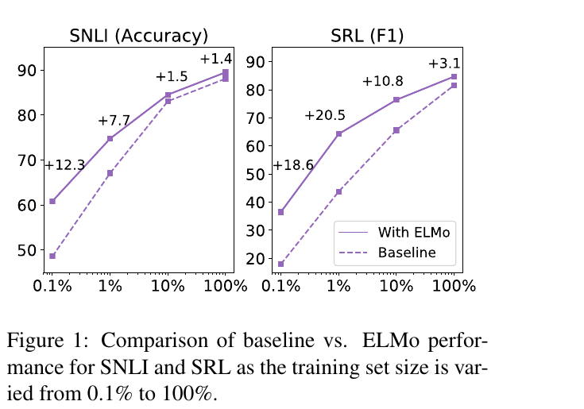
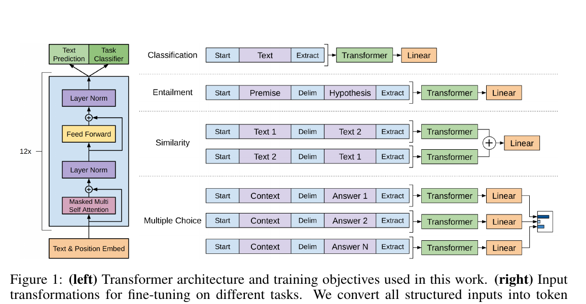

# 05-01 为什么要预训练

> 这一篇**不引入任何新的网络结构**。"预训练"不是一个新架构，它是一种**训练策略**——所有零件你在阶段 3、4 都见过了。

---

## 1. 先看两个数字

先不讲概念，看一组实验。

任务是语义角色标注（Semantic Role Labeling，SRL）：给定一句话和一个动词，标出"谁对谁做了什么"——施事、受事、时间、地点。这是个**标注**任务，每条训练样本都得人工标一遍。

2018 年有组对照实验，跑了两遍同样的任务：

| | 从零训 | 先预训练，再在目标任务上接着训 |
|---|---|---|
| 跑到最好成绩要多少轮 | **486 轮** | **10 轮** |
| 用 1% 的标注数据 | 基线 | ≈ 基线用 **10%** 数据的水平 |

两行都是论文里的原话，不是比喻。

- 第二行的读法：**预训练让 1% 的标注数据顶得上 10%**——标注成本砍到十分之一。
- 第一行更狠：**486 轮变 10 轮，少了 98%。**

再看幅度。同一篇论文里，把训练集规模从 0.1% 一路调到 100%：



*图：左为 SNLI（Stanford Natural Language Inference，斯坦福自然语言推理）的准确率，右为 SRL 的 F1 分数。实线是加了预训练的，虚线是基线。数据来源：Peters et al., 2018, Figure 1。*

图上标的是**加了预训练之后的提升**，把两条曲线的间距列出来：

| 训练集比例 | SNLI 提升 | SRL 提升 |
|---|---|---|
| 0.1% | **+12.3** | **+18.6** |
| 1% | +7.7 | +20.5 |
| 10% | +1.5 | +10.8 |
| 100% | +1.4 | +3.1 |

**数据越少，预训练越值钱。** 数据管够的时候（100%），多出来的也就 1.4 个点。

> **关于这篇论文，先说清楚一件事。** 它叫 ELMo，它的网络是**两层双向 LSTM**（Long Short-Term Memory，长短期记忆网络）。而 LSTM 在阶段 2 结尾被列成支线、没有讲过。
>
> 所以这一篇**只取它的实验结论，不讲它的结构**——它在这里的身份是一份**实验数据**，不是一个架构。凡是你需要理解的网络零件，这一篇里一个都不会超出你已经会的。

---

## 2. 矛盾的根源：标注贵，无标注免费

回到刚才那个任务。为什么"从零训"这么费劲？

因为标注数据**贵**。SST-2 是最常用的情感分类数据集之一，训练集 **67,349 条**，每一条都是人工标出来的。而你的 TinyStories 语料是 200 万字符，**零标注成本**，网上直接下。

> 好数据很贵，垃圾数据免费。

于是矛盾就很清楚了：

> **标注数据很少，但你想要的那个网络很大。**

这个矛盾就是预训练要解的东西。而解开它的钥匙，其实**你已经拿在手里了**。

---

## 3. 你已经做过一次预训练了

回头看阶段 4 你训的那个 mini-GPT。它当时是怎么训的？

- 语料是 TinyStories，2 MB——**一个字都没有标注**
- 目标是 next-token prediction：给定前文，预测下一个 token
- 从随机权重开始，跑 6000 步

**这就是预训练。** 你只是从来没管它叫这个名字。

区别只在于标签从哪来：

| | 情感分类 | 你的 mini-GPT |
|---|---|---|
| 输入 | 一句话 | 一段文本 $t_1, t_2, \dots, t_k$ |
| 标签 | "好评"/"差评" | **下一个 token，也就是 $t_{k+1}$** |
| 标签从哪来 | **人工标** | **语料里本来就有** |

第三行是关键。叫做**自监督**（self-supervised）：**标签不需要人来标，标签是数据自己给的。**

这句话要展开一下，因为它就是预训练的全部秘密：

- 位置 $k$ 的训练样本，输入是 $t_1, \dots, t_k$，标签是 $t_{k+1}$。
- 而 $t_{k+1}$ **本来就在语料里躺着**——不需要任何人做任何事，把句子往右错一位就是标签。
- 所以一句话有 50 个 token，就白送你 **50 个训练样本**。

对比一下：情感分类里，一条样本要人读一遍、标一个"好/差"。你的预训练里，**一个字符就是一个样本**。

> 于是"为什么要预训练"的第一层答案很朴素：
> **因为无标注的文本可以无限供应，而标注数据不能。**

---

## 4. 缺的不是预训练，是迁移

但这里有个问题。你那个 mini-GPT **已经训好了**，它为什么不能直接拿去做情感分类？

因为它只会一件事：给定前文，接下一个 token。你给它"这部电影太"，它接"好了"——**它没有"输出一个二分类标签"的接口。**

所以真正缺的东西叫**迁移**（transfer）：把一个任务上学到的东西，搬到另一个任务上去用。

### 为什么可以搬

阶段 1 你已经搬过一次了。word2vec 在无标注语料上训出一张表（每个词 → 一个向量），然后**把这张表冻住**，当作下游模型的输入。

看你自己的代码：

```python
self.wte = nn.Embedding(vocab_size, n_embd)   # code/mini_gpt_bpe.py:165
```

`nn.Embedding` 是什么？**就是一张查找表**：输入 token id，输出一行向量。同一个 token id 永远拿到同一行，跟它出现在哪句话、前面是什么词**完全无关**。

> **你的 `wte` 就是一张 word2vec 词表。**

8 月学的那套静态词嵌入，现在就躺在你 GPT 的第一行里。

### 但它只搬得动一层

为什么 2013 到 2017 年，大家只搬了**这一层**？

因为**这张表装不下上下文**。看 "bank"：

| 句子 | bank 的意思 |
|---|---|
| I sat on the river **bank**. | 河岸 |
| I went to the **bank** to deposit money. | 银行 |

word2vec 给这两句里的 "bank" **一模一样**的向量——训练时它把语料里所有的 "bank" 全**合并成了一行**。这不是"没训好"，是**这张表的结构里就装不下上下文**：一个词型（word type）只能存一行。

> 表能存的是"词是什么意思"，装不下"这个词**在这里**是什么意思"。

那真正带上下文的表示在哪？在你的 `self.blocks` 里（`code/mini_gpt_bpe.py:175`）——attention 让每个位置看到前面所有位置，**只有到那里面，那个向量才真正"知道自己在什么句子里"**。

于是问题变精确了：

> **`blocks` 里那份表示更值钱，怎么把整个网络都搬走？**

麻烦在于：搬一张查表很简单（复制一张表）。搬一个网络不行——网络的参数是**互相配合着训出来**的，第 2 层是为第 1 层的输出量身定做的，你没法只抠走中间某几层。

**要么整个搬，要么不搬。**

---

## 5. 两种搬法

BERT 论文开篇把这件事归纳成两条路，原文：

> "There are two existing strategies for applying pre-trained language representations to downstream tasks: **feature-based** and **fine-tuning**. The feature-based approach, such as ELMo (Peters et al., 2018a), uses task-specific architectures that include the pre-trained representations as additional features. The fine-tuning approach, such as the Generative Pre-trained Transformer (OpenAI GPT; Radford et al., 2018a), introduces minimal task-specific parameters, and is trained on the downstream tasks by simply fine-tuning all pre-trained parameters."

翻译过来就是：

| | **特征式**（feature-based） | **微调**（fine-tuning） |
|---|---|---|
| 预训练网络 | **冻结**，一动不动 | **不冻结**，一起训 |
| 下游要学的 | 一个任务模型（预训练网络的输出拼进它的输入）| 全部参数 + 一个很小的任务头 |
| 预训练网络的角色 | **特征提取器** | **起点** |
| 代表 | ELMo | GPT |

**微调**长什么样，GPT-1 论文的图 1 画得很清楚：



*图：来源 Radford et al., 2018, Figure 1。左边是 12 层 decoder-only Transformer（`Masked Multi Self Attention`，就是你阶段 3 学的那个因果 mask 自注意力，**和你手写的 `CausalSelfAttention` 是同一个东西**）。左上角两个输出头对应两个阶段：预训练用 `Text Prediction`，微调用 `Task Classifier`。*

看右边那栏——**这是微调这条路的全部意思**：

任务不同，就把输入**重排成一条 token 序列**（该插分隔符 `Delim` 就插），喂进**同一个**预训练模型，最后接一个 `Linear`（线性层 + softmax）。**除了那个线性层，没有为任何任务新设计任何零件。**

两种搬法，一句话说清区别：

> **特征式是"借用表示"，微调是"借用一个起点"。**

- 借表示的人，把预训练网络当**工具**用——它不变，你围着它搭。
- 借起点的人，把预训练网络当**毛坯**用——它整个都动，只是从"已经学过语言"的位置开始动，而不是从随机权重开始。

这个岔口后来是这样收场的：**特征式那条路输在了"没有调整机会"上**（05-02 §4 的冻结那一列，94.9 → 94.0），而微调这条路又被 05-03 的**上下文学习**从上面盖了过去——那是第三条路。这里先只记下这个岔口。

---

## 6. 小结

这一篇的链条：

1. **矛盾**：标注数据贵、无标注数据免费 → 想"先免费学、再便宜用"。
2. **你早就干过**：mini-GPT 就是一次预训练，自监督让标签白送。
3. **缺的是迁移**：你的模型只会续写，得把它学到的东西搬到别的任务上。
4. **迁移有两种**：冻结（特征式）和微调。为什么要整个搬，因为值钱的表示在网络深处，而网络不能拆着搬。

下一篇看 BERT，它走的是**微调**这条路。它要解决的第一个问题是：

> **你的 mini-GPT 只从左边看。想让它"左右都看"，目标函数该怎么改？**

这一改，逼出了三个很讲究的设计。

---

**参考**

- Peters et al., *Deep Contextualized Word Representations* (2018) —— 本篇第 1 节那组实验数据的出处（[arXiv:1802.05365](https://arxiv.org/abs/1802.05365)，本地 `papers/1802.05365.pdf`）。**只引实验结论，其网络结构本篇不涉及。**
- Devlin et al., *BERT: Pre-training of Deep Bidirectional Transformers for Language Understanding* (2018) —— 第 5 节"两条路"的原文出处（[arXiv:1810.04805](https://arxiv.org/abs/1810.04805)，本地 `papers/1810.04805.pdf`）
- Radford et al., *Improving Language Understanding by Generative Pre-Training* (2018) —— GPT-1，微调范式的起点（本地 `papers/gpt1-2018.pdf`）
- Mikolov et al., *Efficient Estimation of Word Representations in Vector Space* (2013) —— word2vec，见 `notes/01-word-vectors/01-word2vec.md`
