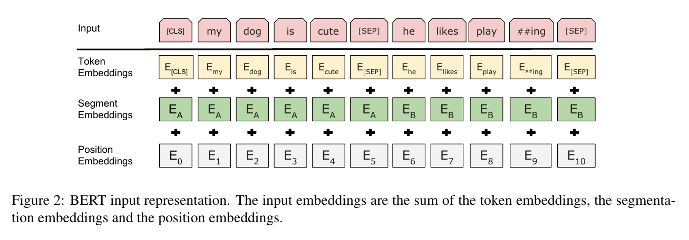
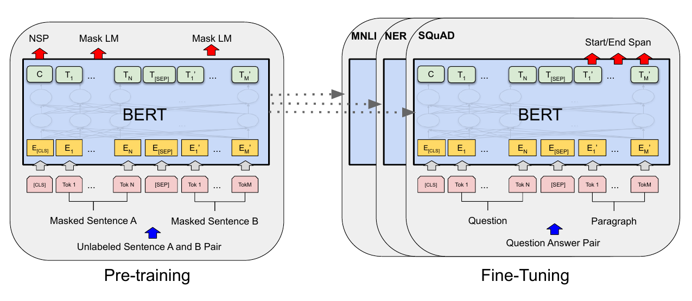

# 05-02 BERT：把目标函数换掉

> 上一篇结尾留了个问题：你的 mini-GPT **只从左边看**，想让它"左右都看"，目标函数该怎么改？
>
> 这一篇的答案是：改目标函数。**架构一行都不用动。**

---

## 1. 先说"只看左边"到底亏在哪

先定位一下 BERT 动的是链条上的哪一环：

```
下游任务做得好
  ← 微调接得上（比从零训便宜太多）          ← 05-01
  ← 预训练出来的表示好用                    ← 05-01
  ← 预训练的目标函数怎么设计                ← BERT 只动了这一环
```

预训练本身在 05-01 就解决了（你的 mini-GPT 就是）。BERT 论文原话是它要 "improve the fine-tuning based approaches"——**架构没动、微调方式没动、数据没动，只换了最底下那一环。**

那它在这一环上冒的风险，买的是什么？先看它想解决的那个问题。

你的 `CausalSelfAttention` 里有一行（`code/mini_gpt_bpe.py:104-105`）：

```python
self.register_buffer(
    'mask', torch.tril(torch.ones(block_size, block_size)).view(1, 1, block_size, block_size))
```

下三角 mask，位置 $i$ 只能看到位置 $\le i$。**这个 mask 是被目标函数逼出来的**：如果位置 $i$ 能看到 $i+1$，那要它预测的 $t_{i+1}$ 就明晃晃摆在输入里，直接抄就行了，什么也学不到。

所以：**next-token prediction 必须配因果 mask。** 这是它的前提，不是它的缺点。

但"理解一句话"的时候，这个限制就纯属亏了。看一组经典的指代消解（coreference resolution）例子：

| 句子 | "it" 指的是什么 |
|---|---|
| The animal didn't cross the street because **it** was too **tired**. | 动物 |
| The animal didn't cross the street because **it** was too **wide**. | 街道 |

决定 "it" 是动物还是街道的那个词——`tired` / `wide`——**出现在 "it" 后面**。

而因果模型在处理到 "it" 这个位置时，看到的是 "The animal didn't cross the street because"，**后面的词它一个都还没看见**。所以它没法把这两句里的 "it" 区分开。

注意这里信号的性质：`tired` / `wide` 在左边的输入里**根本不存在**。不是"信号弱"，是**零**。

> **有些任务的证据只存在于右边。对这类任务，单向不是"效果差一点"，是"根本做不到"。**

那能不能干脆把 mask 去掉？

---

## 2. 不能：去掉 mask 和 next-token 是互斥的

假设你现在做两件事：**去掉因果 mask** + **保留 next-token 目标**。

结果：位置 $i$ 能看到 $i+1$ 了，而位置 $i$ 的标签**就是** $t_{i+1}$。答案在输入里躺着。模型只要学会"把输入原样抄出来"，loss 就归零了——它学到的**只有恒等映射**，别的什么都不会。

BERT 论文（Devlin et al., 2018）§3.1 把这句话说得比我还直接：

> "standard conditional language models can only be trained left-to-right *or* right-to-left, since bidirectional conditioning would allow each word to indirectly 'see itself', and the model could trivially predict the target word in a multi-layered context."

所以矛盾是硬的：

> **"双向" 和 "预测下一个词" 不能同时要。**
> 想要双向，就必须换一个**不会因为看见答案而变平凡**的目标。

那这个目标怎么找？

---

## 3. 被逼出来的答案：把答案从输入里挖掉

既然问题的根源是"答案在输入里"，那解法就很直接：

> **把要预测的那些词，先从输入里挖掉。**

随机选 15% 的位置挖掉，让模型根据**剩下的所有上下文**（左右都有）把它们填回来。

这个目标叫**掩码语言模型**（Masked Language Model，MLM），文献里也叫 Cloze 填空（Taylor, 1953）。

**为什么这样就能双向了？** 因为答案被**擦掉**了——模型左右都看，也看不到自己要预测的那个词。作弊的路径被物理堵死了。

论文里还有一句对比值得注意：**只预测被挖掉的那 15%，不重建整句**（"we only predict the masked words rather than reconstructing the entire input"）。**算 loss 的位置从 100% 降到 15%**，训练也就便宜了——这也是为什么 BERT 敢把模型堆到 12 层还训得起。

### 关键：这里一个新零件都没有

你可能已经注意到了一个很舒服的地方——**输出那一头，和你 mini-GPT 一模一样。**

| | 你的 mini-GPT | BERT 的 MLM |
|---|---|---|
| 经过 `lm_head` 输出词表分布 | ✅ | ✅ |
| 用交叉熵算 loss | ✅ | ✅ |
| **在哪些位置上算 loss** | **全部 $T$ 个位置** | **只有被挖掉的那 15%** |

对照你的代码（`code/mini_gpt_bpe.py:177` 和 `:182`）：

```python
logits = self.lm_head(x)                                    # 177: (B, T, vocab)
loss = F.cross_entropy(logits.view(B * T, -1), ...)         # 182: 每个位置都算
```

BERT 改的只有最后一步：**把没被挖掉的位置的 loss 屏蔽掉**。头是同一个头，损失函数是同一个损失函数。

> 这就是为什么说"BERT 不是新架构，是新目标函数"。**架构那一节，BERT 论文自己都懒得写。**

论文 §3 的架构段落原话是：模型和 Vaswani et al. (2017) 几乎一样，"we will omit an exhaustive background description of the model architecture"——**它直接让你去看《Attention Is All You Need》**。因为真的没有新东西。

> **一笔要记在这儿的账：拿到 ≠ 用上。** MLM 只是**允许**左右都看，并没有**逼**你每次都用上右边。15% 是随机撒的，其中一部分位置光看左边就能填（`my [MASK] is cute`），只有像 `the film [MASK] good` 这种才真需要右边。**能力是白给的，"用不用"是目标函数说了算**——BERT 到底兑现了多少，05-04 拿同等规模的 GPT 做对照才算得出来。

---

## 4. 但它逼出了第一个设计：80 / 10 / 10

### 问题：预训练数据里有 `[MASK]`，微调数据里没有

换目标函数解决了"能不能双向"，但带出一个新问题。**这个问题是论文自己点明的**——§3.1 讲完 MLM 之后紧接着写：

> "a downside is that we are creating a mismatch between pre-training and fine-tuning, **since the `[MASK]` token does not appear during fine-tuning**."

**注意那个 `since`。** 论文把**原因**直接点成了：**`[MASK]` 这个符号，在预训练数据里到处都是，在微调数据里一个都没有。**

一句话概括这个矛盾：

> **预训练和微调用的输入，长得不一样。**

这句话的身份要说清——**它是一句论证，不是实验结论。** 论证的内容是：同一套参数要同时面对两种输入，而在其中一种上学到的"手感"，到另一种里可能就用不上了。具体担心两件事：

- 模型在预训练里学的一部分手感是**长在 `[MASK]` 上**的（"看到它就调动全部上下文去补"）。微调时一个 `[MASK]` 都没有，这份手感作废。
- 反过来，微调时满屏的普通 token，在预训练里恰恰是**"不用管"的那 85%**——模型没怎么被要求在它们身上算出准的东西。

### 解法：把一部分 `[MASK]` 换成随机词或原词

既然矛盾是"预训练输入里有 `[MASK]`、微调输入里没有"，解法就很直接：**让预训练的输入别总是 `[MASK]`。**

论文 §3.1 的说法是 "we do not always replace 'masked' words with the actual `[MASK]` token"，具体规则原话：

> "The training data generator chooses 15% of the token positions at random for prediction. If the i-th token is chosen, we replace the i-th token with (1) the `[MASK]` token 80% of the time (2) a random token 10% of the time (3) the unchanged i-th token 10% of the time."

翻译成一张表（假设原词是 `dog`）：

| 换法 | 概率 | 输入变成 |
|---|---|---|
| 放 `[MASK]` | **80%** | `my [MASK] is cute` |
| 换成随机词 | **10%** | `my apple is cute` |
| **原样不动** | **10%** | `my dog is cute` |

后两种加起来 20%——**这部分位置的输入里没有 `[MASK]`**。微调时的样子，在预训练里被提前预演了。

**这个处方有没有用？论文拿实验回答了它。** 紧接着上面那段引文，论文写了一句：

> "**We compare variations of this procedure in Appendix C.2.**"

那就是 Table 8。

### 效果：有效，但一般

Table 8 左边三列（MASK / SAME / RND）就是处方的旋钮——**"往输入里放多少 `[MASK]`"**。六种拧法全在这儿：

| 掩码策略（MASK / SAME / RND） | MNLI（微调） | NER（微调） | NER（**冻结**） |
|---|---|---|---|
| **80 / 10 / 10**（BERT 采用） | 84.2 | 95.4 | **94.9** |
| 100 / 0 / 0（只用 `[MASK]`，等于完全不治） | 84.3 | 94.9 | **94.0** |
| 80 / 0 / 20 | 84.1 | 95.2 | 94.6 |
| 80 / 20 / 0 | 84.4 | 95.2 | 94.7 |
| 0 / 20 / 80 | 83.7 | 94.8 | 94.6 |
| 0 / 0 / 100（全换成随机词） | 83.6 | 94.9 | 94.6 |

论文自己的结论原话：

> "fine-tuning is **surprisingly robust** to different masking strategies. **However**, as expected, using only the MASK strategy was problematic when applying the feature-based approach to NER. Interestingly, using only the RND strategy performs much worse than our strategy as well."

**"有效但一般"这个判断，两个半边都能在表里指出来。**

**先说"一般"——在微调这条路上，旋钮拧到哪儿都差不多。**

| | 最好 | 最差 | 差多少 |
|---|---|---|---|
| MNLI（微调） | 84.4 | 83.6 | **0.8** |
| NER（微调） | 95.4 | 94.8 | **0.6** |

六种拧法全试遍，**微调这条路上的差距不到 1 个点**。甚至——**"完全不治"（100 / 0 / 0）的 MNLI 是 84.3，比 BERT 自己选的 84.2 还高 0.1。**

**为什么这么钝？因为微调自己就能把 mismatch 吸收掉大半。** 它手上有一份标注数据，可以在目标任务上重新调整表示——起点偏一点，它拉得回来。**这正是"效果一般"的原因。**

**再说"有效"——在没有调整机会的那条路上，旋钮就管用了。**

看最后一列（**冻结**，也就是 05-01 §5 里的**特征式**：预训练网络一个字不改，只当特征提取器）。这条路上没有"拉回来"的机会，mismatch 没人吸收，**只能在预训练时就别产生它**：

**94.9 → 94.0。** 只用 `[MASK]` 时掉 0.9 个点。幅度依然不大，但**方向正中论文的预期**——在没有调整机会的那条路上，mismatch 确实被放大了。

（一个旁证：这一列里 BERT 的 80/10/10 是**最高分**，其余五种拧法**全部低于它**。差距不大，但方向一致。）

论文对这一点是**提前预判**的，原话：

> "we expect the mismatch will be **amplified** for the feature-based approach as **the model will not have the chance to adjust the representations**."

而 2018 年，特征式恰恰是主流路线（ELMo 那条，05-01 §5）。**BERT 不想只在微调那条路上能用**——所以这个 mismatch 它得治。

**还有一条：不能靠"干脆不放 `[MASK]`"绕过去。** 表里最后一行（0 / 0 / 100，全部换成随机词）是最差的一行：MNLI 83.6、冻结 94.6，都低于 BERT。论文原话："using only the RND strategy performs much worse than our strategy as well"。

于是这个设计的准确力度是：

> **诊断成立**（预训练和微调的输入里确实差一个符号）；**处方有效，但效果一般**——微调那条路上几乎看不出差别，真正兑现的是**冻结那条路**，外加"两条路都能用"这个保险。

**一句必要的诚实。** Table 8 检验的是"**处方有没有用**"，它**不是**对上面那个 `since` 的机制证明。支撑"原因"的始终是 §3.1 那句论证；这张表只是确认了"照这个方向治，确实有收益"。

**另一份旁证来自论文 §5.1。** 他们训了个"只看左边"的模型（LTR），微调时**顺手把左约束去掉了**——理由和"微调会拉回来"一模一样：反正微调会用标注数据重训。结果原话："removing it introduced a **pre-train/fine-tune mismatch that degraded downstream performance**"，**被迫把约束加回去**。同一个现象，换了种输入条件又出现一次。

### 具体怎么换：两级骰子

这一步最容易糊，因为它有**两级独立的随机**：

| | 决定什么 | 概率 |
|---|---|---|
| 第一级 | **哪些位置**要预测 | 每个位置 15% |
| 第二级 | 被选中的位置，**往里放什么** | 80 / 10 / 10 |

关键在第二级：三个分支**不是一起喂进去的，同一条样本只走其中一条**。

拿论文图 2 里那个真实序列来演示。原句是：

```
[CLS] my dog is cute [SEP] he likes play ##ing [SEP]
```

一共 11 个 token，第一级大约抽中 1–2 个位置。假设这一轮抽中的是 `dog`，那就为它掷第二级骰子：

| 分支 | 掷中的概率 | 喂给模型的输入 | 要预测的标签 |
|---|---|---|---|
| ① | **80%** | `[CLS] my [MASK] is cute [SEP] ...` | `dog` |
| ② | **10%** | `[CLS] my apple is cute [SEP] ...`（随机换一个词） | `dog` |
| ③ | **10%** | `[CLS] my dog is cute [SEP] ...`（**原样不动**） | `dog` |

如果这一轮掷到 ①，那这条样本的输入就是 `my [MASK] is cute`，训练目标是答出 `dog`。**② 和 ③ 这一轮根本不会出现**——换个样本再掷，才可能掷到它们。

但不管掷到哪一支，**标签永远是 `dog`**。三条支路唯一的区别是"往这个位置上塞了什么"，要模型回答的东西始终是**原来那个词**。

### 三种换法各自在解决什么

- **①（80%）**：真正在训练"填空"。占大头，是主线——但它也正是 mismatch 的来源。
- **②（10%）**：位置上的词被换成了随机的，**但标签仍是原来那个**。这意味着编码器**事先不知道哪些位置会被要求预测**，所以每个位置的表示都得保持可用，不能因为"这里大概要被考"就摆烂（论文附录 C.2 的原话）。直觉版：顺手练了个"错词检测"——不能盲信眼前的 token，得用上下文判断它不对劲。顺带一个数量感：随机替换只发生在全部 token 的 **1.5%** 上（15% 的 10%），论文认为这点噪声不伤语言理解能力。
- **③（10%）**：这一支最容易被误读成"让模型见到真实 token"——**不对，85% 的位置本来就原样不动**。它真正的额外作用是：如果所有**被预测**的位置都必然是坏的（`[MASK]` 或乱词），模型就会学到一个相关——"凡是让我预测的地方，输入都不可信"。微调时一个 `[MASK]` 都没有，这个偏见就纯是负作用。③ 让模型也见过"**这里本来就对**"，从而把表示往"实际看到的那个词"上偏（论文附录 C.2：to bias the representation towards the actual observed word）。

那为什么①还要占 80%？如果③太多，模型会发现"抄输入"是高胜率策略——反正塞什么答什么，答案就是眼前这个 token——填空就学歪了。

> **这个设计的形状是被两个方向同时挤出来的**：往左挤是"别让抄输入变成优解"（所以①要占大头、③不能多），往右挤是"别让'要预测'和'不对劲'绑死"（所以③不能为零）。

---

## 5. 第二个设计：句子对，与 NSP

MLM 解决的是**单个 token** 的表示。但有一大类下游任务，问的不是词，而是**两句话之间的关系**：问答（Question Answering，QA）、自然语言推理（Natural Language Inference，NLI）。

这类任务"not directly captured by language modeling"——光靠填空练不出来。

于是加了第二个预训练目标：**下一句预测**（Next Sentence Prediction，NSP）。

给两句话 A 和 B：

| | 比例 | B 是什么 | 标签 |
|---|---|---|---|
| 正例 | 50% | A 在原文里的**真实下一句** | `IsNext` |
| 负例 | 50% | 从语料里**随便抽的一句** | `NotNext` |

这个数据是白送的——不需要任何标注，从语料里顺着切两段就是正例，随便配一段就是负例。

模型在这个任务上很快就能做到 **97%–98%** 准确率（论文脚注 5）。

> **先记住这个 97–98%。** 第 8 节要说它的坏话。

---

## 6. 第三个设计：怎么把两句话塞进一条序列

你要做 NSP，就得把 A、B 两条句子喂给**同一个** Transformer。而且刚才说了，模型还要用一个向量来表示"整句话"。

三件事要解决：

1. **怎么分开两句话** → 插一个特殊符号 `[SEP]`（separator，分隔符）。
2. **怎么让模型知道某个 token 属于 A 还是 B** → 加一张**段嵌入**（segment embedding）表，每个位置查出来一个向量，标它是 A 还是 B。
3. **整句话的表示放哪** → 在**最前面**挂一个特殊符号 `[CLS]`（classification，分类）。它本身没有词义，作用就是"占一个位置，让它的最终隐向量 $C$ 来代表整条序列"。

于是每个 token 的输入向量是三样东西**相加**：

$$\text{输入} = \underbrace{E_{\text{token}}}_{\text{词是什么}} + \underbrace{E_{\text{segment}}}_{\text{属于 A 还是 B}} + \underbrace{E_{\text{position}}}_{\text{在第几位}}$$

论文图 2 把这个画出来了，用的是一条真实的例子：



*图：来源 Devlin et al., 2018, Figure 2。注意 `##ing` 是 WordPiece 的子词标记——和你的 BPE 是同一族思路（阶段 4）。*

### 对照你的代码，只多了一张表

| BERT 的三张表 | 你的 mini-GPT |
|---|---|
| token 嵌入 $E_{\text{token}}$ | ✅ `self.wte`（`mini_gpt_bpe.py:165`）|
| position 嵌入 $E_{\text{position}}$ | ✅ `self.wpe`（`:166`）|
| **segment 嵌入 $E_{\text{segment}}$** | ❌ **这一张是新的** |

**整个 BERT 相对你已有的 GPT，只多了一张 2 行的查找表**（A 和 B 两个向量）。

图里那个例子完全摊开是这样：

| 位置 | 0 | 1 | 2 | 3 | 4 | 5 | 6 | 7 | 8 | 9 | 10 |
|---|---|---|---|---|---|---|---|---|---|---|---|
| token | `[CLS]` | my | dog | is | cute | `[SEP]` | he | likes | play | `##ing` | `[SEP]` |
| 段 | A | A | A | A | A | A | B | B | B | B | B |
| 位置 | 0 | 1 | 2 | 3 | 4 | 5 | 6 | 7 | 8 | 9 | 10 |

句子 B 是 "he likes playing"，被 WordPiece 切成了 `he` / `likes` / `play` / `##ing` 四个 token——**`##` 表示"我是接着上一个词的一段"**，和你在 04-bpe 里做合并时的思路同源。

顺便说一句 BERT 的词表：**30,000 个 WordPiece**（你的 BPE 是 587，字符级是 87——三个数量级上都有）。

---

## 7. 然后，微调只多一个矩阵

预训练完就是微调（fine-tuning），这一步便宜得离谱。BERT 论文的图 1 把两个阶段并排画在一起：



*图：来源 Devlin et al., 2018, Figure 1。左右两边的蓝色大方块是**同一个 BERT**。差别只有两处：左边喂进去的是无标注的句子对，顶上接 `NSP` 和两个 `Mask LM` 头；右边喂进去的是具体任务的输入（Question / Paragraph），顶上换成 `MNLI` / `NER` / `SQuAD` 这类任务专属的头。论文图注里那句 "Apart from output layers, the same architectures are used in both pre-training and fine-tuning" 说的就是这件事——**只有顶上那层换了，下面整摞没动。***

BERT 论文 §3.2 原话：任务不同就直接把输入输出插进 BERT，"fine-tune all the parameters end-to-end"。**唯一新增的参数**是一个分类层权重矩阵 $W \in \mathbb{R}^{K \times H}$，$K$ 是标签数。损失就是标准的分类交叉熵：

$$\text{loss} = \ln\big(\mathrm{softmax}(C W^\top)\big)$$

（论文里写成 $\log$；机器学习里的 $\log$ 默认是**自然对数** $\ln$，以 $e$ 为底。这里明写出来，免得跟你芯片背景里惯用的 $\log_2$ 混。）

符号逐个说：

- $C$ —— `[CLS]` 那个位置的最终隐向量，代表整条序列。
- $W \in \mathbb{R}^{K \times H}$ —— 新加的分类矩阵。$K$ = 标签个数，$H$ = 隐层维度。
- $CW^\top$ —— 把 $H$ 维的句子向量投到 $K$ 个类别上，得到 logits。
- $\mathrm{softmax}(\cdot)$ —— 变概率。$\ln$ 之后再取负，就是交叉熵——**和你 `code/mini_gpt_bpe.py:182` 那一行 `F.cross_entropy` 是同一个东西**（推导见 `notes/03-attention-transformer/04-transformer-layer.md` §16）。

**新参数有多少？** 算个真的。拿情感分类任务 SST-2 举例（它属于 GLUE，General Language Understanding Evaluation，通用语言理解评估——一个把若干 NLU 任务打包起来的基准），$K = 2$ 个标签（好评 / 差评），BERT-base 的 $H = 768$：

$$K \times H = 2 \times 768 = 1{,}536 \text{ 个新参数}$$

放在 BERT-base 的 **1.1 亿**（110M）参数上：

$$\frac{1{,}536}{110{,}000{,}000} \approx 0.0014\%$$

**万分之零点一四。** 这就是"预训练 + 微调"的全部成本结构——重活干一次，之后每个任务只花零头。

论文脚注 7 还给了个时间尺度：BERT 的 SQuAD 模型在单块 Cloud TPU（Tensor Processing Unit，谷歌的专用加速芯片）上**约 30 分钟**就能微调到 dev F1 91.0%。

---

## 8. 但这些设计经不起追问——RoBERTa 的两刀

一个好设计要能扛住"凭什么这么做"。BERT 有两个设计**没扛住**。

### 第一刀：NSP 白做了

还记得第 5 节那个 **97–98%** 吗？

RoBERTa（Liu et al., 2019）把这个目标**整个删掉**重跑，结论是：

> "removing the NSP loss matches or slightly improves downstream task performance, in contrast to Devlin et al. (2019)."

**删掉 NSP，下游效果持平甚至略好。**

回头看那个 97–98%，现在有另一层意思了：**一个模型轻松就能做到 97–98% 的任务，能教给它的东西本来就很少。** 任务太简单，梯度里没信息。

这是个很值钱的教训：**一个预训练目标的价值，不看它本身多准，看它有多难。** 你自己在阶段 4 也撞过同一堵墙的正面——1 KB 的内置语料模型能直接背下来，loss 掉得飞快，但你**什么都看不见**（`notes/04-karpathy-nanogpt/03-real-data.md`）。

### 第二刀：mask 是静态的

原始 BERT 的实现里，**mask 只在数据预处理时做一次**，然后就固定了。为了避免每个 epoch 都喂同一个 mask，他们把训练数据**复制了 10 份**，于是 40 个 epoch 里每条序列有 10 种不同 mask——**也就是说，每条训练样本被用同一个 mask 看了 4 遍。**

RoBERTa 改成**动态掩码**（dynamic masking）：每次喂进模型时**现场生成**一个新 mask。

> "This becomes crucial when pretraining for more steps or with larger datasets."

**训得越久、数据越大，这个区别越致命。** 因为静态 mask 等于把你的训练集人为缩小了——同一条句子翻来覆去就那几种挖法。

---

## 9. 所以 BERT 到底是什么

| | |
|---|---|
| **架构** | Transformer **encoder**。没有因果 mask。零件你全学过。 |
| **目标函数** | MLM（挖空填空），外加一个后来被证明没用的 NSP |
| **能做什么** | 理解。分类、问答、推理。 |
| **不能做什么** | **生成。** |

最后一行值得停一下。BERT 论文脚注 4 顺手把两个名字给定死了：

> "the bidirectional Transformer is often referred to as a **'Transformer encoder'** while the left-context-only version is referred to as a **'Transformer decoder'** since it can be used for text generation."

**"encoder / decoder" 这两个词，从这一刻起指的就是"双向 / 单向"，而不是"有没有 cross-attention"。** 你阶段 3 学的是 Vaswani 那个 encoder-decoder 结构里的 encoder；BERT 把 decoder 整个扔了；你的 mini-GPT 是 decoder。

还有个数字要记住。BERT 论文 §3 明说：

> **BERT$_\text{BASE}$ 特意选了和 OpenAI GPT 一样的模型大小**——`L=12, H=768, A=12, 110M`。

（符号对照：BERT 的 $L$ 是层数、$H$ 是隐层维度、$A$ 是头数，对应的就是你代码里的 `L = n_layer`、`C = n_embd`、`nh = n_head`。BERT-base 是 12 / 768 / 12，你的是 3 / 96 / 6。）

**同样大小、同样架构、同样语料规模**，唯一的区别是：

> "the BERT Transformer uses **bidirectional self-attention**, while the GPT Transformer uses **constrained self-attention** where every token can only attend to context to its left."

**这是一次被设计成对照实验的对比。** 两条路线到底谁更强，就是在这个控制变量下比的——这是 05-04 的主线。

---

## 10. 小结

这一篇的链条：

1. **因果 mask 是 next-token 逼出来的**——不是缺点，是前提。
2. 但理解任务需要**右边的上下文**。
3. **去掉 mask 和保留 next-token 互斥**——答案会在输入里。
4. 被逼出的解法：**把答案挖掉**（MLM，15%），于是双向安全。**输出那一头一个零件都没换。**
5. 挖空带出**分布不匹配** → 逼出 **80/10/10**。
6. 句子级任务练不出来 → 逼出 **NSP** 和 **[CLS] / [SEP] / 段嵌入**（相对你的 GPT，**只多一张表**）。
7. 微调只多一个 $K \times H$ 的矩阵——**万分之零点一四**的参数。
8. 但 **NSP 白做**、**静态 mask 是缺陷**——RoBERTa 两刀砍掉。**预训练目标的价值看它有多难，不看它多准。**

下一篇走另一条路。BERT 把"预测下一个词"换掉了；GPT 那条路**一个字都没换**，它只是把模型放大，然后发现了一件谁都没料到的事。

---

**参考**

- Devlin et al., *BERT: Pre-training of Deep Bidirectional Transformers for Language Understanding* (2018) —— 本篇主要来源（[arXiv:1810.04805](https://arxiv.org/abs/1810.04805)，本地 `papers/1810.04805.pdf`）。其中第 4 节那张掩码策略对照表是**附录 C.2 的 Table 8**；"去掉左约束会掉分"是 **§5.1** 的原话。
- Liu et al., *RoBERTa: A Robustly Optimized BERT Pretraining Approach* (2019) —— 第 8 节两刀的出处（[arXiv:1907.11692](https://arxiv.org/abs/1907.11692)，本地 `papers/1907.11692.pdf`）
- Vaswani et al., *Attention Is All You Need* (2017) —— BERT 论文让你去读的那篇，见 `notes/03-attention-transformer/`
- Radford et al., *Improving Language Understanding by Generative Pre-Training* (2018) —— 那个"同样大小"的对照组，GPT-1（本地 `papers/gpt1-2018.pdf`）
