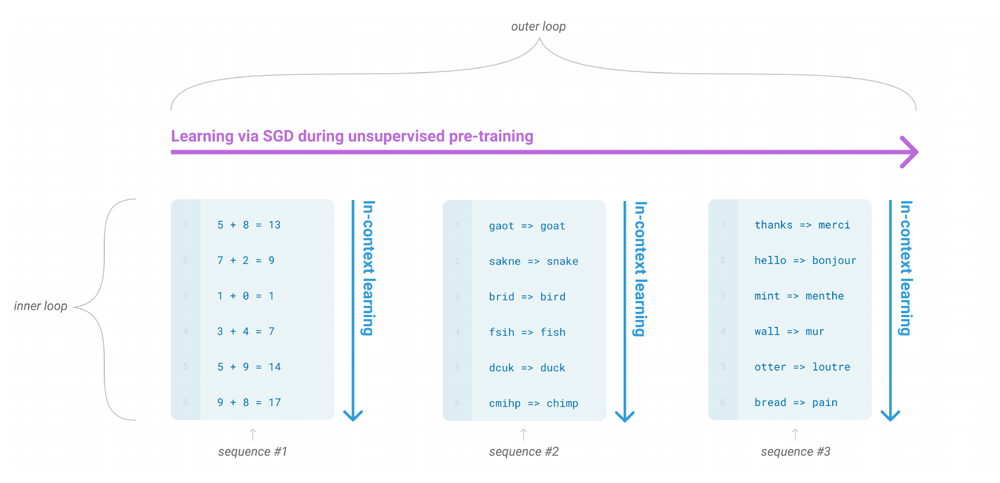
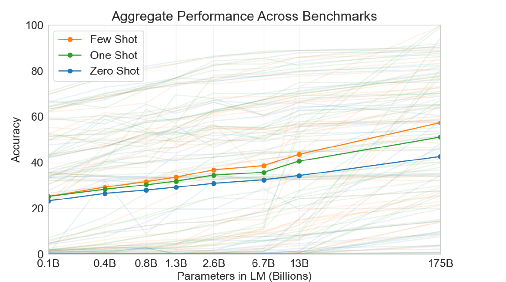

# 05-03 GPT 路线：目标函数没改，改的是规模

> 05-02 的答案是"把目标函数换掉"，代价是三个被迫的设计（80/10/10、句子对、输入表示三件套）。
>
> 这一篇走另外一条路：**目标函数一个字都不改。**
>
> 而它最后撞上的东西，05-02 那条路根本没碰到过。

---

## 1. 先看它有多省事

GPT-1（Generative Pre-trained Transformer，生成式预训练 Transformer，2018）的预训练目标，论文原话是一句话：

> 给定一段文本，预测下一个词。

**这和你的 mini-GPT 是同一件事。** 逐项对：

| | 你的 mini-GPT | GPT-1 |
|---|---|---|
| 目标函数 | 预测下一个 token | 预测下一个 token |
| 因果 mask | 有（`code/mini_gpt_bpe.py:104`） | 有（论文原话 "masked self-attention heads"） |
| 输出头 | `self.lm_head` | 一样 |
| 损失 | 交叉熵 | 一样 |
| 位置编码 | **可学习的**（`self.wpe`） | **可学习的**（明确说不用原论文的正弦函数） |

最后一行顺带一提：你的 `wpe` 和 GPT-1 是同一个选择。原论文《Attention Is All You Need》用的是固定的正弦函数，GPT-1 换成了**可学习的表**，你也是。

**所以 GPT 这条路线的全部意思就是：不改。**

对比一下代价。05-02 里，BERT 为了"左右都看"，付了三样东西：

- 80 / 10 / 10 的掩码策略
- 句子对 + NSP 目标
- `[CLS]` / `[SEP]` / 段嵌入

GPT-1 **一样都没付**。它就是你的 mini-GPT 加大、加数据、跑久一点。

而它还真赢了——论文原话：

> "improving upon the state of the art in **9 out of the 12** tasks studied."

**没改目标函数，也打赢了当时的最好成绩。** 这件事值得先记住。

---

## 2. 但这条线真正的故事，不在 2018 年

GPT-1 只是开胃菜。接下来三年发生的事，才是这一篇的主题。

先把规模阶梯摆出来。GPT-3 论文 §1 回顾这段历史时，是这么写的（原文每个数字后面都跟着一篇文献引用，这里略去）：

> "the capacity of transformer language models has increased substantially, from 100 million parameters, to 300 million parameters, to 1.5 billion parameters, to 8 billion parameters, 11 billion parameters, and finally 17 billion parameters."

翻译成一张表：

| | 年份 | 参数量 | 预训练数据 |
|---|---|---|---|
| **你的 mini-GPT** | — | **453,803** | 2 MB TinyStories |
| GPT-1 | 2018 | 约 1.17 亿 | BooksCorpus，7,000+ 本书 |
| GPT-2 | 2019 | 15 亿 | WebText，800 万个网页 / 40 GB |
| GPT-3 | 2020 | **1750 亿** | 3000 亿个 token |

（GPT-1 的参数量常被记作 1.17 亿，上面引文里 GPT-3 记作"1 亿"，是四舍五入。）

看第一行和最后一行：**1750 亿 ÷ 453,803 ≈ 38 万倍。**

这个倍数要一直记着，因为这一篇后面每一件事，都建立在它上面。

---

## 3. GPT-2：不做微调，也能干活——但干得很差

GPT-2 的论文标题本身就是结论：

> **Language Models are Unsupervised Multitask Learners**（语言模型是无监督的多任务学习者）

它发现的事是这样的：**完全不微调**，直接把任务塞进 prompt 里让模型续写，也能干一点活。这叫**零样本**（zero-shot，"零"指的是 prompt 里不给示例）。

但它同时说了两件事，第二件更值得注意：

> "**The capacity of the language model is essential** to the success of zero-shot task transfer."
>
> （语言模型的**容量**是零样本迁移成功的关键。）

以及一个很实在的自述：它的 15 亿参数模型"**still underfits WebText**"——**连训练数据都没学完**，模型还是饿的。

**效果有多差？** GPT-3 论文后来一句话点破了：

> GPT-2 "achieves only **4%** on Natural Questions."

4%。这不是"能干活"，这是"偶尔蒙对"。

所以 2019 年的状态是：**一个诱人的现象，加一个糟糕的效果，加一句"容量很关键"的直觉。**

---

## 4. GPT-3：把规模推到 1750 亿，然后出现了新东西

GPT-3 干的事很简单：**按 GPT-2 那句话，把容量堆到极限。**

然后同一个"把任务塞进 prompt"的做法，效果变了。GPT-3 论文给这三种情况取了名字：

| 名字 | prompt 里给几个示例 |
|---|---|
| **零样本**（zero-shot） | 0 个，只给一句自然语言指令 |
| **单样本**（one-shot） | 1 个 |
| **少样本**（few-shot） | 10 到 100 个（塞满上下文窗口为止） |

看一组真实数字（GPT-3 论文 §1），两个问答数据集：

| 数据集 | 零样本 | 单样本 | 少样本 |
|---|---|---|---|
| CoQA（对话问答） | 81.5 F1 | 84.0 F1 | **85.0 F1** |
| TriviaQA（冷知识问答） | 64.3% | 68.0% | **71.2%**（超过同条件下的微调模型） |

**示例越多，效果越好**——而这三档之间，**模型的参数一个都没动。**

### 这个能力叫什么

GPT-3 给它取的名字是**上下文学习**（in-context learning，简称 ICL）。论文的定义原话：

> "the model is conditioned on a natural language instruction and/or a few demonstrations of the task and is then expected to complete further instances of the task simply by predicting what comes next."
>
> （模型以一句自然语言指令、和/或几个任务示例为条件，然后**继续预测下一个词**，就完成了后面的同类任务。）

**注意最后半句：还是"预测下一个词"。** 目标函数没变，从 GPT-1 到 GPT-3 一次都没变。

定义里最关键的是**它发生在哪**。论文原话，用的是斜体强调：

> "We use the term 'in-context learning' to describe the inner loop of this process, which **occurs within the forward-pass** upon each sequence."

**发生在一次前向传播里面。** 论文的脚注 1 把这句话钉死了：

> "the method is 'zero-shot' in the sense that **no gradient updates are performed**."

**没有梯度更新。没有反向传播。没有 `loss.backward()`，没有 `optimizer.step()`。**

GPT-3 论文的图 1.1 就是这个结构的画法：



*图：来源 Brown et al., 2020, Figure 1.1。上面紫色的 "outer loop" 是**预训练**——走 SGD（stochastic gradient descent，随机梯度下降），改参数。下面三个浅蓝框是三条**序列**，每条序列内部有自己的一串小任务（sequence #1 是算术，sequence #2 是拼写纠错，sequence #3 是英译法），蓝色的 "in-context learning" 箭头竖着穿过每一条序列，表示这个"学习"发生在**这条序列自己的前向传播里**，**不跨序列，也不改参数**。*

### 为什么这不需要新零件

**因为这就是你已经学过的东西。**

回到你的 `CausalSelfAttention`。因果 mask 的作用是：位置 $i$ 能看到前面**所有**位置（`code/mini_gpt_bpe.py:104-105`）。

现在把 prompt 写出来：

```
把下面的英文翻成法文：
thanks => merci
hello => bonjour
mint => ?
```

模型要预测 `?` 的时候，**`thanks => merci` 和 `hello => bonjour` 就是它前面的位置**。attention 看得见它们，权重可以放在它们上面——于是"英译法"这个映射关系，是从**输入**里读出来的，不是从**参数**里。

> **用到的零件：token 嵌入、位置嵌入、attention、FFN、`lm_head`、softmax。你全都会。一个新零件都没有。**

这就是为什么这一篇讲起来比 05-02 轻松得多——**它真的没有新东西，变的只是规模。**

---

## 5. 这个能力是花钱买来的

回到那张规模表。GPT-3 论文的 Table 2.1 是一组**受控实验**：

| 模型 | 参数量 |
|---|---|
| GPT-3 Small | 1.25 亿 |
| ...（中间 6 档）... | ... |
| GPT-3 175B | **1750 亿** |

**8 个模型，同一套架构，同一份训练数据，同样训 3000 亿个 token——只有大小变。** 这是能拿到的最干净的对照。

结果画在论文的图 1.3 上：



*图：来源 Brown et al., 2020, Figure 1.3。横轴是参数量（对数刻度），纵轴是准确率。橙线是少样本，绿线是单样本，蓝线是零样本；背景那些细线是各个单独的数据集。论文原话："While zero-shot performance improves steadily with model size, **few-shot performance increases more rapidly**, demonstrating that larger models are more proficient at in-context learning."*

**怎么读这张图：**

- **零样本**（蓝）随规模稳步上升——这是"预训练本身"的功劳。
- **少样本**（橙）上升得**更快**。
- 关键在**两条线的间距**：模型小的时候（0.1B ~ 0.4B）三条线几乎重合；到 175B，橙线（约 58）已经比蓝线（约 43）高出一大截。

> **间距就是"示例的价值"。它随规模变大。**

换句话说：**"从上下文里学"这个能力，不是所有模型都有的，它是被规模买来的。**

拿你自己的模型代入一下。你训的那个小 GPT 有 453,803 个参数——**比图里最左边那个点（1.3 亿）还小 2900 倍。** 图上 1.3B（13 亿）那条绿线，在 0 ~ 10 个示例之间几乎是**平的，贴着零**。

所以：**你的 mini-GPT 不会上下文学习，这完全正常。** 它连 GPT-3 图里最小的那个点都差着三个数量级。

---

## 6. 那它到底算不算"学习"？——GPT-3 说它不知道

这一段很重要，因为它是**这一篇最容易被讲过头的部分**。

"模型在上下文里学会了新任务"——这句话听起来很震撼。但 GPT-3 论文自己是怎么说的？

> "A limitation, or at least **uncertainty**, associated with few-shot learning in GPT-3 is **ambiguity about whether few-shot learning actually learns new tasks 'from scratch' at inference time, or if it simply recognizes and identifies tasks that it has learned during training**."

翻译：

> **到底是在推理时"从零学会"了新任务，还是说——这个任务它在预训练时早就学过了，现在只是"认出来"了？论文说：不知道。**

而且论文紧接着说，这**不是非黑即白**，是一条光谱：从"示例和预训练数据同分布"→"同一任务换了个格式"→"适应某个通用任务的特定风格"→一直到"真的从头学一个全新技能"。**GPT-3 在这条光谱上的哪个位置，可能还因任务而异**：拼写纠错、给生造词下定义这类合成任务，"看起来确实像是从头学的"；而翻译，**必然**是预训练时就学过的。

论文最后把这件事直接列成了待解决的问题：

> "understanding precisely how few-shot learning works is an important **unexplored direction** for future research."

> **GPT-3 报告了现象，没有解释机制。**

这一点要分清楚，**和 05-02 §4 里 BERT 那张表是同一类纪律**：

- **现象**：示例越多、模型越大，效果越好。（这是**实验**，Figure 1.3 和 CoQA/TriviaQA 的数字都支持。）
- **机制**：为什么会这样？（这是**开放问题**，GPT-3 自己列为 future work。后来才有人去研究，本篇不展开——**那会引入你现在还没学过的零件**。）

另外，图 1.3 本身论文也自己打了折扣：

> "it **should not be seen as a rigorous or meaningful benchmark in itself**."

（那张图是把 42 个任务平均出来的一个印象，不是严格指标。）而且论文明确列了它**做不好**的任务：自然语言推理类的 ANLI，阅读理解类的 RACE、QuAC。

**所以准确的结论是：规模确实解锁了一种可测的能力，但"这是不是学习"至今没有定论。**

---

## 7. 这对"迁移"意味着什么

回到 05-01 §5 那个岔口。当时只有两条路，现在出现第三条：

| | 预训练网络改不改 | 每个新任务要多少标注 |
|---|---|---|
| **特征式**（冻结） | **不改** | 要训一个任务模型 |
| **微调** | **全改** | 几千 ~ 几十万条 |
| **上下文学习** | **一个字都不改** | **prompt 里几条** |

**这是对 05-01 §2 那个矛盾的第三次冲击。**

回忆一下那条链：

1. **预训练**解决了"标注太贵"——用无标注文本先学一遍。
2. **微调**解决了"每个任务从头训太贵"——复用同一个起点。
3. **上下文学习**解决的是——**连微调都省了。** 标注需求从几千条降到几条，而且不需要训练、不需要存一份新权重、不需要 GPU 跑反向传播。

> **一个模型，一套权重，什么都不改，靠 prompt 干活。**

这就是 GPT-3 那句话的意思——**"Language Models are Few-Shot Learners"**（语言模型是少样本学习者）。

---

## 8. 小结

这一篇的链条：

1. **GPT 路线不改目标函数**：从 GPT-1 到 GPT-3，一直是 next-token prediction，和你的 mini-GPT 一样。
2. **它改的是规模**：1.17 亿 → 15 亿 → 1750 亿。
3. **规模解锁了一个新能力**：上下文学习——在**一次前向传播**里，从 prompt 的示例中把任务读出来，**参数一个都不动**。
4. **这个能力随规模变化**：小模型几乎没有，大模型才有（Figure 1.3 的橙蓝间距）。
5. **但机制是开放问题**：GPT-3 只报告现象，没说清"是不是真的在学"。

**零件上零新东西**——这一篇用到的每一个部件，你在阶段 3、4 都写过。

下一篇要回答一个到这里已经绕不开的问题：

> **BERT 和 GPT-1 大小几乎一样（都是 12 层、768 维、12 头，约 1.1 亿参数），用的是同一批下游任务。一个双向、一个单向——到底谁赢？**
>
> **而且，为什么最后整个行业都收敛到了 GPT 这条路（decoder-only）？**

---

**参考**

- Radford et al., *Improving Language Understanding by Generative Pre-Training* (2018) —— GPT-1（本地 `papers/gpt1-2018.pdf`）
- Radford et al., *Language Models are Unsupervised Multitask Learners* (2019) —— GPT-2，论文标题即结论（本地 `papers/gpt2-2019.pdf`）
- Brown et al., *Language Models are Few-Shot Learners* (2020) —— GPT-3，上下文学习的提出与三种条件的定义（[arXiv:2005.14165](https://arxiv.org/abs/2005.14165)，本地 `papers/2005.14165.pdf`）。本篇第 4 节的三种条件出自 §1 与 §2.4，第 6 节的免责声明出自 §5（Limitations）
- Devlin et al., *BERT* (2018) —— 规模阶梯里那"3 亿"的一档，见 `notes/05-pretraining/02-bert.md`
