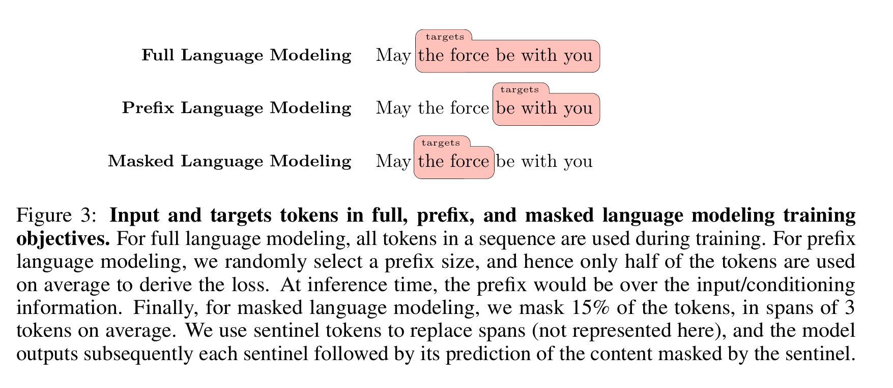

# 05-04 为什么收敛到 decoder-only

> 2018 年，BERT 和 GPT-1 被摆在同一张桌子上量过一次：同样 12 层 / 768 维 / 12 头、同样一批下游任务，**只有目标函数不同**。换目标函数的那个赢了 4.5 分。
>
> 那为什么 2020 年之后，整个行业都倒向了"什么都不换"的那条？
>
> 这一篇只回答这一个问题。

---

## 1. 2018 年的账：BERT 小胜，但没赢干净

BERT 论文 §3.2 原话：**"BERT$_\text{BASE}$ was chosen to have the same model size as OpenAI GPT for comparison purposes."** §4.1 补一句：**"nearly identical in terms of model architecture apart from the attention masking."**

GLUE（General Language Understanding Evaluation，通用语言理解评估）八个任务，BERT 论文 Table 1：

| | MNLI | QQP | QNLI | SST-2 | CoLA | STS-B | MRPC | RTE | 平均 |
|---|---|---|---|---|---|---|---|---|---|
| **训练集大小** | 392k | 363k | 108k | 67k | 8.5k | 5.7k | 3.5k | 2.5k | — |
| OpenAI GPT | 82.1 | 70.3 | 87.4 | 91.3 | 45.4 | 80.0 | 82.3 | 56.0 | 75.1 |
| BERT$_\text{BASE}$ | 84.6 | 71.2 | 90.5 | 93.5 | 52.1 | 85.8 | 88.9 | 66.4 | **79.6** |
| **差** | +2.5 | +0.9 | +3.1 | +2.2 | +6.7 | +5.8 | +6.6 | **+10.4** | **+4.5** |

（行序照抄原表；QQP / MRPC 是 F1，STS-B 是 Spearman 相关系数，其余是准确率，都是越大越好。MNLI 用 matched 那一列。）

**双向赢了 4.5 分。** 但有两件事要说清：

**① 这 4.5 分不能全归给"双向"。** BERT 论文附录 A.4 自己列了四条没控住的变量：预训练语料 **4.1 倍**（800M 词 vs 800M + 2500M 词）、batch size **4 倍**（32k vs 128k 词）、微调学习率**逐任务单独挑**、`[SEP]` / `[CLS]` 预训练时就学。所以这个结论只能停在"相关"。

**② 这 4.5 分分布得极不均匀。** 看最后一行：**训练集越小，差距越大**——训练集 ≤ 8.5k 的四个任务差了 5.8 ~ 10.4 分，≥ 67k 的四个只差 0.9 ~ 3.1 分，**最大最小差 11.6 倍**。

> 这张表其实是在说：**BERT 的优势只在一个条件下值钱——你手上有一份标注数据，而且它不多。**

记住这个条件。第 5 节它要回来。

---

## 2. 核心：只有一个目标函数，训练和使用的动作是同一件事

先看两个模型各自"在干什么"。

| | **BERT（MLM）** | **GPT（next-token）** |
|---|---|---|
| 预训练时做的事 | 挖掉 15% 的 token，把它们填回原词 | 给定前文，**接下一个词** |
| 想直接拿来用时，缺什么 | **一个 `[MASK]` 符号，加一个任务头** | **什么都不缺** |

现在把右边一列**逐字**读一遍：

> **预训练时**：给定前文，接下一个词。
>
> **使用时**：给定 prompt（也是前文），接下一个词。
>
> **是同一句话。**

**这就是核心。**

next-token prediction 是唯一一个"预训练时在做的"和"用的时候要做的"**字面上完全同一**的目标函数。训练完，模型已经在做它要做的事了——**中间没有任何一步转换。**

BERT 不是这样。它训练时练的是**填空**：输入里有个 `[MASK]` 挖出来的洞。而你要用的时候，手里根本没有洞——**你得自己挖一个**（加任务头、喂标注数据、再微调一遍）。

> 05-02 §4 那个"预训练和微调输入对不上"的麻烦，根子就在这儿：**`[MASK]` 这个符号在训练数据里到处都是，在使用时一个都没有。** 当时是靠 80/10/10 去缓解它。而 next-token 那条路**压根不需要缓解——它没有那道缝。**

这个同一性在 2018 年的 GPT-1 身上就已经成立了，只是**当时没人当回事**——因为 GPT-1 一样要微调，两条路看起来没差别。**要等规模把它兑现**：GPT-2 的零样本只有 4%（05-03 §3），到 GPT-3 才变成能用的 ICL（in-context learning，上下文学习；05-03 §4）。而 ICL 之所以一个新零件都不需要，正是因为这条同一性——**"prompt 里的示例"就是"前文"。**

---

## 3. 所以为什么是 decoder-only，而不是别的形状

"预测下一个词"这个动作，对模型的形状提了三条要求：

1. **不能看见答案。** 位置 $i$ 要预测的是 $t_{i+1}$，那它就必须看不见 $t_{i+1}$ → **因果 mask**。这条 05-02 §2 已经证过：去掉 mask 和保留 next-token 互斥。
2. **每个位置既是输入又是输出。** 前文要能读、答案要能写，而且得是**同一摞参数**。→ **单栈，没有独立的 encoder。**
3. **全长都要算 loss。** 一句话有 $T$ 个 token，就白送 $T$ 个训练样本。

三条合起来就是 decoder-only。**它不是被选出来的，是被逼出来的形状。**

顺手把另外两种形状处理掉：

- **encoder-only（= BERT）**：违反第 1、2 条。它吐不出比输入更多的东西，论文原话：**"limited to producing the same number of tokens as it was fed as input"**。**它没有"接下一个词"这个接口。**
- **encoder-decoder（= 阶段 3 的原版）**：也违反第 2 条。它把输入和输出分给两摞不同的参数，还要多一层交叉注意力去接。代价论文自己算了，原话是 **"twice the parameters ... and hence twice the memory footprint"**。多出来的那个 encoder，本质就是一个**接口转换器**——正好是第 2 节说要避免的那一步转换。

---

## 4. 数据

2022 年 BigScience 做了一次干净的受控实验（Wang et al., 2022）：**50 亿参数**（encoder-decoder 用 110 亿来对齐算力）、**168B token** 预训练、**30 个数据集**。它比较的三种架构你全搭过——causal decoder 就是你的 mini-GPT，non-causal decoder 就是 BERT，encoder-decoder 就是阶段 3 原版。

**预训练完，不做任何微调，直接零样本**（论文 Table 3）：

| 架构 + 目标函数 | EAI-Eval | 说明 |
|---|---|---|
| **causal decoder + next-token** | **44.2** | 第一 |
| non-causal decoder + prefix LM | 43.5 | 只差 0.7 |
| encoder-decoder + prefix LM | 39.9 | 落后 4.3 分，**还多花一倍参数** |
| 随机猜 | 32.9 | — |

（T0-Eval 那列没列——那个基准上随机线是 41.7，各模型全贴着它，论文自己点明了读不出东西。）

三个读数：

1. **causal 和 non-causal 只差 0.7。** 所以——**mask 的方向不是要害。** 这一点最关键：说明驱动力**不是"单向更好"，而是"那个目标函数"**。
2. **encoder-decoder 落后 4 分多，还多花一倍参数。** 第 3 节第 2 条要求（单栈）在数据上兑现了。
3. **MLM 那两格是空的。** 表注原话：

> "**MLM pretraining is not considered here, as the models produced are not suitable for direct use in a zero-shot setting.**"

**不是分低，是没法上场。** 第 2 节说"它缺 `[MASK]` 和任务头"——这就是那句话的实验版本。

### 还有一笔账：每个 token 换来多少训练信号

同一篇论文的 Figure 3，画的是三种目标函数"哪些 token 在算 loss"：

*图：来源 Wang et al., 2022, Figure 3。粉色框就是"在算 loss 的那部分"。图注原话：full language modeling "**all tokens** in a sequence are used during training"；prefix language modeling "only **half** of the tokens are used on average"；masked language modeling "we mask **15%** of the tokens"。*

**100% / 50% / 15%。**

05-02 §3 里这个 15% 是当**优点**讲的（BERT 因此才训得起 12 层）。**翻个面：**

> 同样读一遍语料，next-token 拿满训练信号，MLM 只拿 **0.15 份**。要凑出同样的信号量，MLM 得读大约 **6.7 倍**的文本。

到这里，第 2 节那个"同一性"的最后一层好处才露出来：

> next-token 那一份算力，**同时买了两样东西**——① **100% 的训练信号**，② 推理时那个"什么都不缺"的**接口**。
>
> **MLM 只买第一样，还打 1.5 折。**

---

## 5. 唯一要认真回答的反驳：MLM 加多任务微调，不是赢了吗？

是。而且答案就在同一篇论文里。

加一轮**多任务微调**（multitask finetuning，在一批人工标注的多任务数据上再训 13B token）之后，结果**反转**（论文 Finding 2）：

| 组合（预训练 168B + 微调 13B） | T0-Eval |
|---|---|
| encoder-decoder + MLM | **60.6** |
| non-causal decoder + MLM | 55.2 |
| causal decoder + next-token | 51.4 |

**encoder-decoder + MLM 领先整整 9.2 分。** 论文原话：

> "**Finding 2.** Encoder-decoder models trained with masked language modeling achieve the **best** zero-shot performance after multitask finetuning."

**所以它不是输在能力上，是输在前提上。** 那 9.2 分是用 **13B token 的人工标注数据**换来的——而第 1 节那张 GLUE 表已经说了，BERT 的优势本来就只在"你手上有标注数据"时才值钱。

把两条路的入场费并排：

| | 入场费 |
|---|---|
| **BERT 那条路** | **一批人工标注的多任务数据**（13B token，约是预训练语料的 8%——但每一个 token 都得有人标） |
| **GPT 那条路** | **prompt 里几条示例**，一次前向传播，参数一个不动 |

**两条路赢在不同的考场上。** 后来整个行业考的是零样本那个——因为只有那个考场，不需要你先去攒标注数据。

---

## 6. 小结

**核心原因一句话：**

> **next-token prediction 是唯一一个"预训练时在做的"和"用的时候要做的"字面同一的目标函数。** 这个同一性让"用它"这个动作不需要任何附加装置——**没有 `[MASK]`、没有任务头、没有标注数据**。而 decoder-only 是这个同一性的必然形状：看不见答案才能猜（因果 mask）→ 每个位置既读又写（单栈）。

支撑它的四条数据：

1. **同规模对照**：2018 年 BERT 赢 4.5 分，但论文附录 A.4 自己承认对照不干净；而且这 4.5 分几乎全来自训练集最小的那几个任务——**它的优势只长在"有标注数据"这个前提上**。
2. **干净的受控实验**：2022 年，5B 参数 / 168B token / 30 个数据集，预训练完直接零样本，causal decoder + next-token 第一（44.2，随机基线 32.9）；且 causal 与 non-causal **只差 0.7**，说明要害是目标函数不是 mask。
3. **MLM 交白卷**：不是分低，是 "not suitable for direct use in a zero-shot setting"。
4. **每个 token 的账**：100% / 50% / 15%——next-token 一份算力同时买下训练信号和使用接口，MLM 只买一样还打 1.5 折。

**唯一诚实的补充**：加多任务微调之后，MLM 那条路仍然赢 9.2 分——代价是 13B token 的标注数据。**它不是错了，是押注在另一个前提上。**

零件上零新东西——这一篇用到的每个部件，你在阶段 3、4、5 都写过。

阶段 5 到这里收尾，一共四篇。**下一篇进阶段 6：LLM 关键概念**（`notes/06-llm-concepts/01-llm-concepts.md`，一篇按方向组织的概览）——它从这一步接上：上面那张规模阶梯是**历史事实**，而想让模型更强，最直接的想法就是把它做大；**可"做大"到底在花什么钱？**（§1 规模定律）

---

**参考**

- Wang et al., *What Language Model Architecture and Pretraining Objective Work Best for Zero-Shot Generalization?* (2022) —— 第 3、4、5 节的主要来源，BigScience 的受控实验（[arXiv:2204.05832](https://arxiv.org/abs/2204.05832)，本地 `papers/2204.05832.pdf`）。Table 3 = 预训练后直接零样本的成绩表；Finding 2 = 多任务微调后的反转；Figure 3 = 三种目标函数各有多少 token 在算 loss（100% / 50% / 15%）；"twice the parameters ... twice the memory footprint" 出自 §2.1；"limited to producing the same number of tokens as it was fed as input" 出自 §2.1 讲 encoder-only 那一段。
- Devlin et al., *BERT: Pre-training of Deep Bidirectional Transformers for Language Understanding* (2018) —— 第 1 节（[arXiv:1810.04805](https://arxiv.org/abs/1810.04805)，本地 `papers/1810.04805.pdf`）。"为对照而选的尺寸"出自 **§3.2**；"nearly identical apart from the attention masking" 出自 **§4.1**；第 1 节那张 GLUE 表是 **Table 1**（表头带每个任务的训练集大小）；四条没控住的变量出自**附录 A.4**。
- Radford et al., *Improving Language Understanding by Generative Pre-Training* (2018) —— 对照组 GPT-1（本地 `papers/gpt1-2018.pdf`）
- 上游铺垫：`01-why-pretraining.md`（两种迁移路线）、`02-bert.md`（MLM 的三个被迫设计、因果 mask 与双向互斥）、`03-gpt-in-context.md`（ICL 与三次冲击）
